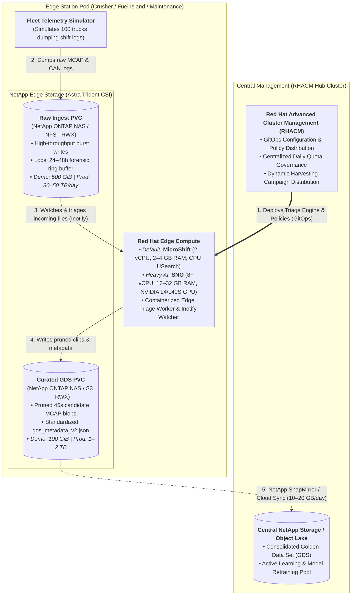
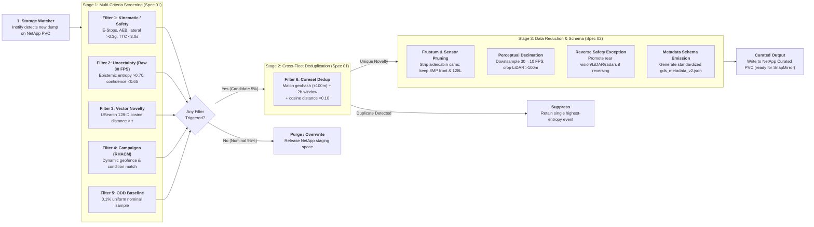

# Edge Data Triage & Deduplication Blueprint
## Hello-World Implementation Guide for Red Hat OpenShift, NetApp Storage & RHACM

**Document Version:** 2.0  
**Status:** Approved Engineering Blueprint & Implementation Guide  
**Upstream Specifications:** [Spec 01: Data Filtering & Triage](../docs/01_data_filtering_and_triage.md) | [Spec 02: Data Reduction & Metadata](../docs/02_data_reduction_and_metadata_schema.md)  
**Target Environments:** Red Hat MicroShift (Lightweight CPU Edge) / Single Node OpenShift (SNO with GPU), NetApp ONTAP (via Astra Trident CSI), Red Hat Advanced Cluster Management (RHACM)

---

## 1. Executive Overview & Objective

This blueprint bridges the high-level system architecture defined in **Specification 01 (Data Filtering, Triage & Deduplication)** and **Specification 02 (Data Reduction & Metadata Schema)** into an actionable, containerized "Hello World" application ready for deployment on Red Hat OpenShift, NetApp Storage, and RHACM.

### 1.1 The Business & Network Bottleneck
Industrial autonomous haulage operations (e.g., Cat 797F, Komatsu 930E) generate between 3.0 and 5.0 TB of uncompressed multi-modal sensor data per vehicle per 24-hour shift (35–60 MB/s). Across a 100-truck fleet, aggregate daily generation scales to approximately 500 TB. 

However, remote extraction sites (Western Australia's Pilbara, Chile's Atacama Desert) lack terrestrial fiber, relying on commercial LEO satellite uplinks (Starlink Business / OneWeb) delivering 10–25 Mbps sustained uplink. This limits cumulative site egress to **100–250 GB/day for the entire site**, with an allocated budget of **10–20 GB/day per 10-truck operational cell** (yielding ~3.5 to 7.0 GB/day nominal upload post-deduplication). Over 99.9% of raw sensor data cannot physically leave the site.

### 1.2 The Platform Value Proposition
By deploying an intelligent edge triage and deduplication workload onto **Red Hat OpenShift at the Edge**, backed by **NetApp Enterprise Storage**, and governed centrally via **Red Hat Advanced Cluster Management (RHACM)**, industrial operators can:
1. **Filter 95%+ of low-entropy nominal driving** directly at edge station pods before data hits the WAN.
2. **Eliminate 60%–80% of repetitive cross-fleet scenes** via spatial-temporal coreset deduplication.
3. **Preserve 100% of safety-critical events and operational anomalies** in a standardized, low-overhead catalog (`gds_metadata_v2.json`).
4. **Reduce recurring cloud storage and labeling costs by over 99%**, replacing unmanaged multi-petabyte cloud floods ($345k+/mo) with a curated Golden Data Set (GDS) ($10–$35/mo).

---

## 2. Target Platform & Infrastructure Architecture



### 2.1 Component Mapping & Division of Responsibility

| Platform Component | Role in the Edge Triage Pipeline | Key Capabilities Demonstrated |
| :--- | :--- | :--- |
| **Red Hat MicroShift** *(Lightweight Edge Default)* | **Low-Footprint Edge Runtime:** Sized for 2 vCPU and 2–4 GB RAM on ruggedized in-vehicle PCs or Crusher skid pods running CPU-only USearch vector search and kinematic screening. | • Minimal resource overhead on industrial hardware.<br>• Deterministic offline execution during satellite WAN dropouts.<br>• Fast cold-boot recovery following vehicle battery disconnects. |
| **Red Hat OpenShift (SNO)** *(Heavy Edge AI)* | **GPU-Accelerated Edge Platform:** Single Node OpenShift (8+ vCPU, 16–32 GB RAM) deployed at Fuel Island pods equipped with NVIDIA L4/L40S GPUs for heavy 4D world modeling (EmerNeRF) and multi-truck triage. | • Native NVIDIA GPU Operator integration.<br>• Full enterprise Kubernetes API and Operator lifecycle.<br>• Complete disconnected/air-gapped registry mirroring support. |
| **NetApp ONTAP + Astra Trident** | **Edge Data Fabric & Persistence:** High-performance storage orchestrator managing raw burst ingest, instant snapshot recovery, and automated replication. | • **Trident CSI Driver:** Automated dynamic provisioning for `ReadWriteMany` (RWX via `ontap-nas`) and `ReadWriteOnce` (RWO via `ontap-san`).<br>• **NetApp Snapshot Copies:** Zero-impact point-in-time snapshots for forensic investigation retention.<br>• **NetApp SnapMirror / Cloud Sync:** Siphon curated GDS snippets over constrained WAN links to central cloud object storage.<br>• **FabricPool & Quotas:** Enforcing storage limits and offloading cold blocks to secondary flash. |
| **Red Hat ACM** *(RHACM)* | **Central Control Plane & Governance:** Centrally distributes triage policies, daily quotas, dynamic campaigns, and model drift compensation vectors across distributed edge sites. | • Multi-cluster application lifecycle via modern `Placement` API.<br>• Governance policies ensuring edge pods adhere to `storage_eviction_policy.yaml`.<br>• Automated deployment of new vision backbone version indices across Crusher and Fuel Bay pods without firmware re-flashing. |

> **Production vs. Demo Storage Sizing Note:** In a full-scale production 10-truck cell, raw multi-sensor streaming generates **30 to 50 TB/day**, requiring high-capacity NetApp AFF/FAS arrays with FabricPool secondary tiering to hold 24–48 hours of rolling forensic ring buffers. In this "Hello World" blueprint, the raw ingest volume is sized at a **demo-scale 500 GiB PVC** (calibrated to absorb synthetic 100-event test batches), while the curated GDS volume is sized at **100 GiB** (holding ~285 pruned candidate snippets at ~350 MB each, equivalent to 14–28 days of curated site uploads).

---

## 3. Core Features & Pipeline Functional Mechanics



### 3.1 Stage 1: Ingestion & Storage Trigger
* The triage daemon monitors the incoming directory on the NetApp raw ingest PVC: `/mnt/raw_ingest/{truck_id}/{timestamp}/`.
* Ingested files comprise multi-channel **MCAP container files** paired with dynamic `telemetry.json` records.
* Upon detecting a closed write handle via `inotify` or file-close events, the daemon initiates the triage pipeline.

### 3.2 Stage 2: Parallel Multi-Criteria Screening (Filters 1–5)
The worker evaluates the raw 45-second event buffer against the screening filters in parallel logical `OR`:
1. **Filter 1 (Kinematic & Safety Floor):** Evaluates physical chassis CAN telemetry. Triggers deterministically if:
   * Emergency Stop active (`e_stop_active == true`)
   * Autonomous Emergency Braking engaged (`aeb_engaged == true`)
   * Lateral acceleration $|a_{\text{lat}}| > 0.30\text{g}$ (dynamically tightened to $>0.20\text{g}$ on loaded downhill grades)
   * Time-to-Collision $\text{TTC} < 3.0\text{s}$ (extended to $<4.5\text{s}$ on downhill haul ramps)
2. **Filter 2 (Model Uncertainty & Disagreement):** 
   * **Critical Pipeline Ordering:** Epistemic uncertainty and bounding-box jitter variance across 5 frames (0.16s) **must be computed in real time on the raw 30 FPS stream** *before* downsampling to 10 FPS.
   * Triggers if minimum bounding-box confidence $< 0.65$, semantic segmentation Shannon entropy $> 0.70$, or detector cross-disagreement is flagged.
3. **Filter 3 (Latent Space Metric Novelty):** 
   * Reads a 128-D latent scene embedding vector (generated by an onboard or edge vision backbone, e.g. MobileNetV4 / DINO-v2 feature extractor).
   * Queries a local **USearch** HNSW index containing the operational baseline gallery.
   * Triggers if cosine distance $d(\mathbf{v}_{\text{query}}, \mathbf{V}_{\text{baseline}}) > \tau_{\text{novelty}}$ (e.g., $\tau = 0.72$).
4. **Filter 4 (Targeted Dynamic Campaigns):** Matches vehicle GPS against active campaign polygons pushed centrally via RHACM (e.g. haul road watering operations, dust plume sectors).
5. **Filter 5 (Stratified ODD Nominal Baselines):** Uniform pseudorandom sampler tagging 0.1% of nominal driving events across operational quadrants to prevent catastrophic forgetting.

### 3.3 Stage 3: Cross-Fleet Coreset Deduplication (Filter 6)
If any filter flags a candidate snippet, it enters fleet deduplication:
* The candidate's coordinate is quantized into an **Uber H3 index (resolution 9, ~100m cell)** or geohash.
* The engine queries the site coreset registry:
  * Has another truck reported an anomaly in this spatial cell within the last **2 hours**?
  * If yes, compute cosine distance between both 128-D embeddings.
  * If $d(\mathbf{v}_1, \mathbf{v}_2) < 0.10$, suppress the duplicate snippet and retain only the instance with higher sensor confidence or sharper exposure.
* **Impact:** Suppresses **60% to 80%** of redundant fleet triggers caused by static obstacles encountered by multiple trucks.

### 3.4 Stage 4: Representation Reduction & Safety Exceptions (Spec 02)
* **Temporal Slicing & FFmpeg Incident Video Extraction:**
  * **MCAP Telemetry Slicing:** Extracts exactly $T - 30\text{s}$ pre-trigger (root cause onset) to $T + 15\text{s}$ post-trigger (stopping stabilization).
  * **In-Container FFmpeg Video Slicing:** When a safety-critical trigger fires (e.g. AEB near-miss, reversing maneuver), the triage engine invokes FFmpeg to slice an incident window $[T - 5\text{s}, T + 5\text{s}]$ (10 seconds total) from the raw camera buffer, outputting `gds_curated_<event_id>_clip_10s_10fps.mp4` directly into `/mnt/gds_curated` for immediate playback in VLC or browser without requiring ROS 2 / Foxglove tooling.
  * **Production Video Scaling Paths (CPU vs. GPU vs. Stream Copy):**
    * *Zero-CPU Stream Copy (`-c copy`):* When vehicle cameras record with fixed 1-second GOPs (Group of Pictures), the worker pipeline uses stream-copy (`-c copy`) on keyframe boundaries. This achieves near-zero CPU overhead even across multiple concurrent 4K (8MP @ 30 FPS) streams. Toggleable via `VIDEO_STREAM_COPY=true`.
    * *Hardware GPU Decimation Offload:* If frame-rate decimation (30 $\rightarrow$ 10 FPS) is mandatory for 4K video to meet WAN/satellite quotas, offload decoding, filtering, and re-encoding to an edge GPU (e.g., NVIDIA L4 / T4) via the **OpenShift NVIDIA GPU Operator** using hardware-accelerated filters (`-c:v h264_cuvid -r 10 -c:v h264_nvenc`).
    * *Lightweight CPU Software Transcode:* In standard compact 3-node CPU edge clusters (as featured in this demo), the pipeline utilizes universal `mpeg4`/`yuv420p` encoding, completing decimation in ~30ms without proprietary codec licensing.
  * **Ingest Buffer Eviction:** The raw un-decimated rolling video buffer (~1.25 MB demo / ~250 MB prod) is automatically purged from `/mnt/raw_ingest`.
* **Canonical Sensor Stream IDs & Frustum Pruning:**
  * `/sensors/cam_front_center_8mp`: **KEEP & DECIMATE** (30 $\rightarrow$ 10 FPS, ~35% bytes)
  * `/sensors/cam_front_telephoto_8mp`: **KEEP & DECIMATE** (Forward) / **DROP** (Reversing)
  * `/sensors/lidar_128_beam_main`: **KEEP & DECIMATE** (100m ODD crop, 32 $\rightarrow$ 16 bit fixed point)
  * `/sensors/radar_front_long_range`: **KEEP** (High Resolution)
  * `/sensors/cam_rear_perimeter_4mp`: **DROP** (Forward) / **KEEP & PROMOTE** (Reversing hopper maneuver, 80% bytes)
  * `/sensors/lidar_perimeter_solid_state`: **DROP** (Forward) / **KEEP & PROMOTE** (Reversing)
  * `/sensors/radar_perimeter_rear`: **DROP** (Forward) / **KEEP & PROMOTE** (Reversing)
  * `/sensors/radar_blind_spot_side_left` & `/sensors/radar_blind_spot_side_right`: **DROP** (Forward) / **KEEP & PROMOTE** (Reversing)
  * `/vehicle/can_bus`: **KEEP** (Native 100 Hz powertrain, steering, kinematics, and safety signals)
  * `/perception/uncertainty`: **KEEP** (Confidence, entropy, and temporal variance metrics)
  * `/perception/embedding_128d`: **KEEP** (Latent feature vectors for vector index querying)
  * `/metadata`: **KEEP** (Event ID, truck ID, GPS coordinates, timestamps, tier assignment)
* **Reversing & Hopper Maneuvering Exception:** If CAN powertrain signals reverse gear (`gear_reverse_active: true`) or geofencing locates the truck within a dump pocket or crusher hopper, the pruning mask dynamically flips: `/sensors/cam_rear_perimeter_4mp`, `/sensors/lidar_perimeter_solid_state`, `/sensors/radar_perimeter_rear`, `/sensors/radar_blind_spot_side_left`, and `/sensors/radar_blind_spot_side_right` are promoted to **KEEP** at native resolution (80% payload) to prevent hopper wall collisions and articulated jackknifing, while forward auxiliary channels are decimated.
* **Perceptual Decimation (Benchmark Proxy vs. Production ROS 2):**
  * *Benchmark Simulation Proxy:* The demo pipeline uses a deterministic byte-slice proxy (`raw_bytes[:slice_len]`) on opaque synthetic payloads to reproduce the exact target volume reductions (~35% forward, ~80% reversing) without requiring gigabytes of ROS 2 / Protobuf / Foxglove schema dependencies on test clusters.
  * *Industrial Production Implementation:* In real-world autonomous haulage, decimation operates at the **structured message cadence level**:
    * **Camera Feeds:** Iterates through individual channel frames and sub-samples cadence (e.g. writing every 3rd message for 30 FPS $\rightarrow$ 10 FPS downsampling of `sensor_msgs/msg/CompressedImage`).
    * **LiDAR Point Clouds:** Deserializes `sensor_msgs/msg/PointCloud2` fields, crops out-of-ODD returns ($r > 100\text{m}$), and quantizes IEEE 754 32-bit float coordinates down to 16-bit fixed-point integers (50% vertex payload reduction).
* **Metadata Schema Emission:** Generates a standardized `gds_metadata_v2.json` record capturing software manifests, SA.45s CSAC clock telemetry (`PTP_HOLDOVER_ACTIVE`, 112 ns drift), filter scores, embedding vector, and optical dock metrics.

### 3.5 Ingestion Handshake & Offload Atomicity (NFS / Trident)
Multi-gigabyte vehicle recordings landing across 10G optical wireless berths or NFS mounts require strict atomic handshakes to prevent reading partial or in-flight writes:
* **Temporary Suffix Masking:** Upstream offload agents (rsync, Zenoh, MinIO) write to `.mcap.tmp` or `.mcap.part` before atomically renaming to `.mcap`.
* **Discrete Completion Sidecars:** The worker recognizes `.ready` or `.complete` sidecar files (`<event_id>.mcap.ready` / `<event_id>.mcap.complete` or `<event_id>.ready` / `<event_id>.complete`), guaranteeing offload finalization before ingestion begins. Sidecars are cleanly purged upon curation or discard.
* **Mtime Settle-Time Buffer:** In environments without sidecars, the worker enforces a minimum settle time ($\ge 2.0\text{s}$ unmodified) before claiming an `.mcap` file.
* **Non-Destructive In-Flight Protection:** If an MCAP parser encounters incomplete chunk headers on a file modified within the last 5.0 seconds, it defers processing without deleting (`unlink`), ensuring active transfers are never corrupted.

### 3.6 End-to-End I/O Math Closure (Production Scale vs. Demo Benchmark)
* **Production Fleet Scale:**
  * **Input Volume (100 vehicle events):** 100 raw 45s events @ 1.6 to 2.7 GB unpruned = **~160 to 270 GB raw ingest**.
  * **Stage 1 & 2 Filtering:** 91 nominal events discarded. 9 candidate anomaly events flagged. Filter 6 deduplicates cross-truck encounters.
  * **Stage 3 Pruning:** Preserved candidates are decimated from ~2.0 GB down to **~240 to 810 MB each** (nominal average ~350 MB; up to ~800 MB if reverse-gear safety exception preserves rear sensors).
  * **Output Volume:** Total curated Golden Data Set volume = **~1.4 to 2.4 GB**, achieving a **~98.6% to 99.1% data volume reduction**.
* **Demo Benchmark Run (Calibrated for Fast Cluster Testing):**
  * **Input Volume:** 100 synthetic MCAP packages @ 1,024 KB each = **~102.4 MB raw ingest**.
  * **Filtering & Decimation:** 91 nominal events discarded; candidate streams pruned to ~350 KB each (and ~800 KB for reversing hopper maneuvers).
  * **Output Volume:** Total curated volume = **~1.4 MB**, demonstrating the exact same **~98.6% bandwidth reduction** live on Prometheus gauges within seconds.

---

## 4. Open Source & Commercial Technology Stack

| Layer | Component / Tool | Licensing | Implementation Role in Blueprint |
| :--- | :--- | :--- | :--- |
| **Robotics Log Serialization** | **Foxglove MCAP** (`mcap`) | Apache-2.0 | Append-only container format for multi-modal sensor streams. Enables seeking and channel extraction without loading entire files into memory. |
| **Embedded Vector Search** | **USearch (Unum)** (`usearch` Python / C++11) | Apache-2.0 | Fast, lightweight HNSW vector index. Runs SIMD-optimized cosine distance queries on 128-D embeddings directly on edge CPU/NPU. |
| **Spatial Indexing** | **Uber H3** (`h3`) / **Geohash2** | Apache-2.0 / MIT | Hexagonal spatial indexing for quantizing truck GPS coordinates into ~100m buckets for Filter 6 coreset matching. |
| **Video Extraction & Decimation** | **FFmpeg** / `imageio-ffmpeg` | LGPL-2.1+ | In-container temporal extraction of incident video windows ($T-5\text{s}..T+5\text{s}$) and frame-rate decimation (30 $\rightarrow$ 10 FPS) to standalone `.mp4`. |
| **Microservice Runtime** | **Python 3.11+** / **FastAPI** | PSF / MIT | Event-driven triage worker and mock telemetry generator. |
| **Container Base Image** | **Red Hat Universal Base Image 9 (UBI 9 Minimal)** | Red Hat UBI EULA | Hardened enterprise container base image optimized for OpenShift workloads. |
| **Storage Orchestration** | **NetApp Astra Trident CSI** | Apache-2.0 | Open-source Kubernetes CSI driver dynamically provisioning NetApp ONTAP PersistentVolumes and VolumeSnapshots. |
| **Storage Backend** | **NetApp ONTAP** | Commercial | Enterprise storage operating system providing NVMe, NFS, deduplication, and SnapMirror replication. |
| **Cluster Management** | **Red Hat ACM (RHACM)** | Commercial (Upstream: Open Cluster Management, Apache-2.0) | Multi-cluster GitOps engine deploying triage workloads and synchronizing configuration policies across edge clusters. |

---

## 5. Concrete Data Contracts & Mock Payload Specifications

### 5.1 Simulated Raw Ingest Directory Structure (NetApp Raw PVC)
```
/mnt/raw_ingest/
├── HAUL-TRUCK-002/
│   └── 20261014T080000Z/
│       ├── sensor_stream.mcap        # 45-second multi-channel raw recording (~1.6–2.7 GB)
│       └── telemetry.json             # CAN bus, IMU, GPS, and inference outputs
├── HAUL-TRUCK-007/
│   └── 20261014T081500Z/
│       ├── sensor_stream.mcap
│       └── telemetry.json
```

### 5.2 Telemetry JSON Contract (`telemetry.json`)
```json
{
  "truck_id": "HAUL-TRUCK-042",
  "timestamp_iso": "2026-10-14T08:12:40.000000Z",
  "software_version": "v4.14.0-prod",
  "kinematics": {
    "ground_speed_kph": 24.2,
    "road_grade_percent": -7.8,
    "lateral_acceleration_g": 0.34,
    "longitudinal_deceleration_g": 0.45,
    "time_to_collision_seconds": 2.6,
    "reverse_gear_engaged": false,
    "e_stop_active": false,
    "aeb_active": true
  },
  "geospatial": {
    "latitude": -22.451234,
    "longitude": 118.874512,
    "pit_sector": "BENCH_04_SOUTH_RAMP"
  },
  "perception_outputs": {
    "epistemic_entropy": 0.78,
    "minimum_detection_confidence": 0.52,
    "bounding_box_jitter_variance": 0.042,
    "sensor_disagreement": true,
    "embedding_128d": [0.0381, -0.1422, 0.8912, 0.0054, -0.0612]
  }
}
```

### 5.3 Curated GDS Output Directory Structure (NetApp Curated PVC)
```
/mnt/gds_curated/
└── SNIP-20261014-TRK042-00941/
    ├── gds_metadata_v2.json           # Standardized catalog entry (<5 KB)
    └── pruned_payload.mcap            # Pruned 45s event snippet (~240–810 MB)
```

---

## 6. OpenShift & NetApp Kubernetes Manifest Architecture

The complete deployable Kubernetes and OpenShift manifests are located in [`demo/k8s/`](./k8s/):

```
demo/
├── src/                          # Enterprise modular Python microservice source
│   ├── Containerfile             # Hardened Red Hat UBI 9 image definition
│   ├── requirements.txt          # mcap, usearch, pyyaml, pydantic, prometheus-client
│   ├── triage_engine/            # Core triage engine package
│   │   ├── config.py             # Pydantic schema validation & inotify policy reloader
│   │   ├── metrics.py            # Prometheus metrics (bytes, counters, reduction ratio)
│   │   ├── pipeline.py           # MCAP processor & USearch CPU SIMD vector index
│   │   └── main.py               # Main service daemon & HTTP metrics server
│   └── simulator/                # Benchmark fleet telemetry generator
│       └── generator.py          # Emits genuine multi-channel MCAP containers
│
└── k8s/                          # OpenShift & NetApp manifests
    ├── 00_namespace.yaml         # Namespace, ServiceAccount, non-root OpenShift SCC compliance
    ├── 01_storage_classes.yaml   # Trident StorageClasses, TridentBackendConfig, and Secret template
    ├── 02_persistent_volumes.yaml# Raw Ingest (500 GiB demo-scale) and Curated GDS (100 GiB) PVCs
    ├── 03_triage_configmap.yaml  # Triage quotas, thresholds, campaigns, and storage eviction policy
    ├── 04_triage_deployment.yaml # Containerized triage worker pod with probes & Prometheus port 8080
    ├── 05_simulator_job.yaml     # Benchmark fleet generator Job producing 100 MCAP test packages
    ├── 06_monitoring.yaml        # Service and OpenShift ServiceMonitor for Web Console dashboards
    ├── 07_buildconfig.yaml       # OpenShift ImageStream & BuildConfig for in-cluster builds
    └── 08_rhacm_governance.yaml  # RHACM Placement, ConfigurationPolicy, and PlacementBinding
```

### 6.1 Storage Classes & NetApp Trident Integration (`01_storage_classes.yaml`)
* **`ontap-nas`:** Configured with `nfs` protocol (NFS v4.1, 1MB rsize/wsize) and `ReadWriteMany` (RWX) access mode, allowing the simulator job and triage worker to mount the volume concurrently.
* **`ontap-san`:** Configured with `iscsi` protocol and `ReadWriteOnce` (RWO) for dedicated high-throughput raw buffers.
* **`netapp-snapshot-class`:** `VolumeSnapshotClass` enabling zero-impact point-in-time snapshots for forensic audit retention.
* **`TridentBackendConfig` & Secret:** Includes the declarative CRD and Secret template for connecting Astra Trident to the ONTAP SVM, management LIF, and data LIF so PVCs provision immediately without remaining in `Pending`.

### 6.2 In-Cluster Image Build (`07_buildconfig.yaml`)
On OpenShift, developers do not need an external Docker Hub or Quay.io registry account. The provided `BuildConfig` builds the container directly inside the cluster:
```bash
oc start-build edge-triage-builder --from-dir=demo/src --follow
```
This pushes `edge-triage-engine:latest` into the cluster's internal registry, which the Deployment and Simulator Job consume immediately via OpenShift's native `ImageStream` local lookup (`lookupPolicy.local: true`).

### 6.3 OpenShift Monitoring & Telemetry Dashboard (`06_monitoring.yaml`)
The triage worker exports real-time metrics on port 8080 (`/metrics`), scraped automatically by OpenShift's cluster monitoring stack:
* `edge_triage_bytes_ingested_total` vs `edge_triage_bytes_curated_total`
* `edge_triage_reduction_percentage` (exposes live 98–99% volume reduction)
* `edge_triage_events_curated_total` (labeled by `tier`)
* `edge_triage_dedup_suppressions_total` (counts Filter 6 duplicates suppressed)

### 6.4 RHACM Multi-Cluster Fleet Governance (`08_rhacm_governance.yaml`)
Provides the central GitOps governance artifacts:
* **`Placement` (`cluster.open-cluster-management.io/v1beta1`):** Selects managed edge clusters across mining sites based on environment and tier labels.
* **`Policy` & `ConfigurationPolicy` (`policy.open-cluster-management.io/v1`):** Enforces `triage-policy` ConfigMaps cluster-wide with `remediationAction: enforce`.
* **`PlacementBinding`:** Binds the policy to the target edge cluster placements.

### 6.5 Hot-Reloading Configuration via RHACM & Offline Resiliency
* **ConfigMap Hot-Reloading:** The triage worker does not use static environment variables or `subPath` mounts. Instead, `03_triage_configmap.yaml` is mounted as a full directory volume at `/etc/triage-config`. The Python worker monitors file modification timestamps and hot-reloads detection thresholds, campaigns, and quotas within seconds without container restarts.
* **Satellite WAN Blackout Behavior:** If remote satellite WAN drops out, RHACM cannot reach the edge pod. The edge pod continues running deterministically using the locally cached ConfigMap and NetApp persistent storage, buffering curated GDS events locally on the 100 GiB PVC until satellite connectivity resumes.

---

## 7. Execution Guide: Running the Demo on a 3-Node OpenShift Cluster

Follow these steps to run the complete demonstration:

### Step 1: Create Namespace and Storage
```bash
# If using a dedicated namespace:
oc apply -f demo/k8s/00_namespace.yaml
oc project edge-triage
# (Or switch to your existing project: oc project <my-namespace>)

# Storage Classes:
# If running with NetApp Trident, apply 01_storage_classes.yaml.
# If running on cloud (AWS ROSA, Azure ARO, GCP) or without Trident, skip 01.
# 02_persistent_volumes.yaml will automatically bind to your cluster's default RWX class
# (or uncomment 'efs-sc' / 'azurefile-csi' / 'standard-rwx' in 02).
oc apply -f demo/k8s/02_persistent_volumes.yaml
oc apply -f demo/k8s/03_triage_configmap.yaml
```

### Step 2: Build the Container Image in OpenShift
```bash
oc apply -f demo/k8s/07_buildconfig.yaml
oc start-build edge-triage-builder --from-dir=demo/src --follow
```

### Step 3: Deploy the Triage Worker and Prometheus Monitoring
```bash
oc apply -f demo/k8s/04_triage_deployment.yaml
oc apply -f demo/k8s/06_monitoring.yaml
```

### Step 4: Run the 100-Event Fleet Simulator
```bash
oc apply -f demo/k8s/05_simulator_job.yaml
```

### Step 5: Observe Live Reduction in Logs and OpenShift Web Console
```bash
# Follow the live triage engine logs
oc logs -l app.kubernetes.io/component=triage-worker -f

# Verify curated packages and extracted incident clips on the Curated Volume
oc exec deploy/edge-triage-worker -- ls -lh /mnt/gds_curated
```
In the OpenShift Web Console under **Observe -> Metrics**, query `edge_triage_reduction_percentage` to observe the live data volume reduction graph (~84% - 99% depending on novelty distribution).

