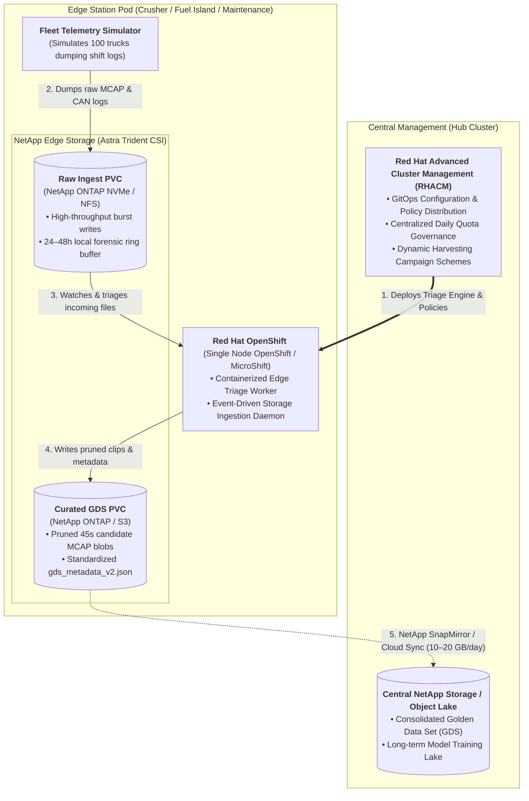
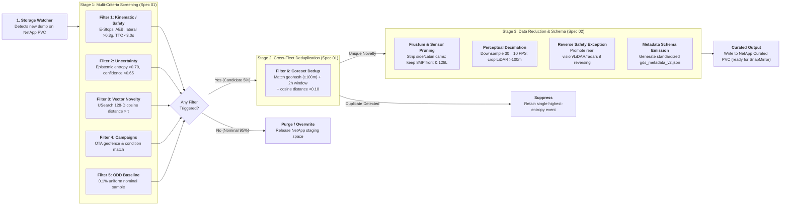

# Edge Data Triage & Deduplication Blueprint
## Hello-World Implementation Guide for Red Hat OpenShift, NetApp Storage & RHACM

**Document Version:** 1.0  
**Status:** Engineering Blueprint & Implementation Guide  
**Upstream Specifications:** [Spec 01: Data Filtering & Triage](../docs/01_data_filtering_and_triage.md) | [Spec 02: Data Reduction & Metadata](../docs/02_data_reduction_and_metadata_schema.md)  
**Target Environment:** Red Hat OpenShift (SNO / MicroShift), NetApp Storage (ONTAP / Astra Trident), Red Hat Advanced Cluster Management (RHACM)

---

## 1. Executive Overview & Objective

This blueprint bridges the high-level system architecture defined in **Specification 01 (Data Filtering, Triage & Deduplication)** and **Specification 02 (Data Reduction & Metadata Schema)** into a buildable, containerized "Hello World" application.

### 1.1 The Business & Architectural Challenge
Industrial autonomous fleets (such as ultra-class mining haulers) generate between 3.0 and 5.0 TB of uncompressed multi-modal sensor data per vehicle per 24-hour shift (35–60 MB/s). Across a 100-truck fleet, aggregate daily generation exceeds 500 TB. However, remote extraction sites rely on constrained satellite WAN backhaul (Starlink/LEO uplinks at 10–25 Mbps), restricting cumulative daily site egress to only 100–250 GB/day. Over 99.9% of generated data cannot leave the site.

### 1.2 The Solution Architecture Value Proposition
By deploying an intelligent edge triage and deduplication workload onto **Red Hat OpenShift at the Edge**, backed by **NetApp Enterprise Storage**, and governed centrally via **Red Hat Advanced Cluster Management (RHACM)**, industrial operators can:
1. **Filter 95%+ of low-entropy nominal driving** directly at edge station pods before data hits the WAN.
2. **Eliminate 60%–80% of repetitive cross-fleet scenes** via spatial-temporal coreset deduplication.
3. **Preserve 100% of safety-critical events and operational anomalies** in a standardized, low-overhead catalog (`gds_metadata_v2.json`).
4. **Reduce recurring cloud storage and labeling costs by over 99%**, replacing unmanaged multi-petabyte cloud floods with a curated Golden Data Set (GDS).

---

## 2. Target Platform & Infrastructure Architecture



### 2.1 Component Mapping & Division of Responsibility

| Platform Component | Role in the Edge Triage Pipeline | Key Capabilities Demonstrated |
| :--- | :--- | :--- |
| **Red Hat OpenShift** *(SNO / MicroShift)* | **Edge Execution Platform:** Hosts the containerized triage engine, vector search workers, and ingestion watchers on rugged 4U skid-mounted pods. | • Low-latency container runtime on edge hardware.<br>• Resilient offline execution during satellite WAN dropouts.<br>• Health monitoring and automated pod restart. |
| **NetApp Storage** *(ONTAP + Astra Trident)* | **Edge Data Fabric & Persistence:** Manages high-throughput staging volumes, instant snapshot protection, and multi-tier lifecycle management. | • **Trident CSI Driver:** Dynamic volume provisioning for raw burst ingest and curated GDS storage.<br>• **NetApp Snapshot Copies:** Zero-impact point-in-time snapshots for forensic investigation retention.<br>• **SnapMirror / Cloud Sync:** Replicating deduplicated GDS candidate snippets over constrained WAN links to central cloud object storage.<br>• **FabricPool / Tiering:** Automatically tiering inactive raw blocks to secondary flash or cold tiers. |
| **Red Hat ACM** *(RHACM)* | **Central Control Plane & Governance:** Centrally distributes triage policies, daily quotas, dynamic campaigns, and model drift compensation vectors across distributed edge sites. | • Multi-cluster application lifecycle via GitOps.<br>• Configuration policies ensuring edge pods adhere to `storage_eviction_policy.yaml`.<br>• Automated deployment of new vision backbone version indices across Crusher and Fuel Bay pods. |

---

## 3. Core Features & Pipeline Functional Mechanics

The "Hello World" application translates the architectural principles of Specifications 01 and 02 into five concrete functional stages:



### 3.1 Stage 1: Ingestion & Storage Trigger
* The triage daemon monitors the incoming directory on the NetApp raw ingest PVC: `/mnt/raw_ingest/{truck_id}/{shift_date}/`.
* Dumps are organized as append-only **MCAP container files** (or paired JSON telemetry + binary sensor files in the demo).
* Upon detecting a completed offload or closed file lock, the daemon dispatches an event worker.

### 3.2 Stage 2: Parallel Multi-Criteria Screening (Filters 1–5)
The worker evaluates the raw 45-second event buffer against the five screening filters:
1. **Filter 1 (Kinematic & Safety Floor):** Parses dynamic vehicle CAN bus signals. Triggers if:
   * Emergency Stop active (`e_stop_active == true`)
   * Autonomous Emergency Braking engaged (`aeb_engaged == true`)
   * Lateral acceleration $|a_{\text{lat}}| > 0.30\text{g}$ (dynamically tightened to $>0.20\text{g}$ if loaded downhill)
   * Time-to-Collision $\text{TTC} < 3.0\text{s}$ (extended to $<4.5\text{s}$ on downhill haul ramps)
2. **Filter 2 (Model Uncertainty & Disagreement):** Evaluates perception inference outputs. Triggers if:
   * Epistemic bounding-box confidence $< 0.65$
   * Shannon entropy in semantic segmentation $> 0.70$
   * Cross-sensor divergence (e.g. LiDAR detector detects an obstacle, but vision foundation model reports clear road)
3. **Filter 3 (Latent Space Metric Novelty):** 
   * Reads a pre-computed 128-D latent scene embedding vector.
   * Queries a local **USearch** HNSW index containing the operational baseline gallery.
   * Triggers if cosine distance $d(\mathbf{v}_{\text{query}}, \mathbf{V}_{\text{baseline}}) > \tau_{\text{novelty}}$ (e.g., $\tau = 0.72$).
4. **Filter 4 (Targeted Dynamic Campaigns):** Checks whether GPS geohash matches active campaign polygons pushed via RHACM (e.g., haul road watering zones, blast dust sectors).
5. **Filter 5 (Stratified ODD Baselines):** Uniform pseudorandom sampler tagging 0.1% of nominal events across operational quadrants to maintain regression anchors.

### 3.3 Stage 3: Cross-Fleet Coreset Deduplication (Filter 6)
If any filter flags a candidate snippet, it enters fleet deduplication:
* The candidate's spatial location is quantized into a spatial geohash (e.g. Uber H3 index resolution 9, ~100m cell).
* The engine queries the site coreset registry:
  * Has another truck reported an anomaly in this spatial cell within the last **2 hours**?
  * If yes, compute cosine distance between both 128-D embeddings.
  * If $d(\mathbf{v}_1, \mathbf{v}_2) < 0.10$, suppress the duplicate snippet and keep only the instance with higher sensor confidence or sharper exposure.
* **Impact:** Eliminates **60% to 80%** of redundant fleet triggers caused by static haul road obstacles encountered by multiple trucks.

### 3.4 Stage 4: Representation Reduction & Safety Exceptions (Spec 02)
* **Temporal Windowing:** Slices exactly $T - 30\text{s}$ pre-trigger (root cause onset) to $T + 15\text{s}$ post-trigger (stopping stabilization).
* **Frustum Pruning:** Drops non-critical channels (cabin driver camera, side blind-spot radars, perimeter views during forward haul).
* **Reversing & Hopper Maneuvering Exception:** If CAN powertrain signals reverse gear or geofencing locates the truck inside a dump pocket or crusher hopper, the pruning mask dynamically flips: rear-facing cameras, perimeter LiDAR, rear radars, and side radars are promoted to **KEEP** at native resolution to prevent hopper wall collisions and jackknifing.
* **Decimation:** Decimates camera frames from 30 FPS down to 10 FPS for archival serialization (66% volume reduction).
* **Metadata Schema Emission:** Generates a lightweight (<5 KB) `gds_metadata_v2.json` record capturing software versions, SA.45s CSAC clock telemetry, filter scores, embedding vector, and optical dock metrics.

---

## 4. Open Source Technology Stack

| Layer | Selected Open Source Technology | License | Implementation Role in Demo / PoC |
| :--- | :--- | :--- | :--- |
| **Robotics Log Serialization** | **Foxglove MCAP** (`mcap`, `mcap-protobuf-support`) | Apache-2.0 | Append-only container format for multi-modal sensor streams (video, LiDAR, CAN, radar). Enables seeking and channel extraction without reading entire files into memory. |
| **Embedded Vector Search** | **USearch (Unum)** (`usearch` Python / C++11) | Apache-2.0 | Fast, lightweight HNSW vector index. Runs SIMD-optimized cosine distance queries on 128-D embeddings directly on edge CPU/NPU without heavy database daemons. |
| **Spatial Indexing** | **Uber H3** (`h3`) / **Geohash2** | Apache-2.0 | Hexagonal hierarchical spatial index for quantizing haul truck GPS coordinates into discrete spatial buckets for Filter 6 coreset matching. |
| **Microservice Runtime** | **Python 3.11+** / **FastAPI** | PSF / MIT | Event-driven triage worker and mock telemetry generator. Clean, readable, and easily containerizable. |
| **Container Base Image** | **Red Hat Universal Base Image 9 (UBI 9 Minimal)** | Open Source (Red Hat) | Enterprise-grade, hardened container base image optimized for OpenShift workloads. |
| **Storage Orchestration** | **NetApp Astra Trident CSI** | Apache-2.0 | Open-source Kubernetes CSI storage orchestrator managing NetApp ONTAP PersistentVolumes, dynamic resizing, and volume snapshots. |
| **Cluster Management** | **Red Hat ACM (RHACM)** | Open Source (Open Cluster Management upstream) | GitOps-driven policy engine deploying workloads and synchronizing configuration maps across edge OpenShift clusters. |

---

## 5. Concrete Data Contracts & Mock Payload Specifications

To allow anyone to start building immediately, the demo utilizes standardized data contracts.

### 5.1 Simulated Raw Ingest Directory Structure (NetApp Raw PVC)
```
/mnt/raw_ingest/
├── HAUL-TRUCK-002/
│   └── 20261014T080000Z/
│       ├── sensor_stream.mcap        # 45-second multi-channel raw recording
│       └── telemetry.json             # CAN bus, IMU, GPS, and inference outputs
├── HAUL-TRUCK-007/
│   └── 20261014T081500Z/
│       ├── sensor_stream.mcap
│       └── telemetry.json
```

### 5.2 Telemetry JSON Contract (`telemetry.json`)
```json
{
  "truck_id": "HAUL-TRUCK-042",
  "timestamp_iso": "2026-10-14T08:12:40.000000Z",
  "software_version": "v4.14.0-prod",
  "kinematics": {
    "ground_speed_kph": 24.2,
    "road_grade_percent": -7.8,
    "lateral_acceleration_g": 0.34,
    "longitudinal_deceleration_g": 0.45,
    "time_to_collision_seconds": 2.6,
    "reverse_gear_engaged": false,
    "e_stop_active": false,
    "aeb_active": true
  },
  "geospatial": {
    "latitude": -22.451234,
    "longitude": 118.874512,
    "pit_sector": "BENCH_04_SOUTH_RAMP"
  },
  "perception_outputs": {
    "epistemic_entropy": 0.78,
    "minimum_detection_confidence": 0.52,
    "sensor_disagreement": true,
    "embedding_128d": [0.0381, -0.1422, 0.8912, "...", 0.0512]
  }
}
```

### 5.3 Curated GDS Output Directory Structure (NetApp Curated PVC)
```
/mnt/gds_curated/
└── SNIP-20261014-TRK042-00941/
    ├── gds_metadata_v2.json           # Standardized catalog entry (<5 KB)
    └── pruned_payload.mcap            # Pruned 45s event snippet (~240–500 MB)
```

---

## 6. OpenShift & NetApp Kubernetes Manifest Architecture

The workload is deployed on OpenShift using standard Kubernetes resources backed by NetApp Astra Trident CSI:

```
demo/k8s/
├── 01_storage_classes.yaml       # NetApp ONTAP NAS / SAN Trident StorageClass
├── 02_persistent_volumes.yaml    # Raw Ingest and Curated GDS PVCs
├── 03_triage_configmap.yaml      # Quotas, thresholds, and campaign rules (managed via RHACM)
├── 04_triage_deployment.yaml     # Containerized edge triage worker pod
└── 05_simulator_job.yaml         # Synthetic fleet generator for test validation
```

### 6.1 Storage Definition Example (`02_persistent_volumes.yaml`)
```yaml
apiVersion: v1
kind: PersistentVolumeClaim
metadata:
  name: raw-ingest-pvc
  namespace: edge-triage
spec:
  accessModes:
    - ReadWriteMany
  storageClassName: netapp-ontap-nas  # Provisioned via Astra Trident
  resources:
    requests:
      storage: 500Gi
---
apiVersion: v1
kind: PersistentVolumeClaim
metadata:
  name: gds-curated-pvc
  namespace: edge-triage
spec:
  accessModes:
    - ReadWriteMany
  storageClassName: netapp-ontap-nas  # Provisioned via Astra Trident
  resources:
    requests:
      storage: 100Gi
```

### 6.2 Central Policy Governance via RHACM
RHACM enforces the triage configuration across all edge clusters using a `ConfigurationPolicy`:
* Updates to detection thresholds (e.g. tightening $\tau_{\text{novelty}}$ or modifying campaign geofences) are committed to a Git repository.
* RHACM detects changes and automatically synchronizes the `03_triage_configmap.yaml` across edge clusters without requiring application restarts or vehicle firmware modifications.

---

## 7. Developer Implementation Roadmap

To build this "Hello World" systematically, development is divided into four milestones:

### Milestone 1: Local Python Prototype (Standalone)
* **Deliverables:**
  * `fleet_telemetry_simulator.py`: Generates 100 mock truck events (80 nominal, 10 kinematic/E-stops, 5 perception uncertainty, 5 duplicate obstacle encounters).
  * `edge_triage_engine.py`: Implements Filters 1, 2, 3, and 6, performs channel pruning, and emits `gds_metadata_v2.json`.
* **Success Metric:** Ingests 100 mock events (~10 GB), filters out 95 nominal events, deduplicates cross-truck redundant triggers, and outputs ~5 curated events (<500 MB) with 100% schema validation.

### Milestone 2: Containerization & Local Testing
* **Deliverables:**
  * `Containerfile`: Builds a hardened, multi-stage UBI 9 container running the triage service.
  * `docker-compose.yaml` / `podman-compose.yaml`: Runs the simulator and triage engine against local volume mounts simulating NetApp PVCs.

### Milestone 3: OpenShift & NetApp Trident Deployment
* **Deliverables:**
  * Apply Kubernetes manifests to an OpenShift cluster with NetApp Astra Trident installed.
  * Verify that the worker successfully reads from `raw-ingest-pvc` and writes to `gds-curated-pvc`.
  * Validate NetApp Snapshot creation for short-horizon forensic retention.

### Milestone 4: Central Multi-Cluster Orchestration via RHACM
* **Deliverables:**
  * RHACM `Application` and `PlacementRule` deploying the triage engine across Crusher Pod and Fuel Bay edge clusters.
  * GitOps demonstration: Updating a dynamic harvesting campaign in Git and observing RHACM propagate the rule to edge nodes in real time.
