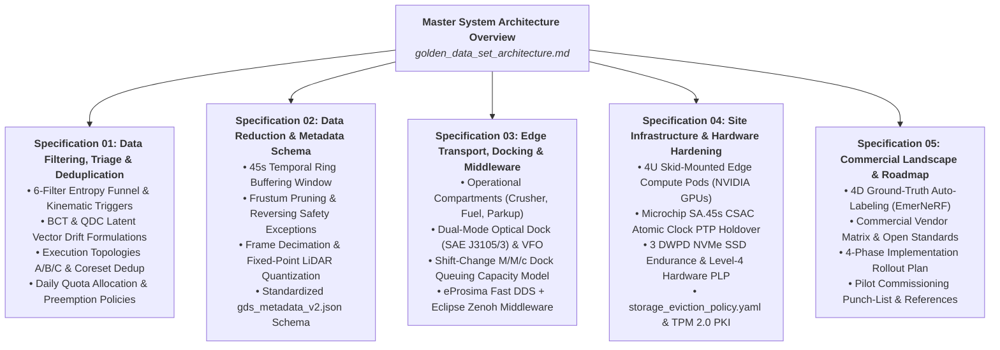

# Specification 00: Master Architecture & Site Infrastructure Overview

This document is the master index and executive architectural overview for the Remote Autonomous Fleet Data Triage & Golden Data Set (GDS) pipeline.

The full master architecture document is maintained at:
**[Master System Architecture & Site Infrastructure Overview (`golden_data_set_architecture.md`)](file:///home/jwesterl/Downloads/opencode/edge-data/docs/golden_data_set_architecture.md)**

---

## Direct Subsystem Specification Index

1. [**Specification 01: Data Filtering, Triage & Deduplication Subsystem**](file:///home/jwesterl/Downloads/opencode/edge-data/docs/01_data_filtering_and_triage.md)
2. [**Specification 02: Data Reduction & Metadata Schema**](file:///home/jwesterl/Downloads/opencode/edge-data/docs/02_data_reduction_and_metadata_schema.md)
3. [**Specification 03: Edge Transport, Docking & Middleware Subsystem**](file:///home/jwesterl/Downloads/opencode/edge-data/docs/03_transport_docking_and_middleware.md)
4. [**Specification 04: Site Infrastructure, Hardware Hardening & Storage Lifecycle**](file:///home/jwesterl/Downloads/opencode/edge-data/docs/04_site_infrastructure_and_hardware.md)
5. [**Specification 05: Commercial Landscape, Tooling Evaluation & Implementation Roadmap**](file:///home/jwesterl/Downloads/opencode/edge-data/docs/05_commercial_landscape_and_roadmap.md)
