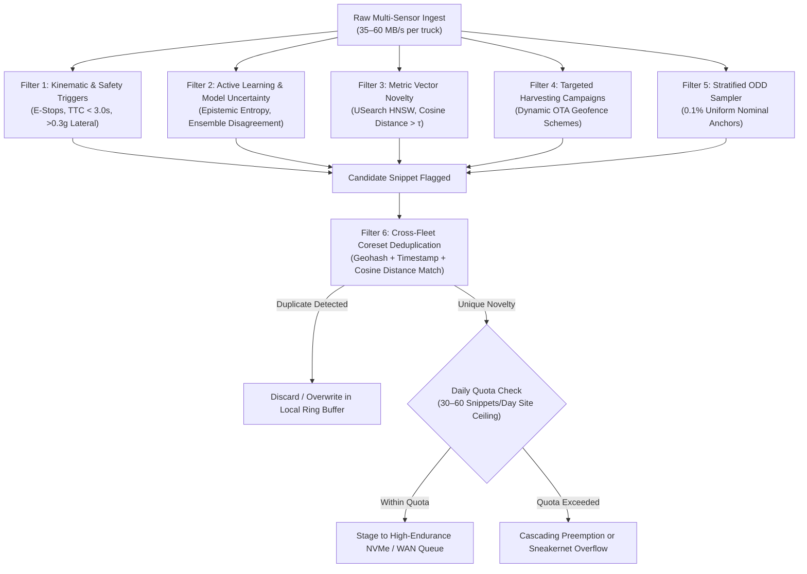
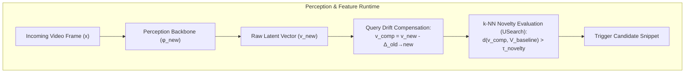

# Specification 01: Data Filtering, Triage & Deduplication Subsystem

**Document Version:** 2.1  
**Status:** Approved Architecture Specification  
**Parent Document:** [Master System Architecture & Site Infrastructure Overview](./golden_data_set_architecture.md)  
**Target Audience:** Autonomy Engineers, Perception/ML Teams, Data Operations Leads

---

## 1. Defining the Golden Data Set (GDS) for Heavy Industry

In autonomous mining and heavy industrial transport, data qualifies for the Golden Data Set if and only if it fulfills at least one of four core objectives:

| Model Failure & Uncertainty | High Entropy & Novelty | Safety Incidents & Near-Misses | Stratified ODD Baselines |
| :--- | :--- | :--- | :--- |
| • High epistemic variance • Detector bounding-box jitter • Sensor cross-disagreement (LiDAR vs. Vision) | • Unseen mining equipment / contractor vehicles • Severe blast dust plumes • Extreme weather & mud spray • Low-angle pit wall glare | • Remote teleoperation takeovers • Emergency stops (E-Stops) & AEB • Spilled rock berm near-strikes | • 0.1% uniform nominal sampling • Continuous regression anchors across environmental permutations |

1. **Failure & Uncertainty Manifestation:** Scenarios where perception classifiers, occupancy grids, or path planners exhibited high ambiguity, low confidence, bounding-box flickering, or ensemble divergence.
2. **High Domain Entropy (Outliers & Novelty):** Visual, geometric, or radar features that diverge significantly from the existing training baseline (e.g., novel contractor vehicles, rare water-truck spray patterns, extreme sun glare off wet quarry rock, deep pit fog).
3. **Safety-Critical & Control Violations:** Hard decelerations, emergency stops (E-Stops), human/remote operator overrides, traction control events, and proximity alerts with light vehicles or personnel.
4. **Stratified Operational Design Domain (ODD) Anchors:** A tiny, scientifically balanced slice of nominal driving across every permutation of operational variables (lighting, precipitation, payload mass, road grade) to prevent catastrophic forgetting and maintain regression testing suites.

---

## 2. The 6-Filter Information Entropy Funnel

Rather than capturing continuous uncurated streams, the triage engine evaluates incoming sensor data through a two-stage triage funnel: parallel multi-criteria screening (Filters 1–5 in logical OR) flags candidate snippets, followed by fleet-wide coreset deduplication (Filter 6) and adaptive daily quota allocation:

### 2.1 Filter 1: Deterministic & Kinematic Triggers
Hard-coded rules operating directly off vehicle kinematics, safety controllers, and hardware diagnostic buses:
* **Human Interventions:** Remote teleoperation takeovers, safety supervisor disengagements, or manual in-cab overrides.
* **Control Boundary Violations:** Autonomous Emergency Braking (AEB) events, lateral accelerations exceeding 0.3g (or site-calibrated limit), uncommanded roll/pitch deviations on compromised haul-road berms, and severe wheel-slip events.
* **Hardware & Perception Faults:** Sensor degradation alerts (camera lens mud splatter, LiDAR reflectivity attenuation from thick dust, radar radome blockage, GNSS RTK lock dropouts).
* **Proximity & Safety Envelope Breaches:** Time-To-Collision (TTC) < 3.0s relative to auxiliary equipment, light vehicles (pickups), or workers.

> **Site Calibration Note for Ultra-Class Haulers:** The 0.3g lateral acceleration and TTC < 3.0s thresholds are nominal automotive reference figures. For 400-tonne haul trucks operating at 15–35 km/h on steep unpaved grades (-8% to -10%), stopping distances scale heavily with payload (160t tare vs. 400t loaded gross mass) and dust-attenuated perception ranges. Therefore, Filter 1 parameters must be dynamically modulated at runtime based on truck payload state and road grade: loaded downhill operations require extending the TTC trigger to <4.5–5.0s and tightening lateral acceleration bounds to >0.18–0.22g to capture incipient loss of traction and berm scrapes before emergency intervention.

### 2.2 Filter 2: Active Learning & Model Uncertainty
Edge perception and prediction models calculate real-time confidence scores and information entropy:
* **Epistemic Uncertainty:** Low confidence scores (< 0.65) on detected bounding boxes, or high Shannon entropy in semantic segmentation heads (e.g., distinguishing between a harmless dust cloud and a solid boulder).
* **Sensor & Ensemble Disagreements:** Divergence between parallel heads (e.g., primary LiDAR detector identifies an obstacle at 45m, but the vision foundation model identifies clear road; or tracker bounding-box variance exceeds tolerance over 5 consecutive frames).
* **Planner Trajectory Surprises:** Significant delta between the trajectory the planner intended to execute and sudden emergency avoidance paths.

### 2.3 Filter 3: Latent Space Vector Embeddings & Novelty Detection
Raw point clouds and imagery cannot be compared across the fleet, but lightweight latent vectors can:
* A lightweight vision-backbone encoder (e.g., MobileNetV4 or DINO-based feature extractor running at 1–2 Hz) compresses multi-camera views into a 128-D or 256-D metric vector.
* The vector is compared against an indexed **k-NN baseline of operational scenes** powered by **USearch (Unum)**, an embedded, header-only C++11 HNSW vector engine optimized for SIMD and ARM NEON hardware acceleration.
* If the cosine distance d(v_scene, V_baseline) > τ_novelty, the clip is tagged as an out-of-distribution environmental anomaly (e.g., rare whiteout blizzard, heavy mud rooster-tails, atypical rock wall geological formations).

#### Vector Space Drift Mitigation under Over-the-Air (OTA) Model Updates
When autonomy engineering deploys an upgraded vision backbone model via an OTA push (e.g., from model hash `a8f90c4e12` to `b9e01d5f34`), the latent manifold shifts from M_old to M_new. Evaluating query vectors generated by the new backbone against an older onboard k-NN baseline causes representation collapse, triggering either persistent false-positive collection avalanches or dangerous blind spots. 

The architecture enforces a three-stage mathematical mitigation protocol:

1. **Backward-Compatible Training (BCT):** When training an upgraded vision encoder φ_new, the cloud training loss couples task objectives with an orthogonal backward-compatibility constraint. As a proposed architectural synthesis combining Shen et al.'s representation regression loss with orthogonal projection constraints on a Stiefel manifold:
   > **L_BCT = L_task + λ * E_{x ~ D} [ || R * φ_new(x) - φ_old(x) ||²₂ ]   subject to R * Rᵀ = I_{d_old}**  
   where:
   * E_{x ~ D} denotes expectation over the operational data distribution D.
   * λ > 0 is a balancing hyperparameter weighting backward-compatibility against task-specific accuracy.
   * When latent dimensionality expands across generations (e.g., d_old = 128 to d_new = 256), R ∈ ℝ^{d_old × d_new} represents a semi-orthogonal projection matrix on the Stiefel manifold satisfying R * Rᵀ = I_{d_old}, mapping the expanded latent space onto legacy baseline dimensions while preserving metric inner products.
2. **Zero-Shot Query Drift Compensation (QDC):** When upgrading between models of identical latent dimensionality (d_old = d_new), prior to fleet-wide OTA rollout, a calibration dataset of N operational scenes (nominally N = 500 to 1,000 representative mining scenes sampled across diverse lighting, weather, and dust conditions) is passed through both legacy and upgraded encoders to compute a first-order linear bias correction offset:
   > **Δ_old→new = (1 / N) * Σ_{i=1}^N [ φ_new(xᵢ) - φ_old(xᵢ) ]**  
   This offset is bundled directly in the OTA deployment payload. Incoming query vectors are compensated at runtime: `v_comp = v_new - Δ_old→new`, suppressing artificial novelty spikes caused by rigid coordinate translation.
   > **Non-Linear Manifold Shift & Avalanche Rollback:** Mean-translation Δ_old→new is strictly a first-order linear approximation; it cannot fully compensate for complex non-linear manifold warping across deep layers. Consequently, QDC requires per-site calibration and real-time trigger rate monitoring. If the candidate novelty trigger rate exceeds **3× the historical baseline** in the 4-hour window following an OTA rollout, the edge agent initiates an **automated rollback**: reverting to the legacy feature extractor or temporarily elevating τ_novelty to prevent storage exhaustion until full Edge Forward-Compatible Transformation (FCT) re-indexing completes.
3. **Edge Forward-Compatible Transformation (FCT) & Batch Re-Indexing:** The Edge Station Pod NAS maintains the historical baseline gallery. When an OTA update is deployed, an asynchronous background job re-embeds the local baseline dataset using a trained transformation module, compiling an updated native M_new k-NN index.

### 2.4 Filter 4: Targeted Harvesting Campaigns (OTA Dynamic Schemes)
Autonomous engineering teams frequently train models for specific operational issues. Configurable logging schemes are pushed to specific trucks or sectors without software redeployments:
* *Campaign Example:* "Harvest 15 seconds of raw uncompressed LiDAR + forward cameras whenever a truck enters Pit Sector 7 during haul road watering operations."
* *Trigger Configuration:* Geofence polygon + CAN water-truck proximity flag + local wind speed sensor threshold.

### 2.5 Filter 5: Stratified ODD Baseline Sampler
To prevent the GDS from suffering from severe anomaly bias (which creates false positives during retraining), a background sampler collects a uniform, randomized 0.1% to 0.5% slice of nominal driving:
* Binned across: `[Shift: Day/Night] x [Weather: Clear/Rain/Dust] x [Payload: Empty/Loaded] x [Route Segment: Ramp/Dump/Crusher]`.
* Provides continuous anchor data for regression testing and nominal safety verification.

### 2.6 Filter 6: Cross-Fleet Coreset Deduplication
While Filters 1–5 evaluate individual clips, Filter 6 eliminates **cross-vehicle duplication across the fleet**. On repetitive closed haul circuits, multiple trucks encounter the exact same static obstacle (e.g., an unusual rock formation, a temporary maintenance berm, or a newly graded haul ramp) within minutes of each other.
* **Mechanism:** Evaluates spatial geohash, temporal proximity windows, and latent embedding cosine distance across all candidate snippets.
* **Execution:** If Truck 02 and Truck 07 both flag an anomaly at coordinate (X, Y) within a 2-hour window and their vector distance `d(v_2, v_7) < 0.10`, the engine retains only the highest-entropy instance (e.g., the one with higher sensor confidence or sharper exposure), suppressing the duplicate.
* **Bandwidth Reduction:** Strips an additional **60%–80% of candidate snippets** that survive initial triage.

---

## 3. Deployment Topologies: Where the Capability Runs

Because the triage and deduplication engine is modular, autonomy architects can deploy it across three primary physical configurations based on organizational constraints and vehicle access:

| Architecture Topology | Execution Location | Vehicle Software Impact | Pros | Cons & Constraints |
| :--- | :--- | :--- | :--- | :--- |
| **Topology A: Edge-Site Centric** *(Recommended for Fast Production)* | **Edge Station Pods** (Crusher / Fuel Bay) | **Zero modification.** Vehicle runs dumb rolling MCAP log; dumps raw via physical caddy swap or 10GbE umbilical. | Bypasses ISO 26262 / ASIL re-certification; zero OEM warranty risk; uses full server-grade GPUs (NVIDIA L40S); enables native cross-fleet deduplication. | Requires 10GbE optical docks or physical NVMe drive swaps at fueling stops (1.5–2.5 TB offload per shift). |
| **Topology B: Hybrid / Parasitic Tap** | **Isolated In-Cab Flight Recorder** | **Zero software modification.** Passive GMSL camera splitters and optical Ethernet mirror taps feed an auxiliary logging PC. | Completely isolated from safety bus; can run Filter 1–3 pre-filtering without ASIL risk; reduces physical offload volume. | Additional hardware per vehicle (cables, secondary industrial PC, power tap). |
| **Topology C: Fully Onboard Edge** *(Long-Term Maturity)* | **Primary Vehicle Autonomy Compute** | **Direct software integration.** Custom C++/Rust daemons run on vehicle NPUs. | Maximum bandwidth reduction before data ever leaves vehicle flash (<50 GB offloaded). | High barrier to entry: requires ASIL certification, OEM stack access, thermal/PCIe budget sharing with vehicle planner. |

---

## 4. Triage Recall Risk & Short-Horizon Forensic Retention

Every filter in §2 is a *recall* mechanism: data not flagged by any filter is discarded or overwritten in the circular ring buffer. This is an intentional trade-off for the 95%+ redundant nominal driving the architecture is built to discard, but it introduces an operational risk: **a miscalibrated or drifted uncertainty/novelty model could fail to flag a genuine safety-relevant precursor**.

* **Layered Trigger Floor:** While Filter 1 includes perception-assisted metrics (TTC envelopes and lens mud/dust attenuation alerts), its core kinematic safety net relies on deterministic, hardware-level CAN triggers (chassis accelerometers, E-stops, AEB hydraulic pressure, and operator takeovers) that operate strictly independently of the deep learning perception and uncertainty heads in Filters 2–3. If a neural network suffers representation collapse or silent inference failure, the physical kinematic triggers remain fully operational.
* **Continuous Low-Rate Forensic Shadow Log:** In addition to high-fidelity triggered snippets, each truck retains an overwritten, heavily decimated rolling buffer (1 FPS H.265 forward camera @ ~200 KB/s, 1 Hz spatially cropped LiDAR @ ~250 KB/s, and full 100 Hz CAN kinematics @ ~50 KB/s ≈ 0.5 MB/s aggregate) covering the **prior 24–48 hours** on secondary storage for insurance and regulatory investigations:
  * **Storage Sizing:** Sized at **~43.2 GB/day/truck** (~86.4 GB for 48 hours of total retention).
  * **Endurance Impact:** Across a 15.36 TB drive tier (or even lower-cost QLC secondary media rated for 0.5–1.0 DWPD), 43.2 GB/day imposes an endurance burden of only **~0.0028 DWPD** (<0.6% of a 0.5 DWPD drive's daily endurance limit), incurring negligible wear while guaranteeing an unassailable forensic replay trail.
* **Post-Hoc Recall Auditing:** Edge Station Pods periodically re-score random samples of the forensic shadow log against current novelty thresholds to detect threshold drift before real incidents occur.
* **Tamper-Evidence:** Thresholds controlling Filter 1 are cryptographically signed and checksummed against known manifests to ensure compliance.

---

## 5. Daily Snippet Budget & Per-Filter Quota Allocation Policy

A 45-second raw rolling buffer recorded at 35–60 MB/s produces **1.6 to 2.7 GB of uncompressed data per event**. After applying spatial frustum pruning (70%–85% reduction) and temporal decimation, an individual pruned snippet occupies **~240 to 810 MB** (nominal average ~350 MB, expanding toward 500–810 MB when reversing safety exceptions preserve rear sensors).

Given a strict **10 to 20 GB/day WAN uplink ceiling** for a 10-truck pit cell, the site infrastructure operates under a hard budget of **28 to 57 high-fidelity snippets per day** across the fleet (at ~350 MB average pruned snippet size; ~12 to 25 snippets/day if safety exceptions elevate average sizes toward 800 MB). To prevent a single noisy sensor from exhausting the daily satellite allotment, Edge Station Pods enforce an **adaptive quota allocation policy**:

> **Pre-Deduplication Candidate Quotas vs. Post-Filter-6 Upload Budget:** The quotas assigned to Filters 1–5 in the table below represent **pre-deduplication daily candidate ceilings** (summing to ~47–50 candidate snippets/day/cell across the 10 trucks). Because Filter 6 suppresses 60%–80% of repetitive cross-fleet scenes, this translates to an expected **10 to 20 unique uploaded snippets/day/site** (~3.5 to 7.0 GB/day nominal at 350 MB, or 8–16 GB/day during reversing-heavy shifts), safely inside the 10–20 GB/day WAN ceiling while leaving ample headroom for unexpected safety bursts.

| Triage Filter | Pre-Dedup Candidate Ceiling | Threshold Adaptivity Mechanism | Overflow Handling |
| :--- | :--- | :--- | :--- |
| **Filter 1: Kinematic / Safety (E-Stops, AEB)** | **100% Guaranteed** (No hard cap; typically 2–5/day) | Deterministic; thresholds are non-negotiable safety floors. | Highest QoS tier. Preempts and evicts all lower-priority staged clips. |
| **Filter 2: Active Learning / Model Uncertainty** | **Max 15 candidate snippets / day / cell** | **PID Threshold Adaptation:** If candidate rate exceeds budget, epistemic confidence trigger τ_entropy automatically tightens. | Deferred to local Pod NVMe tier; dropped from WAN queue if unrequested. |
| **Filter 3: Latent k-NN Novelty Discovery** | **Max 15 candidate snippets / day / cell** | **Dynamic Cosine Margin:** Cosine distance threshold τ_novelty dynamically floats upward during high-entropy conditions. | Lowest novelty scores discarded first. Automated rollback if trigger rate >3× baseline. |
| **Filter 4: Targeted Dynamic Campaigns** | **Max 10 candidate snippets / day / cell** | Quota pre-allocated and distributed per active engineering campaign ID. | Rate-limited per geofence sector once daily campaign ceiling is met. |
| **Filter 5: Stratified ODD Nominal Baselines** | **Fixed 5 candidate snippets / day / cell** | Deterministic uniform sampling (1 clip per operational quadrant). | First to be shed if WAN link degrades or buffer exceeds 80% capacity. |
| **Filter 6: Fleet Coreset Resolution** | **Site Deduplication Layer** | Suppresses 60%–80% of cross-truck redundant triggers before WAN staging. | Yields final 10–20 unique snippets/day (<10–20 GB/day WAN envelope). |

> **Safety-Critical Burst & Filter 1 Preemption / Sneakernet Overflow:** Filter 1 triggers (safety interventions, AEB, E-stops) have zero quota caps because safety data cannot be discarded. Under nominal conditions (2–5 safety events/day), Filter 1 consumes less than 1.8 GB. However, during an operational anomaly day (e.g., severe weather or slick haul roads triggering >30–35 emergency events requiring >12–15 GB of WAN quota), this could threaten to exhaust satellite allotments. To handle this, the edge pod enforces an explicit **cascading preemption and overflow protocol**:
> 1. **Cascading WAN Preemption:** As Filter 1 volume expands, the scheduler preemptively sheds lower-priority WAN upload queues in strict reverse priority order: Filter 5 (nominal baselines) is dropped first, followed by Filter 4 (campaigns), and finally Filters 2 and 3 (uncertainty and novelty).
> 2. **Local Retention Guarantee:** Dropped clips are never deleted from local storage; they remain fully indexed on the Edge Pod NVMe tier for the standard 14-day local retention window (aligned with the Tier 2 storage eviction lifecycle in [Spec 04 §3](./04_site_infrastructure_and_hardware.md)).
> 3. **Sneakernet WAN-Cap Overflow:** If Filter 1 volume itself exceeds 10 GB/day (threatening to saturate real-time satellite telemetry), the edge pod caps Filter 1 real-time WAN egress at 10 GB, transmitting the lightweight JSON metadata catalog for 100% of events plus the top 15 highest-severity MCAP snippets over WAN. The full uncompressed MCAP recordings for all remaining safety snippets are automatically held on local NVMe and queued for bulk collection via the next scheduled Tier 4 Physical Storage Shuttle (sneakernet) cycle (or downloaded via targeted ad-hoc Wi-Fi query). This prevents satellite link exhaustion while guaranteeing that 100% of safety-relevant events are preserved for engineering investigation.

---

## 6. Subsystem References & Mathematical Foundations

* **Goswami et al. (Research Preprint):** [Enabling Compatibility in Continual Learning of Retrieval Embeddings](https://raw.githubusercontent.com/mlresearch/v330/main/assets/goswami26a/goswami26a.pdf) – *Formalizes zero-shot query drift compensation (QDC) and embedding transformation during model updates.*
* **Shen et al. (CVPR):** [Towards Backward-Compatible Representation Learning](https://arxiv.org/abs/2003.11942) – *Mathematical formulation of BCT regularizers preserving metric space geometry across model revisions.*
* **Ramanujan et al.:** [Metric Compatible Training for Online Backfilling in Large-Scale Vector Search](https://arxiv.org/html/2301.03767v2) – *Techniques for avoiding catastrophic false-positive avalanches during latent manifold shifts.*
* **OpenReview:** [Orthogonality Regularization for Compatible Representation Learning](https://openreview.net/forum?id=Due3iZPa6u) – *Orthogonal projection constraints (Rᵀ R = I) for cross-model feature vector compatibility.*
* **Unum Cloud:** [USearch: Compact & Fast Vector Search Engine](https://github.com/unum-cloud/usearch) – *Header-only C++11 HNSW vector engine optimized for SIMD (AVX-512, ARM NEON) execution on edge NPUs.*
