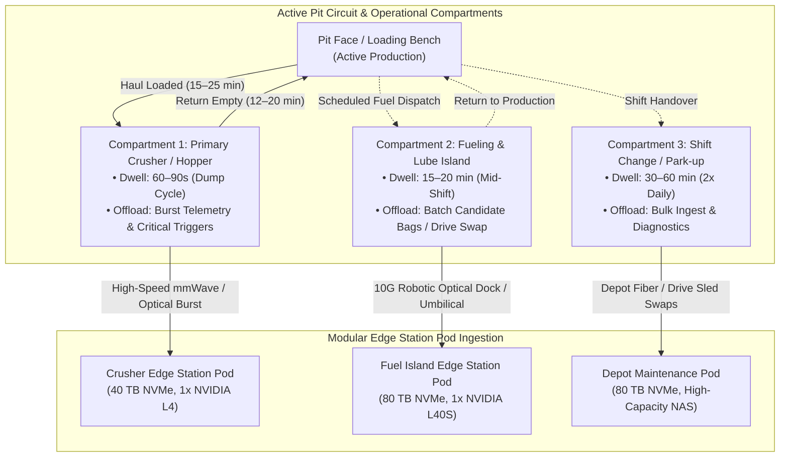
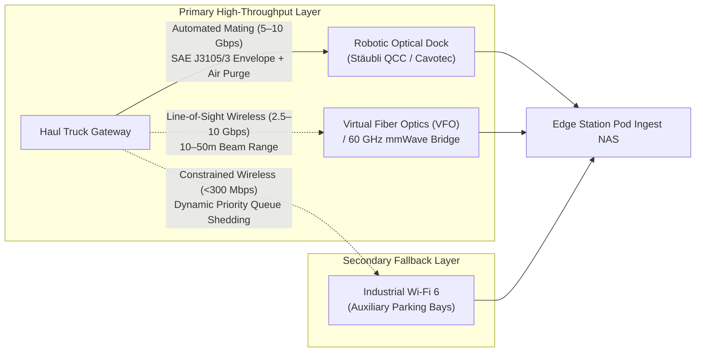
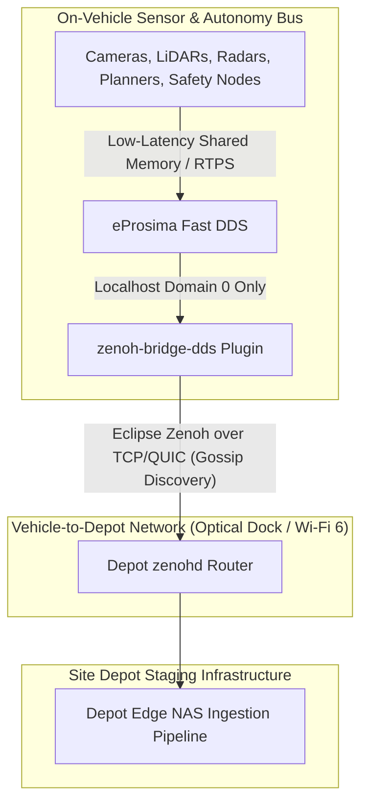

# Specification 03: Edge Transport, Docking & Middleware Subsystem

**Document Version:** 2.1  
**Status:** Approved Architecture Specification  
**Parent Document:** [Master System Architecture & Site Infrastructure Overview](./golden_data_set_architecture.md)  
**Target Audience:** Network Architects, Depot Automation Engineers, Embedded Systems Leads

---

## 1. Operational Compartments & Natural Duty-Cycle Dwell Times

Rather than forcing haul trucks to interrupt active production for data transfers, the architecture leverages the natural operational rhythm of open-pit mining. The site is partitioned into **operational compartments** where haul trucks naturally dwell:



### 1.1 Sharded Ingestion Architecture
To prevent single-depot bottlenecks and eliminate multi-kilometer data runs, ingestion is sharded across distributed Edge Station Pods:
1. **Compartment Ingestion Split:** 
   * *Crusher Hopper (60–90s dwell):* Dedicated to non-contact wireless burst offload (Free-Space Optics / 60 GHz mmWave). Trucks offload lightweight JSON metadata catalogs (<5 KB) and critical Filter 1 safety alerts without physical docking.
   * *Fueling & Lube Island (15–20 min dwell):* Dedicated to full automated physical optical docking (T_s ≈ 240s), offloading 30–50 GB candidate snippet bags.
   * *Parkup Bays (30–60 min dwell):* Handles maintenance diagnostics, bulk shift dumps, and physical drive sled exchanges.
2. **Inter-Pod Vector Sync:** Pods broadcast lightweight metadata packets over the local pit LAN (combining 128-D embeddings, GPS geohash tiles, and timestamp bounds; **<50 MB total per day** across the entire site).
3. **Global Coreset Resolution:** Using a distributed LanceDB or USearch index, each pod cross-checks its candidate snippets against the global site registry. If Pod B finds that Pod A already staged a near-identical event (`d(v_A, v_B) < 0.10` within the same lighting/weather window), Pod B suppresses its local snippet from WAN upload.
4. **Consolidated Uplink:** Only the globally deduplicated Golden Data Set (**<10–20 GB/day** for a 10-truck site) is transmitted over satellite/WAN to the central cloud.

---

## 2. Dual-Mode Depot Offload Interface & Throughput Sizing

In active mining environments, RF wireless offloads suffer from severe dust attenuation, multipath reflections off massive steel haul bodies, and concurrent channel contention, dropping real-world Wi-Fi 6 throughput to **150–300 Mbps**. At 200 Mbps, offloading a 50 GB candidate bag requires over 33 minutes—exceeding fueling dwell times and overflowing vehicle storage.

To eliminate this bottleneck, the offload topology uses a **hybrid dual-interface**:



1. **Primary Physical Dock (5–10 Gbps Nominal):** Automated robotic coupling interface integrated into stationary fueling and maintenance islands:
   * **Mechanical Form-Factor & Structural Envelope Reuse:** Reuses the ruggedized enclosed pin-and-socket mechanical housing of **SAE J3105/3** (originally standardized for automated electric bus conductive charging). This practice repurposes the proven industrial latching arm, alignment funnel, and environmental sealing enclosure to house expanded-beam optical ferrules alongside auxiliary low-voltage contacts, *not* as high-voltage conductive power compliance.
   * **Optical Alignment & Eye-Safety Interlocks:** Floating ferrule assemblies provide micrometer-level axial compliance (±1.5 mm lateral/angular float) to isolate expanded-beam optical elements from vehicle vibration and mechanical wear, while maintaining >50 mm physical clearance from electrical lines. An automated shutter interlock enforces Class 1 / 1M eye-safety, disabling laser emitters until physical docking continuity is established.
   * **Second-Source Architecture:** To avoid single-vendor lock-in, the dock receiver bay uses a modular mounting plate compatible with standard industrial multi-pole inserts (e.g., Stäubli QCC series, Cavotec systems, or Harting Han-Modular with expanded-beam fiber inserts).
   * **Dust Mitigation:** The mating arm incorporates an automated **high-pressure compressed air purge nozzle** that blasts the vehicle's protective optical shutter clean immediately before physical mating.
   * **Throughput:** An integrated 10GBASE-SR / 25GBASE-SR optical line transfers a standard 50 GB candidate payload in **45–80 seconds** under nominal conditions.
2. **Line-of-Sight Optical Wireless (Virtual Fiber Optics / VFO):** Where mechanical docking arms are unfeasible (such as primary crusher dumping pockets), directed Free-Space Optical transceivers (e.g., In A Blink VFO) provide 2.5 to 10 Gbps line-of-sight wireless optical transfer over 10 to 50 meters, immune to RF spectrum saturation and metal multipath interference. As a secondary wireless backup, 60 GHz V-band mmWave bridges (e.g., Peraso / Siklu) provide gigabit-rate wireless handoffs.
3. **Empirical Pilot Validation Requirement:** Nominal vendor specifications (5–10 Gbps transfer, 45–80s duration, VFO beam maintenance) are theoretical maximums. Heavy dust deposition, thermal shimmering in open pits, and haul truck engine vibration during idle require rigorous pilot verification before finalizing dock provisioning.
4. **Wireless Fallback (Industrial Wi-Fi 6 / mmWave):** Engaged at auxiliary parking bays or mobile service trucks.
5. **Dynamic Offload Prioritization Engine:** When operating over constrained wireless links (<300 Mbps), the vehicle's edge agent automatically sheds lower-priority queues in strict alignment with [Spec 01 §5](./01_data_filtering_and_triage.md):
   * **Priority 1 (Mandatory & Immutable):** Filter 1 (Deterministic/E-Stops/Safety Interventions).
   * **Priority 2 (High):** Filter 2 (Model Uncertainty) and Filter 3 (Latent Novelty).
   * **Priority 3 (Deferred):** Filter 4 (Targeted Campaigns).
   * **Priority 4 (Shed First):** Filter 5 (Nominal Stratified Baselines) are dropped from queues to preserve buffer headroom.

---

## 3. Dock Capacity Planning Under Fleet-Scale Contention ($M/M/c$ Queuing Model)

A per-truck transfer time of 45–80 seconds represents raw optical pipe time. Real-world berth occupancy includes vehicle maneuvering, robotic alignment, compressed air purging, and mating disengagement:
* **Effective Berth Service Time (T_s):** ~240s (4.0 minutes) per truck (60s positioning + 30s air purge/latch + 60s data transfer + 30s verify/unmate + 60s clearance). This yields an individual dock service rate μ = 15 trucks/hour/berth.
* **Shift-Change Arrival Burst (λ):** During a 90-minute shift change in a 25-truck compartment, peak arrival rates reach λ = 15 to 20 trucks/hour.
* **$M/M/c$ Erlang-C Queuing Analysis:**
  * **Single Bay (c=1):** Offered load ρ = λ / μ = 18 / 15 = 1.20. System is unstable (ρ > 1.0), generating severe truck queues that stall mine production.
  * **Dual Bay (c=2):** System capacity μ_total = 30 trucks/hour. At λ = 18 trucks/hr, utilization ρ = 0.60 and average queue wait time W_q ≈ 2.25 minutes. At peak λ = 20 trucks/hr, utilization ρ = 0.67 and W_q ≈ 3.20 minutes.
  * **Triple Bay (c=3):** System capacity μ_total = 45 trucks/hour; utilization ρ = 18 / 45 = 0.40. Average wait time W_q < 0.5 minutes, absorbing unexpected re-mate retries without queue buildup.
* **Berth Sizing Policy:** Sites provision dedicated optical docks using the following continuous fleet sizing rule:
  * **≤ 10 trucks:** c = 1 dock berth (supplemented by crusher wireless burst).
  * **11 to 20 trucks:** c = 2 parallel dock berths.
  * **21 to 35 trucks:** c = 3 parallel dock berths.
  * **≥ 36 trucks:** c = 4 parallel dock berths.

> **Queuing Bounds & Empirical Pilot Acceptance Criteria:** The $M/M/c$ formulation provides an analytical upper bound, but real-world mining shift-change arrivals are dispatch-coordinated and partially batched rather than memoryless Poisson processes. Furthermore, 60-second spotting and alignment for a 400-tonne hauler in night-time mud or dust conditions is an aggressive estimate that may vary with driver skill or robotic positioning precision. Sizing must be validated during Phase 1/2 pilot trials against the following empirical acceptance criteria:
> 1. Minimum trial sample of N ≥ 150 consecutive docking events under production shift conditions.
> 2. Optical insertion loss <1.5 dB across dust deposition environments up to 50 mg/m³ after pneumatic air-purge cycle.
> 3. Mechanical alignment compliance absorbing ±25 mm vehicle suspension travel and 0.5g RMS low-frequency idle vibration (10–50 Hz).

---

## 4. Quantitative Reduction Funnel across Scale Tiers

| Tier | Transmission Medium | Volume (10-Truck Cell) | Volume (100-Truck Site) | Latency / Frequency | Architectural Purpose |
| :--- | :--- | :--- | :--- | :--- | :--- |
| **Tier 1: Immediate Telemetry** | Private 5G / Starlink Satellite | **~1–2 GB / day** | **~10–20 GB / day** | Real-time (<500ms) | Fleet safety alerts, disengagement coordinates, and JSON metadata catalog. |
| **Tier 1.5: Inter-Pod Vector Sync** | High-Speed Local Pit LAN | **<50 MB / day** | **<250 MB / day** | Real-time (<5s) | Local broadcast of 128-D vector hashes and geohashes for cross-shard coreset deduplication. |
| **Tier 2: Sharded Edge Ingestion** | 10 Gbps Optical Dock + mmWave / Wi-Fi 6 | **~30–50 TB / day** (raw) or **~0.5–1.0 TB** (pruned) | **~300–500 TB / day** (raw) or **~5–10 TB** (pruned) | Hourly / Shift-change | Ingestion of raw shift logs or candidate snippets into local Edge Pods. |
| **Tier 3: Cloud GDS Ingestion** | Cloud-directed pull over night-time WAN / Sat | **~10–20 GB / day** | **~20–50 GB / day** | 12–24 hours | Highest-priority deduplicated GDS snippets and auto-labeled training cases. |
| **Tier 4: Physical Archive (Sneakernet)** | Rugged U.2/U.3 NVMe storage shuttles | **~1.5–3.0 TB / 14-day batch** (~3–6 TB / mo) | **~15–30 TB / 14-day batch** (~30–60 TB / mo) | 7–14 days transit | Regulatory compliance, catastrophic incident replays, and long-term cold archives. |

> **Fleet Scaling & Coreset Saturation (10 vs. 100 Trucks):** Notice that while fleet size expands by 10× (10 to 100 haulers), the cloud GDS upload volume grows by only ~2× (10–20 GB/day to 20–50 GB/day). This sublinear scaling is an intentional architectural result of Filter 6 cross-fleet coreset deduplication: on repetitive, closed pit haul circuits, expanding the fleet does not proportionally increase environmental novelty. 100 trucks encounter the same loading benches, crusher approaches, and static haul obstacles, allowing Filter 6 to suppress 60%–80% of candidate triggers and plateauing the unique Golden Data Set.

---

## 5. Hybrid Transport Middleware: Resolving the DDS Wireless Dilemma

A major operational failure mode in distributed vehicle-to-depot robotics is relying on standard Data Distribution Service (DDS) protocols across wireless boundaries:
* **The Problem:** eProsima Fast DDS and CycloneDDS provide microsecond-level shared-memory IPC on-vehicle, but rely on continuous multicast Simple Participant Discovery Protocol (SPDP) broadcasts. When haul trucks enter intermittent wireless zones around depot bays, DDS discovery initiates packet storms, saturating wireless bandwidth, exhausting CPU cycles, and dropping telemetry.
* **The Architecture:** The system decouples internal vehicle IPC from external fleet transport:



* **Eclipse Zenoh** bridges the vehicle to the depot server. By replacing multicast discovery with set-theoretic resource keys and gossip-based scouting, Zenoh maintains deterministic, low-overhead data transport over lossy or intermittent wireless channels without network flooding.

### 5.1 Vehicle-to-Depot Middleware Configuration (`zenoh_bridge_config.json5`)

```json5
{
  plugins: {
    dds: {
      domain: 0,
      localhost_only: true,
      allow: {
        publishers: [
          "/triage/candidate_metadata",
          "/chassis/critical_kinematics",
          "/sensors/diagnostics"
        ],
        subscribers: [
          "/fleetwise/dynamic_schemes",
          "/depot/vector_gallery_update"
        ]
      }
    }
  },
  transport: {
    unicast: {
      // Dynamic endpoint discovery with TLS and QUIC/TCP failover
      endpoints: [
        "quic/${DEPOT_INGEST_IP:-10.240.12.1}:7447?tls=true",
        "tcp/${DEPOT_INGEST_IP:-10.240.12.1}:7447?tls=true"
      ],
      multicast_scouting: false
    },
    link_loss_action: "BUFFER_IN_LOCAL_RING",
    buffer_management: {
      max_buffer_size_mb: 2048,
      default_sample_ttl_ms: 60000,
      overflow_policy: "priority_shedding",
      // Shedding order aligned strictly with Spec 01 §5 cascading preemption
      priority_shedding_order: [
        "DROP_FILTER_5_ODD_SAMPLES",
        "DROP_FILTER_4_CAMPAIGNS",
        "DROP_FILTER_3_NOVELTY_LOWEST_SCORE",
        "DROP_FILTER_2_UNCERTAINTY_LOWEST_ENTROPY",
        "PRESERVE_FILTER_1_IMMUTABLE"
      ]
    }
  }
}
```

---

## 6. Subsystem References

* **Stäubli International AG:** [QCC Automatic Quick Charging and Multi-Pole Connectors for Industrial Vehicles](https://www.staubli.com/en/electrical-connectors/products/multi-pole-connectors/qcc.html) – *Automated industrial coupling interface with high-pressure air purge for heavy dust environments.*
* **Cavotec SA:** [Automated Connection Systems for Mining & Heavy Industry](https://www.cavotec.com/industry/mining-tunnelling) – *Robotic mating systems engineered for open-pit and underground mobile equipment.*
* **SAE International:** [SAE J3105/3: Recommended Practice for Electric Vehicle Automated Conductive Connection (Enclosed Pin and Socket)](https://www.sae.org/standards/content/j3105/3_202001/) – *Industrial automated connection practice; referenced for mechanical form-factor and pin-and-socket envelope reuse to house expanded-beam optical contacts alongside DC power.*
* **In A Blink:** [Virtual Fiber Optics (VFO) Free-Space Optical Wireless Data Transfer](https://inablink.zone/) – *Line-of-sight optical wireless communications (2.5–10 Gbps) immune to RF multipath interference.*
* **eProsima:** [Fast DDS (Fast RTPS): High-Performance OMG DDS Implementation](https://www.eprosima.com/index.php/products-all/eprosima-fast-dds) – *Real-time publish-subscribe middleware for deterministic in-vehicle intra-node IPC.*
* **Eclipse Foundation:** [Eclipse Zenoh: Zero Overhead Pub/Sub, Store, and Query Protocol](https://zenoh.io/) – *Gossip-scouting and unicast transport resolving DDS discovery storms across lossy wireless links.*
