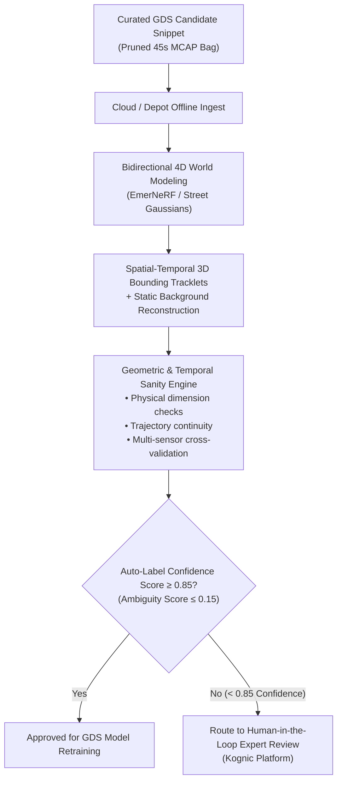
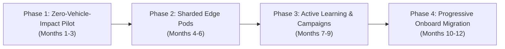

# Specification 05: Commercial Landscape, Tooling Evaluation & Implementation Roadmap

**Document Version:** 2.1  
**Status:** Approved Architecture Specification  
**Parent Document:** [Master System Architecture & Site Infrastructure Overview](./golden_data_set_architecture.md)  
**Target Audience:** Program Managers, Vendor Selection Leads, Autonomy Architects

---

## 1. Ground Truth Annotation & 4D Auto-Labeling Strategy

Data admitted into the Golden Data Set is only valuable if it can be annotated accurately. Mining environments feature specialized machinery, extreme dust, and dynamic surface topographies that general-purpose automotive vision foundation models cannot reliably parse.

1. **Heavy Offline 4D Auto-Labeling:** Unlike on-vehicle models which must operate under 20ms causal constraints, site pods and cloud clusters run heavy, non-causal multi-frame foundation models and neural radiance/splatting pipelines (such as EmerNeRF and Street Gaussians) that optimize across the entire sequence forward and backward in time.
2. **Mining-Specific Semantic Ontology:** The annotation schema explicitly incorporates industrial classes:
   * Heavy haulers, bucket excavators, front-end wheel loaders, water trucks, service pickups.
   * Static infrastructure: Safety berms (with height estimation), high-voltage dragline cables, blast cones, oversize rock obstacles (>30cm).
3. **Targeted Human-in-the-Loop:** Only candidate scenes where auto-labeling confidence falls below 0.85 (or geometric ambiguity exceeds 0.15) are routed to human annotators via platforms like Kognic, automating up to 90% of bounding tracklets without human intervention.

---

## 2. Commercial Product Landscape & Vendor Evaluation

The commercial autonomy and robotics tooling market is segmented across three primary execution layers:

| Pipeline Tier | Architectural Role | Core Functional Responsibilities | Representative Technologies & Platforms | Interconnect & Offload Link |
| :--- | :--- | :--- | :--- | :--- |
| **In-Vehicle Edge** | Edge Filtering & Ring Buffering | Pre-trigger circular buffering, deterministic triggers, uncertainty scoring, frustum pruning. | **AWS IoT FleetWise**, Sonatus, **Foxglove MCAP**, USearch | Vehicle PCIe / Localhost Fast DDS |
| **Depot Staging & Pruning** | Smart Sampling & Coreset Selection | Automated optical offload ingest, visual coreset sampling, cross-fleet deduplication, vector re-indexing. | **Akridata DataSense**, **Voxel51 FiftyOne**, LanceDB | 10 Gbps Optical Dock / Wi-Fi 6 (`zenoh-bridge-dds`) |
| **Cloud / Central GDS** | Active Learning & Ground-Truth Labeling | Multi-sensor 4D auto-labeling, expert human annotation, ASAM OpenSCENARIO simulation loop. | **Kognic**, Scale AI (Nucleus), **Applied Intuition (Strada)** | LEO Satellite WAN (<50 GB/day) / NVMe Sneakernet |

### 2.1 Platform Evaluation: Kognic (AD/ADAS Annotation & Active Learning)
* **Market Position:** Kognic (formerly Annotell) is an industry-leading platform specifically built for the AD/ADAS and robotics data flywheel, trusted by automotive Tier-1s and OEMs (Continental, Qualcomm, Zenseact/Volvo).
* **Core Capabilities:**
  * **Multi-Sensor 4D Fusion:** Natively aligns 3D LiDAR point clouds, 4D imaging radars, and multi-camera visual feeds in a synchronized spatio-temporal coordinate space.
  * **Active Learning & Curation:** Integrates with perception models to identify high-impact failure modes, detector disagreement, and low-confidence edge cases for human review.
  * **Auto-Labeling Copilot & QA:** Automated validation engines (e.g., verifying physical bounding-box constraints, temporal trajectory consistency, and occlusion sanity checks).
* **Role in This Architecture:** Primary candidate for the **Cloud / Central GDS Ground-Truth & Active Learning Engine**.

### 2.2 Open Standards and Open-Source Technology Matrix

| Architecture Layer | Open Standard / Tool | Licensing | Edge / Embedded Suitability | Primary Operational Role | Trade-offs & Engineering Considerations |
| :--- | :--- | :--- | :--- | :--- | :--- |
| **Serialization Container** | **Foxglove MCAP** | Apache 2.0 | **Native Embedded** (C++, Rust, Python, Go) | Row-oriented, append-only container format for multi-modal robotics logs. | Built-in indexing adds minor file size overhead; requires custom schema decoders for proprietary sensors. |
| **Intra-Vehicle IPC** | **eProsima Fast DDS** | Apache 2.0 | **Native Embedded** (C++, RTPS compliant) | Ultra-low latency, deterministic inter-process communication on-vehicle. | Multicast discovery floods lossy/wireless links; strictly confined to localhost loopback. |
| **Edge-to-Depot Transport**| **Eclipse Zenoh** | EPL 2.0 / Apache 2.0 | **Native Embedded** (Rust, C, Python; low memory footprint) | Unified data plane bridging vehicle networks to depot servers over wireless without multicast storms. | Requires running a lightweight routing daemon (`zenohd`); emerging standard in ROS 2 / Autoware. |
| **On-Vehicle Vector Search** | **USearch (Unum)** | Apache 2.0 | **Native Embedded** (Header-only C++11, SIMD/NEON optimized) | Lightweight HNSW vector engine running real-time novelty checks (d(v, V) > τ) on NPUs. | In-memory index architecture requires explicit disk serialization across reboots. |
| **Depot Vector Database** | **LanceDB** | Apache 2.0 | **High Embedded** (Rust, Python) | Serverless, disk-backed multimodal vector database built on Lance columnar format for depot NAS search. | Optimized for local NVMe access; distributed multi-server scaling requires custom coordination logic. |
| **Outlier & Noise Detection**| **Cleanlab** | Apache 2.0 | **Medium** (Python) | Confident learning algorithms to detect label noise, estimate out-of-distribution density, and prune redundant data. | Tailored for classification/tabular data; requires pre-extracted feature vectors for 3D point clouds. Standard Apache-2.0 open-source licensing allows unencumbered deployment as an edge pod microservice or containerized batch job. |
| **4D Auto-Labeling Pipeline**| **EmerNeRF / Street Gaussians** | Open Research / Apache 2.0 | **Cloud / Depot GPU Cluster** | Self-supervised 4D neural radiance fields / Gaussian Splatting decomposing dynamic scenes. | Computationally intensive (30 to 120 minutes of GPU training per sequence). |
| **Cross-Tier Simulation** | **ASAM OpenSCENARIO & OpenDRIVE** | ASAM Open Standard | **Cross-Platform Standard** | Standardized formats for dynamic scenario behavior and static haul road surface geometry. | Complex XML schema specifications; requires specialized conversion tools for raw telemetry logs. |

### 2.3 Comprehensive Commercial Vendor Matrix

| Pipeline Layer | Platform / Vendor | Core Strength | Operational Trade-off | Strategic Recommendation |
| :--- | :--- | :--- | :--- | :--- |
| **In-Vehicle Edge Agent** | **AWS IoT FleetWise** | Dynamic declarative scheme deployment, CAN signal parsing, condition-based edge filtering without firmware re-flashing. | Tied to AWS cloud ecosystem; lacks native parsing support for high-throughput uncompressed LiDAR point clouds. | **Hybrid Integration:** Deploy FleetWise for vehicle kinematics, CAN telemetry, and Filter 1/4 rules; wrap it with custom edge agents for raw MCAP sensor buffers. |
| **In-Vehicle Edge Agent** | **Sonatus Collector** | Software-defined dynamic vehicle data collector; instant policy updates without OTA firmware re-flashing. | Primarily tailored for passenger automotive CAN/Ethernet architectures. | **Selective Use:** Excellent for deep chassis CAN and powertrain diagnostics. |
| **In-Vehicle Diagnostics** | **Vector Informatik (CANape / VP75x1)** | Industry standard for multi-gigabit sensor data capture, microsecond hardware time-stamping, and ASAM compliance. | High enterprise licensing costs; proprietary hardware dependency; lacks cloud-native active learning curation. | **Selective Buy:** Deploy on specialized engineering prototype trucks; implement lightweight C++/Rust logging agents on production haulers. |
| **Machine Observability** | **Sift** | High-frequency physical machine observability, sub-second telemetry anomaly triage, Apache Arrow/Parquet data stack. | Focused on time-series telemetry and system health rather than 3D LiDAR/video point cloud computer vision. | **Commercial Buy:** Deploy to unify chassis CAN, PTP timing health, and hardware telemetry triage across the fleet. |
| **Depot Edge Curation** | **Akridata (DataSense)** | Visual Coreset sampling algorithms, edge deduplication, eliminating 90%+ of redundant video frames before cloud upload. | Closed-source proprietary software; requires dedicated edge compute nodes at depot NAS installations. | **Commercial Buy:** Deploy at depot fueling bays to automate visual candidate deduplication prior to WAN transmission. |
| **Depot Edge Curation** | **Voxel51 (FiftyOne Enterprise)** | Centralized visual dataset exploration, FiftyOne Brain similarity indexing, distribution shift detection. | Geared primarily toward server/cloud curation; requires custom orchestration to automate headless depot pruning. | **Buy / Integrate:** Adopt as the unified catalog platform for the Depot NAS and Cloud GDS tiers. |
| **Cloud GDS & Labeling** | **Kognic** | Specialized for multi-sensor temporal fusion (LiDAR, Camera, Radar), active learning copilot, and dataset quality assurance. | Enterprise pricing structure; requires pre-curated candidate data (cannot ingest raw 500 TB/day site feeds directly). | **Commercial Buy:** Integrate as the primary platform for generating verified 4D ground-truth labels from curated GDS snippets. |
| **Cloud GDS & Labeling** | **Scale AI (Nucleus)** | Massive auto-labeling infrastructure, semantic dataset search, and human-in-the-loop annotation pools. | Less specialized in European automotive/robotics multi-sensor calibration than Kognic. | **Enterprise Alternative:** Strong general-purpose data engine for large-scale computer vision models. |
| **Simulation & Validation** | **Applied Intuition (Strada / Simian)** | Automated scenario extraction from real drive logs, conversion to ASAM OpenSCENARIO, synthetic edge-case permutation. | Complex enterprise stack with high licensing tiers; requires well-structured input data. | **Commercial Buy:** The premier solution for closing the active learning loop from real-world edge cases to synthetic simulation. |

### 2.4 Recommended Commercial Reference Stack
1. **Vehicle & Ingest Layer:** Standardize raw ring buffers on **Foxglove MCAP** format with passive caddy swaps or 10GbE umbilical links, using **USearch** for local metric vector indexing and **Sift** for chassis telemetry health. Confine **eProsima Fast DDS** to vehicle-internal loopback.
2. **Sharded Edge Station Pods:** Ingest automated optical offloads and caddy drops via **Eclipse Zenoh** into 40–80 TB Edge Station Pods running **Akridata DataSense** and **Voxel51 FiftyOne Enterprise** (backed by **LanceDB**) to perform cross-fleet deduplication, vector synchronization, and coreset extraction.
3. **Cloud GDS Platform:** Ingest surgical high-priority snippets into **Kognic** for 4D multi-sensor annotation and model feedback, feeding verified edge cases directly into **Applied Intuition Strada** for synthetic re-simulation and regression testing.

---

## 3. Phased Implementation Roadmap

### Phase 1: Zero-Vehicle-Modification Pilot (Months 1–3)
* **Fleet Scope:** 5–10 trucks operating in a single pit cell (30–50 TB/day raw generation).
* **Infrastructure:** Deploy 1x modular Edge Station Pod (80 TB NVMe, 1x NVIDIA L40S GPU) at the primary fueling island. The 80 TB volume provides either 1.5–2.0 days of uncompressed raw dump buffers for initial commissioning or 5–7 days of pruned candidate snippets and forensic shadow logs (~0.5–1.0 TB/day) awaiting WAN upload or sneakernet collection.
* **Vehicle Integration:** Zero onboard code modifications. Configure passive circular logging to high-endurance NVMe caddies. Implement manual caddy swaps or manual 10GbE umbilical offloads during scheduled 15-minute fueling dwells.
* **Triage Execution:** Edge Station Pod runs Filter 1 CAN error parsing, Filter 2–3 uncertainty and novelty scoring, and Filter 6 coreset deduplication directly on server GPUs.
* **Uplink:** Establish private 5G / Starlink Tier-1 telemetry and Tier-3 curated GDS upload (<10–20 GB/day).

### Phase 2: Sharded Edge Stations & Cross-Shard Federation (Months 4–6)
* **Fleet Scope:** 10–25 trucks across multiple site compartments (75–125 TB/day raw generation).
* **Infrastructure:** Deploy a 2nd modular Edge Station Pod at the Primary Crusher (40 TB NVMe, 1x NVIDIA L4 GPU) for high-frequency burst offloading during 60–90 second dump cycles.
* **Transport Middleware:** Deploy Eclipse Zenoh (`zenoh-bridge-dds`) on 60 GHz mmWave / optical interfaces for deterministic offloading without wireless DDS discovery storms.
* **Cross-Shard Federation:** Connect Crusher and Fuel Bay pods via the local pit wireless/fiber mesh to synchronize 128-D vector embeddings (<50 MB/day), eliminating duplicate edge-case uploads across pods.

### Phase 3: Active Learning & Dynamic Campaigns on Edge Pods (Months 7–9)
* **Heavy Edge Intelligence:** Execute EmerNeRF / 3D Gaussian Splatting static background reconstruction and Cleanlab confident learning algorithms on Edge Pod GPUs.
* **Dynamic Harvesting Campaigns:** Deploy dynamic over-the-air schemes (declarative rules targeting haul road watering operations, dust plumes, and low-angle sun glare) managed centrally across the Edge Station Pods.
* **Cloud Feedback Loop:** Integrate surgical GDS blobs into Kognic for 4D multi-sensor ground truth annotation and Applied Intuition Strada for ASAM OpenSCENARIO synthetic permutations.

### Phase 4: Progressive Onboard Migration & Full Data Flywheel (Months 10–12+)
* **Selective In-Vehicle Migration:** As OEM integration paths open up or ASIL safety certification pathways mature, selectively migrate lightweight filters (Filter 1 deterministic thresholds and USearch HNSW vector novelty) directly into vehicle compute to reduce physical offload sizes to <50 GB.
* **Backward-Compatible Vector Updates:** Enforce Backward-Compatible Training (BCT) and Zero-Shot Query Drift Compensation (QDC) for seamless OTA model upgrades without invalidating historical vector galleries.
* **Automated Flywheel:** Full closed-loop pipeline from site edge triage to cloud auto-labeling, simulation parameterization, and OTA model redeployment.

### 3.1 Pilot Engineering Punch-List & Commissioning Verification
During Phase 1 and Phase 2 pilot deployments, site commissioning engineers must benchmark and tune three non-blocking edge behaviors before scaling to full fleet production:
1. **Inter-Pod Time Synchronization for Coreset Deduplication:** The 2-hour spatial deduplication window in Filter 6 assumes consistent timestamps across distributed Edge Station Pods. Crusher, fuel island, and maintenance pods must synchronize system clocks via IEEE 1588 PTP over site backhaul fiber or dedicated multi-GNSS disciplined oscillators to constrain inter-pod time skew <10 ms across the 2-hour deduplication window, ensuring cross-pod vector comparisons remain time-coherent.
2. **Secondary Storage Power-Loss Protection (PLP) Architecture:** While primary 3 DWPD enterprise SSDs feature Level-4 hardware PLP (tantalum capacitors), secondary QLC drives selected for the 24–48h forensic shadow log must be audited. If commercial QLC drives lack discrete PLP capacitors, the storage daemon must stage all shadow chunks through the primary PLP-backed NVMe write cache before asynchronous flushing, preventing Flash Translation Layer (FTL) corruption during ungraceful master battery disconnects.
3. **PID Controller Tuning & Anti-Windup for Adaptive Thresholds (τ):** The adaptive quota feedback loops in Filter 2 (τ_entropy) and Filter 3 (τ_novelty) require calibrated proportional, integral, and derivative coefficients. Recommended baseline commissioning gains: **K_p = 0.05, K_i = 0.005, K_d = 0.01**. Crucially, the integral term must enforce strict **anti-windup clamping** (I_min = -0.15, I_max = +0.15) to prevent threshold runaway and sluggish recovery during abrupt environmental step-changes (e.g., immediate onset of highwall blast dust or torrential rain).

---

## 4. Architectural Hardening & Review Alignment

| Dual-Mode Docking | PTP CSAC Clock Holdover | Vector Space Versioning | Sharded Site Federation |
| :--- | :--- | :--- | :--- |
| • **10 Gbps Optical Mating (Nominal):** Targets clearing 50 GB payload in <45–80 seconds (nominal optical pipe rate; pilot to validate end-to-end berth occupancy). • **Air Purge Nozzle:** Blasts optical shutter clean. • **Fallback:** Tier 2B Wi-Fi 6 with priority shedding. | • **Microchip SA.45s CSAC (Nominal):** Datasheet <0.8 µs drift over 24h GNSS denial (pilot to validate under heavy pit vibration and thermals). • **Sub-Millimeter Alignment:** Prevents camera/LiDAR spatial registration errors at haul speeds. | • **Backward-Compatible Training (BCT):** Constrains manifold geometry. • **Query Drift Compensation (QDC):** Zero-shot offset suppression. • **Depot Re-indexing:** Asynchronous baseline updates. | • **Modular Edge Pods:** 4U skids deployed at Crusher (burst) and Fuel (batch). • **Cross-Shard Sync:** Exchanging 128-D vectors (<50 MB/day) eliminates duplicate uploads. • **Location-Agnostic Engine:** Zero-vehicle-modification deployment. |

| Technical Pillar | Baseline Assumption | Operational Vulnerability | Hardened Architecture Specification |
| :--- | :--- | :--- | :--- |
| **Site Scaling & Vehicle Integration** | Monolithic central depot requiring complex active learning software modifications directly on vehicle compute. | Modifying onboard software voids OEM warranties, breaks ASIL safety certifications, and causes dispatch bottlenecks at single depot. | **Location-Agnostic Triage & Sharded Pods:** Modular 4U skid-mounted Edge Station Pods at natural choke points (Crusher, Fuel Bay) + Cross-Shard Vector Federation (<50 MB/day) + Zero-Vehicle-Modification caddy/umbilical ingest (Topology A/B). |
| **Depot Offload Throughput** | Continuous 1.2–2.5 Gbps Wi-Fi 6 offload during 15-min fueling stop. | Dust attenuation, metal multipath, and multi-truck RF contention drop speeds to **150–300 Mbps**, taking >33 min to offload 50 GB and overflowing storage. | **Dual-Mode Hybrid Interface:** Automated robotic optical dock (**Stäubli QCC / Cavotec**, adapting SAE J3105/3 mechanical envelope) with compressed air dust purge delivering nominal **5–10 Gbps** (<45–80s transfer) + Virtual Fiber Optics (VFO) second-sourced with 60 GHz mmWave + Dynamic Priority Offload Engine that sheds Filter 5 baseline clips if wireless bandwidth drops <300 Mbps (nominal ratings subject to pilot verification). |
| **Transport Protocol Stability** | Standard DDS participant discovery across vehicle-to-depot wireless. | Intermittent wireless triggers DDS SPDP multicast discovery storms, packet flooding, CPU exhaustion, and dropped telemetry. | **Hybrid IPC & Transport Architecture:** **eProsima Fast DDS** restricted to vehicle-internal loopback + **Eclipse Zenoh** (`zenoh-bridge-dds`) for wireless transport via TCP/QUIC unicast with gossip-based discovery. |
| **Sensor Time Synchronization** | Standard GNSS RTK 1PPS + IEEE 1588 PTP. | Deep pit benches experience prolonged GNSS denial; microsecond-level clock drift causes **spatial registration errors** (>10 cm) between cameras and LiDAR, corrupting 4D auto-labeling. | **Hardware-Backed CSAC Holdover:** Primary switch incorporates a **Microchip SA.45s Chip-Scale Atomic Clock**, targeting nominal **<0.8 µs drift over 24h** of complete GNSS denial (<120 mW power; subject to field pilot validation). |
| **Novelty Vector Embeddings** | Static 128-D vector cosine distance against onboard k-NN baseline. | OTA updates to vision backbone model shift latent vector space, invalidating onboard indices and causing false-positive novelty avalanches. | **BCT, QDC & Versioned Embeddings:** Cloud trains with **Backward-Compatible Training (BCT)**, runtime applies **Zero-Shot Query Drift Compensation (QDC)** with **USearch**, and edge NAS executes automated batch re-indexing. |
| **Storage Endurance & Thermals** | 2x 15.36 TB U.2 NVMe SSDs in RAID-0/1. | Continuous 35–60 MB/s writes in **>45°C** in-cab bays wear out flash in <18 months and trigger thermal throttling, risking dropped frames in the autonomy thread. | **3 DWPD Enterprise NVMe with PLP:** Micron 7450 MAX (12.8 TB) / Solidigm D7-P5620 (~70 PBW endurance) + optional D7-P5810 SLC write cache, Level-4 Hardware PLP (tantalum capacitors), conduction chassis cooling, and **Graceful Storage Degradation Policy** (`storage_eviction_policy.yaml`). |

---

## 5. Master Bibliography & Authoritative Citations

**A note on source classes:** (1) **Standards and peer-reviewed literature** (IEEE 1588, ASAM OpenSCENARIO/OpenDRIVE, SAE J3105/3, arXiv/conference papers [10]–[13], [34]–[35]) are independently vetted ground truth. (2) **Vendor technical/spec-sheet pages** (Micron, Solidigm, Microchip, SiTime, Stäubli, Cavotec, USearch/LanceDB/Zenoh/MCAP docs) are reliable for nominal datasheet ratings but require empirical site pilot validation. (3) **Marketing/commercial pages** are useful for positioning but carry the least evidentiary weight.

### 5.1 Cloud Economics & Satellite Networking
1. **Starlink Enterprise & Maritime:** [Starlink High-Performance Satellite Terminals & Uplink Specifications](https://www.starlink.com/business) – *Documents LEO satellite sustained uplink capacity (10–25 Mbps) in remote field extraction environments.*
2. **Amazon Web Services:** [AWS Simple Storage Service (S3) Pricing & TCO Model](https://aws.amazon.com/s3/pricing/) – *Standard S3 object storage baseline pricing ($0.023/GB/month) used to calculate 15 PB/month uncurated storage overhead ($345,000/mo).*
3. **Google Cloud Platform:** [Google Cloud Storage Class Pricing](https://cloud.google.com/storage/pricing) – *Enterprise multi-region and nearline cold storage cost comparators.*
4. **Heavy Duty Journal:** [Autonomous Truck Costs and Self-Driving Truck ROI Explained](https://heavydutyjournal.com/autonomous-truck-costs-and-self-driving-truck-roi/) – *Economic models for class-8 heavy vehicle autonomy and operational design domain maintenance.*

### 5.2 Autonomous Haulage Systems & Industry Benchmarks
5. **Caterpillar Inc.:** [Cat MineStar Command for Hauling](https://www.caterpillar.com/en/brands/cat-minestar/command.html) – *Autonomous haulage system operational protocols and strict private LTE/5G network QoS prioritization.*
6. **Komatsu Ltd.:** [Komatsu FrontRunner Autonomous Haulage System (AHS)](https://www.komatsu.com/en/products/technology/autonomous-haulage-system/) – *Deep-pit vehicle dispatch, fleet management communication, and localized diagnostic data recording.*
7. **Kodiak Robotics:** [Kodiak Autonomous Trucking Technology & Simulation Architecture](https://kodiak.ai/) – *Selective edge logging, safety-critical kinematic exceptions, and parameterized simulation testing.*
8. **Tesla, Inc.:** [Tesla AI Day: The Data Engine, Shadow Mode, and Vector Space Autolabeling](https://www.youtube.com/watch?v=j0z4FweCy4M) – *Micro-classifier triggers, fleet-wide shadow mode divergence, and 3D vector space retrieval.*
9. **Waymo LLC:** [Waymo Safety Impact: Empirical Validation of the Waymo Driver](https://waymo.com/safety/) – *Depot-level multi-sensor data offload architectures and simulation-driven scenario verification.*

### 5.3 Metric Learning, Backward Compatibility & Embedded Vector Search
10. **Goswami et al. (Research Preprint / PMLR v330):** [Enabling Compatibility in Continual Learning of Retrieval Embeddings](https://raw.githubusercontent.com/mlresearch/v330/main/assets/goswami26a/goswami26a.pdf) (also archived as arXiv:2506.00037 / PMLR v330) – *Formalizes first-order zero-shot query drift compensation (QDC) and embedding transformation during model updates.*
11. **Shen et al. (CVPR):** [Towards Backward-Compatible Representation Learning](https://arxiv.org/abs/2003.11942) – *Mathematical formulation of BCT regularizers preserving metric space geometry across model revisions.*
12. **Ramanujan et al.:** [Metric Compatible Training for Online Backfilling in Large-Scale Vector Search](https://arxiv.org/html/2301.03767v2) – *Techniques for avoiding catastrophic false-positive avalanches during latent manifold shifts.*
13. **OpenReview:** [Orthogonality Regularization for Compatible Representation Learning](https://openreview.net/forum?id=Due3iZPa6u) – *Orthogonal projection constraints (Rᵀ R = I) for cross-model feature vector compatibility.*
14. **Unum Cloud:** [USearch: Compact & Fast Vector Search Engine](https://github.com/unum-cloud/usearch) – *Header-only C++11 HNSW vector engine optimized for SIMD (AVX-512, ARM NEON) execution on edge NPUs.*

### 5.4 Precision Timing, PTP Holdover & GNSS-Denied Navigation
15. **Microchip Technology:** [SA.45s Chip-Scale Atomic Clock (CSAC) Technical Specification](https://www.microchip.com/en-us/product/sa45s) – *Physics package consuming <120 mW with <0.8 µs holdover time drift over 24-hour GNSS denial.*
16. **SiTime Corporation:** [Precision Timing in Defense and Autonomous Open Systems Architecture](https://www.sitime.com/company/newsroom/blog/precision-timing-heart-defense-open-architecture-systems) – *Ruggedized MEMS oscillators (SiT7111) resistant to mechanical shock and heavy vehicle vibration.*
17. **IEEE Standards Association:** [IEEE 1588-2019: Standard for a Precision Clock Synchronization Protocol for Networked Measurement and Control Systems (PTPv2)](https://standards.ieee.org/ieee/1588/6825/) – *Sub-microsecond hardware timestamping across automotive Ethernet and GMSL2 sensor gateways.*
18. **Bregni et al. (arXiv):** [A Review of Contemporary Atomic Frequency Standards and Clock Holdover in GNSS-Denied Environments](https://arxiv.org/pdf/2004.09987) – *Quantitative analysis of phase drift and frequency stability across quartz, rubidium, and MEMS standards.*

### 5.5 Physical Depot Docking, Mechanical Mating & Free-Space Optics
19. **Stäubli International AG:** [QCC Automatic Quick Charging and Multi-Pole Connectors for Industrial Vehicles](https://www.staubli.com/en/electrical-connectors/products/multi-pole-connectors/qcc.html) – *Automated industrial coupling interface with high-pressure air purge for heavy dust environments.*
20. **Cavotec SA:** [Automated Connection Systems for Mining & Heavy Industry](https://www.cavotec.com/industry/mining-tunnelling) – *Robotic mating systems engineered for open-pit and underground mobile equipment.*
21. **SAE International:** [SAE J3105/3: Recommended Practice for Electric Vehicle Automated Conductive Connection (Enclosed Pin and Socket)](https://www.sae.org/standards/content/j3105/3_202001/) – *Industrial automated connection practice; referenced for mechanical form-factor and pin-and-socket envelope reuse to house expanded-beam optical contacts alongside DC power.*
22. **In A Blink:** [Virtual Fiber Optics (VFO) Free-Space Optical Wireless Data Transfer](https://inablink.zone/) – *Line-of-sight optical wireless communications (2.5–10 Gbps) immune to RF multipath interference.*

### 5.6 Rugged Storage Hardware, NVMe Endurance & Power-Loss Protection
23. **Micron Technology:** [Micron 7450 MAX Enterprise NVMe SSD with 3 DWPD Endurance](https://www.micron.com/products/ssd/product-lines/7450) – *High-endurance enterprise storage specification (12.8 TB @ 3 DWPD ≈ 70 PBW) engineered for 24/7 continuous writes.*
24. **Solidigm:** [Solidigm D7-P5620 & D7-P5810 Storage Architectures](https://www.solidigm.com/products/data-center/d7.html) – *High-endurance NVMe drives built for sustained write-heavy edge buffer and SLC caching applications.*
25. **ATP Electronics:** [Hardware Power-Loss Protection (PLP) and Level-4 Industrial SSD Reliability](https://www.atpinc.com/about/news/highest-endurance-industrial-ssd) – *Onboard tantalum capacitor hold-up circuitry ensuring DRAM and FTL cache safety during sudden power cuts.*

### 5.7 Open-Source Middleware, Serialization & Dataset Infrastructure
26. **Foxglove Technologies:** [MCAP: High-Performance Open Container Format for Robotics](https://mcap.dev/) – *Append-only, serialization-agnostic log container optimized for high-frequency sensor streaming.*
27. **eProsima:** [Fast DDS (Fast RTPS): High-Performance OMG DDS Implementation](https://www.eprosima.com/index.php/products-all/eprosima-fast-dds) – *Real-time publish-subscribe middleware for deterministic in-vehicle intra-node IPC.*
28. **Eclipse Foundation:** [Eclipse Zenoh: Zero Overhead Pub/Sub, Store, and Query Protocol](https://zenoh.io/) – *Gossip-scouting and unicast transport resolving DDS discovery storms across lossy wireless links.*
29. **LanceDB Inc.:** [LanceDB: Developer-Friendly Serverless Vector Database for Multimodal Data](https://lancedb.com/) – *Disk-backed columnar vector database engineered for NVMe storage performance on edge servers.*
30. **Cleanlab:** [Confident Learning: Estimating Uncertainty and Label Errors in Machine Learning Datasets](https://cleanlab.ai/) – *Open-source algorithms for detecting out-of-distribution density, label errors, and dataset noise.*

### 5.8 4D Perception, Ground Truth Annotation & Simulation Standards
31. **Kognic AB:** [Kognic: The Dataset Platform for Autonomous Driving and Robotics](https://www.kognic.com/) – *Multi-sensor 4D temporal calibration, point-cloud bounding, active learning curation, and quality copilot.*
32. **Sift Stack:** [Sift: Unified Observability for Critical Physical Systems](https://www.siftstack.com/) – *High-frequency machine telemetry, Apache Arrow/Parquet data streaming, and hardware time-series triage.*
33. **Applied Intuition:** [Applied Intuition: Simulation & Software Development Platform for Autonomy](https://www.appliedintuition.com/) – *Automated incident scenario extraction (Strada) and synthetic regression testing (Basis/Simian).*
34. **Yang et al. (ICLR 2024):** [EmerNeRF: Emergent Spatial-Temporal Scene Decomposition](https://proceedings.iclr.cc/paper_files/paper/2024/file/47fc64d05a394955b1ae2487bfef1ab0-Paper-Conference.pdf) – *Self-supervised 4D neural radiance field reconstructing dynamic objects and static geometry.*
35. **Yan et al. (2024):** [Street Gaussians for Modeling Dynamic Urban and Driving Scenes](https://openreview.net/forum?id=0PcJAHbSmc) – *4D Gaussian Splatting for photorealistic driving scene simulation and ground-truth modeling.*
36. **ASAM e.V.:** [ASAM OpenSCENARIO Standard for Dynamic Driving Behavior](https://www.asam.net/standards/detail/openscenario/) – *Industry standard for parameterizing real-world vehicle maneuvers into virtual simulation test suites.*
37. **ASAM e.V.:** [ASAM OpenDRIVE Standard for Static Road Network Description](https://www.asam.net/standards/detail/opendrive/) – *Standard format for describing haul road topologies, bench geometries, and surface boundaries.*
38. **Amazon Web Services:** [AWS IoT FleetWise: Collect and Transfer Vehicle Data to the Cloud](https://aws.amazon.com/iot-fleetwise/) – *Edge agent and campaign manager evaluating declarative collection schemes at vehicle run-time.*
39. **Voxel51 Inc.:** [FiftyOne: Open Source Dataset Curation and Model Analysis for Computer Vision](https://voxel51.com/) – *FiftyOne Brain embedding analysis, duplicate detection, and visual dataset exploration.*
40. **Akridata Inc.:** [Akridata DataSense: Visual Data Curation from Edge to Cloud](https://akridata.ai/) – *Coreset sampling algorithms and patch-based search for visual edge data reduction.*
