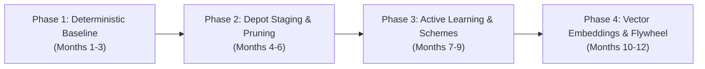

# Edge Data Triage & Golden Data Set (GDS) Architecture
## Remote Autonomous Haulage & Heavy Logistics (500 TB/Day Scaled Fleet)

---

## 1. Executive Summary & Problem Formulation

### 1.1 The Operational Challenge
Autonomous haulage operations in remote mining, quarries, and logistics transfer hubs generate massive quantities of high-fidelity perception data. A modern heavy autonomous truck equipped with multi-modal sensor arrays (high-resolution cameras, solid-state and mechanical LiDARs, 4D imaging radars, and high-frequency IMU/telemetry) generates approximately **3 TB to 5 TB of raw uncompressed data per 24-hour cycle**. 

At an initial scale of 10 trucks, a site produces **30–50 TB/day**. As fleet sizes scale to 50–100 trucks and next-generation sensor suites are introduced, site-level data generation quickly scales to **500 TB per 24 hours**.

```
+-----------------------------------------------------------------------------------+
|                              THE SCALING BOTTLENECK                               |
|                                                                                   |
|  100 Autonomous Trucks x 5 TB/day = 500 TB / day / site                           |
|  Standard Starlink Uplink Capacity = ~10-25 Mbps continuous (~100-250 GB/day)    |
|  Uplink Deficit: ~99.95% of generated raw data cannot leave the site over WAN    |
+-----------------------------------------------------------------------------------+
```

### 1.2 The Core Premise: 95%+ Redundancy
Haul trucks in open-pit mining and closed-circuit logistics operate on **repetitive, closed-loop paths** (e.g., Pit Face $\rightarrow$ Primary Crusher $\rightarrow$ Waste Dump). Driving the exact same 4-kilometer haul road under identical sunny conditions for the 80th time in a week yields zero incremental learning value for machine learning models. 

Streaming or uploading continuous raw sensor feeds produces:
1. **Network exhaustion:** Saturation of critical private 5G/LTE pit networks required for safety heartbeats and fleet dispatch (FMS).
2. **Astronomical storage & cloud egress costs:** Ingesting 15 PB/month into cloud object storage without curation creates unsustainable cloud bills.
3. **Data swamps:** Annotators and ML pipelines drown in identical, low-entropy nominal miles.

### 1.3 Objective
To transition from a **"Collect and Upload"** paradigm to an **"Intelligent Edge Triage"** architecture. By evaluating information density directly on the vehicle's edge compute and at local depot aggregation servers, the fleet identifies, extracts, and transmits only high-entropy, safety-critical, and novel scenarios—the **Golden Data Set (GDS)**—compressing 500 TB/day of raw logs into **<50 GB/day** of high-priority WAN uplink data and targeted on-demand physical offloads.

### 1.4 Financial Feasibility & Cloud Cost Model
Ingesting 500 TB/day uncurated into commercial hyperscaler object storage (AWS S3, GCP Cloud Storage) generates **15 Petabytes of new raw data monthly**:
* **Raw Storage Overhead:** At standard cloud object storage pricing of ~$0.023/GB/month, baseline storage alone costs **>$345,000 per month**, compounding continuously by over $4.1M annually without accounting for multi-region replication, API requests, compute cycles, and network egress.
* **Annotation Bottleneck:** Human labeling of multi-sensor 3D point clouds, 4D radar tracks, and multi-view video streams costs between **$3 and $8 per synchronized frame**. Attempting to annotate even 1% of raw uncurated footage would quickly exhaust annual autonomy R&D budgets.
* **Curated ROI:** By pruning data at the vehicle edge to 5–10 TB/day and executing depot-level coreset reduction algorithms to extract **20 GB to 50 GB per day** of high-entropy snippets, recurring cloud storage expenses drop to **<$1,100 per month (>99.7% reduction)**. Capital expenditure is efficiently redirected into ruggedized in-cab compute and on-site depot infrastructure, amortized over 5+ years of continuous mine production.

---

## 2. Defining the Golden Data Set (GDS) for Heavy Industry

In autonomous mining and heavy transport, data qualifies for the Golden Data Set if and only if it fulfills at least one of four core objectives:

```
                                  GOLDEN DATA SET (GDS)
                                            │
        ┌───────────────────┬───────────────┴───────────────┬───────────────────┐
        ▼                   ▼                               ▼                   ▼
 [Model Failure &     [High Entropy &               [Safety Incidents &  [Stratified ODD
    Uncertainty]         Novelty]                      Near-Misses]          Baselines]
  • High epistemic     • Unseen mining equipment     • Remote takeovers   • 0.1% nominal
    variance           • Severe blast dust plumes    • E-Stops & AEB        sampling
  • Detector jitter    • Extreme weather / mud       • Spilled rock berm  • Continuous
  • Sensor cross-      • Low-angle pit wall glare      near-strikes         regression
    disagreement                                                            anchors
```

1. **Failure & Uncertainty Manifestation:** Scenarios where perception classifiers, occupancy grids, or path planners exhibited high ambiguity, low confidence, bounding-box flickering, or ensemble divergence.
2. **High Domain Entropy (Outliers & Novelty):** Visual, geometric, or radar features that diverge significantly from the existing training baseline (e.g., novel contractor vehicles, rare water-truck spray patterns, extreme sun glare off wet quarry rock, deep pit fog).
3. **Safety-Critical & Control Violations:** Hard decelerations, emergency stops (E-Stops), human/remote operator overrides, traction control events, and proximity alerts with light vehicles or personnel.
4. **Stratified Operational Design Domain (ODD) Anchors:** A tiny, scientifically balanced slice of nominal driving across every permutation of operational variables (lighting, precipitation, payload mass, road grade) to prevent catastrophic forgetting and maintain regression testing suites.

---

## 3. Industry Benchmarks & Structural Precedents

Autonomous vehicle operations across industrial mining, commercial long-haul trucking, passenger transport, and urban robotaxis operate against fundamentally different operational constraints:

| Architectural Dimension | Remote Mining Haulage (This Architecture) | Heavy Mining OEMs (Caterpillar / Komatsu) | Autonomous Trucking (Kodiak Robotics) | Mass Passenger AVs (Tesla Data Engine) | Urban Robotaxis (Waymo Driver) |
| :--- | :--- | :--- | :--- | :--- | :--- |
| **Operational Design Domain** | Deep open-pit benches, crushers, dumps, private haul roads. | Structured mining benches, waste dumps, crusher ramps. | Long-haul interstate highways and private energy corridors. | Global consumer roadways, mixed urban and highway. | Dense urban cores, complex intersections, arterials. |
| **Cloud Uplink Ingest Ratio** | **<0.01%** uploaded over WAN (<50 GB/day from 500 TB). | **<0.005%** over wireless; strictly critical telemetry and fault codes. | **<0.05%** continuous; critical safety events and target scenarios. | **<0.1%**; micro-classifier triggers and shadow mode clips. | **~0.5%–2.0%**; localized depot fiber offloads with cloud active curation. |
| **Directed Triage Mechanics** | Kinematic bounds, epistemic entropy, vector novelty, dynamic schemes, ODD anchors. | Deterministic fault codes, geofence breaches, payload limits, obstacle stops. | Kinematic exceptions, planner-perceiver deltas, remote ops intervention. | Fleet-wide micro-classifiers, shadow mode path divergence, disengagements. | Causal event logs, planner uncertainty metrics, regression triggers. |
| **Edge Compute Footprint** | Multi-modal perception compute, NPU embedding extractor, U.2/U.3 NVMe SSDs. | Industrial embedded controllers, telemetry gateway, circular crash logger. | Rugged dual-stack commercial vehicle compute, local high-speed NVMe. | In-house dual FSD System-on-Chip (SoC) executing primary and shadow heads. | Automotive-grade custom computing cluster with redundant multi-sensor units. |
| **Depot Edge Responsibilities** | 250 TB NAS, automated optical docking, coreset deduplication, vector re-indexing. | Telemetry offload, scheduled maintenance diagnostics, raw crash archive dumps. | Terminal-based high-speed offload, automated safety inspection diagnostics. | Minimal depot processing; consumer Wi-Fi uploads directly to central clusters. | Extensive depot network infrastructure, complete raw shift ingest, autocalibration. |
| **Simulation Integration** | Closed-loop export to ASAM OpenSCENARIO, synthetic near-miss variations. | Fleet management replays, route optimization, mine digital twins. | Daily simulation operations, virtual incident replay, parameter variations. | Purely data-driven neural network weight retraining, autolabeling loops. | High-fidelity multi-sensor simulation pipelines (e.g., Carcraft, world models). |

### Structural Key Takeaway
* **Industrial Mining OEMs (Caterpillar MineStar, Komatsu FrontRunner):** Enforce absolute QoS prioritization. Safety heartbeats and dispatch commands occupy 100% priority on private LTE/5G; raw perception streaming over WAN is strictly prohibited.
* **Commercial Autonomous Trucking (Kodiak Robotics):** Employs selective logging of kinematic and perceptual anomalies to parameterize daily simulation scenarios in ASAM OpenSCENARIO.
* **Urban Robotaxis (Waymo):** Can rely on dedicated fiber networks at urban maintenance depots to ingest terabytes per vehicle at each shift return.
* **Remote Heavy Logistics Requirement:** Because remote mine sites lack urban fiber depots and pervasive WAN backhauls, the architecture must synthesize **mining QoS network isolation** with **onboard edge triage** and **automated high-throughput physical depot docking**.

---

## 4. The 5-Layer Edge Data Value Triage Mechanics

To determine value at runtime, the truck’s on-vehicle edge compute continuously runs five complementary triage filters:

```
[Continuous Raw Sensor Streams (LiDAR, Cameras, Radar, IMU, CAN)]
                                │
                                ▼
 ┌─────────────────────────────────────────────────────────────────────────────┐
 │                         ON-VEHICLE EDGE TRIAGE ENGINE                       │
 ├─────────────────────────────────────────────────────────────────────────────┤
 │ [Filter 1] Deterministic Hard Triggers (E-stops, Slip, Sensor Occlusion)    │
 │ [Filter 2] Active Learning & Uncertainty Scoring (Entropy > Threshold)     │
 │ [Filter 3] Feature Vector Embeddings (Novelty & Cosine Distance)            │
 │ [Filter 4] Targeted Harvesting Campaigns (Dynamic OTA Rules)                │
 │ [Filter 5] Stratified ODD Baseline Sampler (0.1% Uniform Slice)             │
 └─────────────────────────────────────────────────────────────────────────────┘
                                │
             Candidate Snippet Flagged? (Yes/No)
                                │
         ┌──────────────────────┴──────────────────────┐
         ▼ NO                                          ▼ YES
   [Discard / Ring Buffer               [Capture Temporal Window:
    Overwritten]                         T-20s to T+10s]
                                                       │
                                        [Apply Frustum & Channel Pruning]
                                                       │
                                        [Store to Onboard U.2 NVMe Staging]
```

### 4.1 Filter 1: Deterministic & Kinematic Triggers
Hard-coded rules operating directly off vehicle kinematics, safety controllers, and hardware diagnostic buses:
* **Human Interventions:** Remote teleoperation takeovers, safety supervisor disengagements, or manual in-cab overrides.
* **Control Boundary Violations:** Autonomous Emergency Braking (AEB) events, lateral accelerations exceeding $0.3g$, uncommanded roll/pitch deviations on compromised haul-road berms, and severe wheel-slip events.
* **Hardware & Perception Faults:** Sensor degradation alerts (camera lens mud splatter, LiDAR reflectivity attenuation from thick dust, radar radome blockage, GNSS RTK lock dropouts).
* **Proximity & Safety Envelope Breaches:** Time-To-Collision (TTC) $< 3.0\text{s}$ relative to auxiliary equipment, light vehicles (pickups), or workers.

### 4.2 Filter 2: Active Learning & Model Uncertainty
Edge perception and prediction models calculate real-time confidence scores and information entropy:
* **Epistemic Uncertainty:** Low confidence scores ($< 0.65$) on detected bounding boxes, or high Shannon entropy in semantic segmentation heads (e.g., distinguishing between a harmless dust cloud and a solid boulder).
* **Sensor & Ensemble Disagreements:** Divergence between parallel heads (e.g., primary LiDAR detector identifies an obstacle at 45m, but the vision foundation model identifies clear road; or tracker bounding-box variance exceeds tolerance over 5 consecutive frames).
* **Planner Trajectory Surprises:** Significant delta between the trajectory the planner intended to execute and sudden emergency avoidance paths.

### 4.3 Filter 3: Latent Space Vector Embeddings & Novelty Detection
Raw point clouds and imagery cannot be compared across the fleet, but lightweight latent vectors can:
* A lightweight vision-backbone encoder (e.g., MobileNetV4 or DINO-based feature extractor running at 1–2 Hz) compresses multi-camera views into a 128-D or 256-D metric vector.
* The vector is compared against an onboard **k-NN index of baseline operational scenes** powered by **USearch (Unum)**, an embedded, header-only C++11 HNSW vector engine optimized for SIMD and ARM NEON hardware acceleration on vehicle NPUs.
* If the cosine distance $d(\mathbf{v}_{\text{scene}}, \mathbf{V}_{\text{baseline}}) > \tau_{\text{novelty}}$, the clip is tagged as an out-of-distribution environmental anomaly (e.g., rare whiteout blizzard, heavy mud rooster-tails, atypical rock wall geological formations).

#### Vector Space Drift Mitigation under Over-the-Air (OTA) Model Updates
When autonomy engineering deploys an upgraded vision backbone model via an OTA push (e.g., from model hash `a8f90c4e12` to `b9e01d5f34`), the latent manifold shifts from $\mathcal{M}_{\text{old}}$ to $\mathcal{M}_{\text{new}}$. Evaluating query vectors generated by the new backbone against an older onboard k-NN baseline causes representation collapse, triggering either persistent false-positive collection avalanches or dangerous blind spots. 

The architecture enforces a three-stage mathematical mitigation protocol:

```
[On-Vehicle Perception Runtime]
Incoming Video Frame (x) ──► Perception Backbone [φ_new] ──► Raw Latent Vector (v_new)
                                                                     │
                                                                     ▼
                                                        Query Drift Compensation:
                                                        v_comp = v_new - Δ_{old->new}
                                                                     │
                                                                     ▼
                                                        k-NN Novelty Evaluation (USearch):
                                                        d(v_comp, V_baseline) > τ_novelty
                                                                     │
                                                                     ▼
                                                        [Trigger Candidate Snippet]
```

1. **Backward-Compatible Training (BCT):** When training an upgraded vision encoder $\phi_{\text{new}}$, the cloud training loss function couples task objectives with an orthogonal backward-compatibility constraint:
   $$\mathcal{L}_{\text{BCT}} = \mathcal{L}_{\text{task}} + \lambda \left\| R \phi_{\text{new}}(x) - \phi_{\text{old}}(x) \right\|_2^2 \quad \text{subject to } R^T R = I$$
   Applying an orthogonal transformation matrix $R$ preserves the global geometric manifold of the legacy baseline while allowing the new model to learn novel features.
2. **Zero-Shot Query Drift Compensation (QDC):** Prior to fleet-wide OTA rollout, a small calibration dataset of $N$ operational mining scenes is passed through both legacy and upgraded encoders to compute a global translation offset:
   $$\Delta_{\text{old}\to\text{new}} = \frac{1}{N} \sum_{i=1}^N \left( \phi_{\text{new}}(x_i) - \phi_{\text{old}}(x_i) \right)$$
   This offset is bundled directly in the OTA deployment payload. On the truck, incoming query vectors are compensated at runtime: $\mathbf{v}_{\text{comp}} = \mathbf{v}_{\text{new}} - \Delta_{\text{old}\to\text{new}}$, suppressing artificial novelty spikes caused by coordinate translation.
3. **Depot-Side Forward-Compatible Transformation (FCT) & Batch Re-Indexing:** The Depot Edge NAS maintains the historical baseline gallery. When an OTA update is deployed, an asynchronous background job re-embeds the local baseline dataset using a trained transformation module, compiling an updated native $\mathcal{M}_{\text{new}}$ k-NN index that is synchronized to the haul truck during its next physical docking stop.

### 4.4 Filter 4: Targeted Harvesting Campaigns (OTA Dynamic Schemes)
Autonomous engineering teams frequently train models for specific operational issues. Configurable logging schemes are pushed to specific trucks or sectors without software redeployments:
* *Campaign Example:* "Harvest 15 seconds of raw uncompressed LiDAR + forward cameras whenever a truck enters Pit Sector 7 during haul road watering operations."
* *Trigger Configuration:* Geofence polygon + CAN water-truck proximity flag + local wind speed sensor threshold.

### 4.5 Filter 5: Stratified ODD Baseline Sampler
To prevent the GDS from suffering from severe anomaly bias (which creates false positives during retraining), a background sampler collects a uniform, randomized 0.1% to 0.5% slice of nominal driving:
* Binned across: `[Shift: Day/Night] x [Weather: Clear/Rain/Dust] x [Payload: Empty/Loaded] x [Route Segment: Ramp/Dump/Crusher]`.
* Provides continuous anchor data for regression testing and nominal safety verification.

---

## 5. Multi-Tier Transport & Infrastructure Topology

Data offloading follows a strict hierarchy designed around the real physical bandwidth limitations of remote open-pit and industrial sites:

```
+─────────────────────────────────────────────────────────────────────────────────+
|                          HARDENED DATA FLOW TOPOLOGY                            |
+─────────────────────────────────────────────────────────────────────────────────+

  [ Autonomous Haul Truck ]
     │  (Continuous Ring Buffering: 3 TB/day)
     │
     ├─► [Tier 1: Continuous WAN] ──► Starlink / Private 5G (Low Bandwidth)
     │     Payload: JSON Telemetry Index, Trigger Logs, Downsampled Thumbnails
     │     Bandwidth: ~10-50 kbps/truck  │  Volume: ~100-200 MB/truck/day
     │     Target: Cloud Fleet Management & GDS Metadata Index
     │
     └─► (Enters Maintenance / Fueling Depot Island: 15–20 min Stop)
           │
           ├──► [Tier 2A: Primary Physical Dock] ──► Rugged Optical / Auto-Magnetic Dock
           │      Physical Rate: 5 - 10 Gbps (50 GB offloaded in <80 seconds)
           │      Resistant to dust attenuation and heavy machinery RF multipath
           │
           └──► [Tier 2B: Wireless Fallback] ──► Industrial Wi-Fi 6 / 60 GHz mmWave
                  Sustained Rate: 150 - 300 Mbps in dusty pit environments
                  Managed by Dynamic Offload Prioritization Engine
                  │
                  ▼
         [Site Depot Edge Server & Staging NAS (250 TB)]
           │
           ├─► [Selective Cloud Uplink] (Overnight WAN)
           │     Surgically requested GDS raw blobs (<50 GB/day)
           │
           └─► [Tier 3: Sneakernet / Physical Transit]
                 Payload: Cold rolling raw archives, dense sensor bags
                 Hardware: Swappable Rugged NVMe Shuttles (e.g. AWS Snowball)
                 Frequency: Bi-weekly / Monthly physical shipment
+─────────────────────────────────────────────────────────────────────────────────+
```

### 5.1 Dual-Mode Depot Offload Interface & Throughput Sizing
In active mining environments, RF wireless offloads suffer from dust attenuation, multipath reflection off massive haulers, and concurrent channel contention, dropping real-world Wi-Fi 6 throughput to **150–300 Mbps**. At 200 Mbps, offloading 50 GB exceeds 33 minutes, overflowing vehicle storage. 

To eliminate this bottleneck, the offload topology uses a **hybrid dual-interface**:
1. **Primary Physical Dock (5–10 Gbps):** Automated robotic coupling interface integrated into stationary fueling and maintenance islands (utilizing standard **SAE J3105/3 form factors**, such as **Stäubli QCC-5000 series or Cavotec automated systems**). 
   * **Dust Mitigation:** The mating arm incorporates an automated **high-pressure compressed air purge nozzle** that blasts the vehicle's protective optical shutter clean immediately before physical mating.
   * **Throughput:** An integrated 10GBASE-SR / 25GBASE-SR multi-mode optical line offloads a standard 50 GB candidate payload in under **45–80 seconds**, completing comfortably within the 15-minute scheduled fueling dwell.
2. **Line-of-Sight Optical Wireless (Virtual Fiber Optics / VFO):** Where mechanical docking is unfeasible, directed Free-Space Optical transceivers (e.g., In A Blink VFO) provide 2.5 to 10 Gbps line-of-sight wireless optical transfer over 10 to 50 meters, immune to RF spectrum saturation and metal multipath interference.
3. **Wireless Fallback (Industrial Wi-Fi 6 / mmWave):** Engaged at auxiliary parking bays or mobile service trucks.
4. **Dynamic Offload Prioritization Engine:** When operating over constrained wireless links ($<300\text{ Mbps}$), the vehicle's edge agent automatically sheds lower-priority queues:
   * **Priority 1 (Mandatory):** Filter 1 (Deterministic/E-Stops/Interventions) and Filter 2 (High Uncertainty).
   * **Priority 2 (Deferred):** Filter 4 (Targeted Campaigns).
   * **Priority 3 (Suppressed):** Filter 5 (Nominal Stratified Baselines) are dropped from queues to preserve buffer headroom.

### 5.2 Tier Sizing & Quantitative Reduction Funnel
For a scaled site producing **500 TB/day** across the fleet:

| Tier | Transmission Medium | Daily Data Volume | Latency / Availability | Purpose |
| :--- | :--- | :--- | :--- | :--- |
| **Tier 1: Immediate Telemetry** | Private 5G / Starlink Satellite | **~10–20 GB / day** (fleet total) | Real-time (<500ms) | Fleet safety alerts, disengagement coordinates, and JSON metadata catalog. |
| **Tier 2: Depot Edge Ingestion** | Hybrid: 10 Gbps Optical Dock + VFO / Wi-Fi 6 | **~5–10 TB / day** (fleet total) | Hourly / Shift-change | Ingestion of all candidate snippets, campaign bags, and sensor health logs. |
| **Tier 3: Cloud GDS Ingestion** | Cloud-directed pull over night-time WAN / Sat | **~20–50 GB / day** (fleet total) | 12–24 hours | Highest-priority GDS snippets, auto-labeled training cases, edge-case anchors. |
| **Tier 4: Physical Archive (Sneakernet)** | Rugged U.2/U.3 NVMe storage shuttles | **20–50 TB / batch** (on demand) | 7–14 days transit | Forensic incident investigations, baseline sensor re-simulation, regulatory audits. |

### 5.3 Hybrid Transport Middleware Architecture: Resolving the DDS Wireless Dilemma
A major operational failure mode in distributed vehicle-to-depot robotics is relying on standard Data Distribution Service (DDS) protocols across wireless boundaries:
* **The Problem:** eProsima Fast DDS and CycloneDDS provide nanosecond-level shared-memory IPC on-vehicle, but rely on continuous multicast Simple Participant Discovery Protocol (SPDP) broadcasts. When haul trucks enter intermittent wireless zones around depot bays, DDS discovery initiates packet storms, saturating wireless bandwidth, exhausting CPU cycles, and dropping telemetry.
* **The Architecture:** The system decouples internal vehicle IPC from external fleet transport:

```
[On-Vehicle Sensor & Autonomy Bus]
Cameras, LiDARs, Radars, Planners, Safety Nodes
                   │
                   ▼ (Low-Latency Shared Memory / RTPS)
          [eProsima Fast DDS]
                   │
                   ▼ (Localhost Domain 0 Only)
         [zenoh-bridge-dds Plugin]
                   │
═══════════════════╪═════════════════════════════════════════════
[Vehicle-to-Depot Network: Optical Dock / Wi-Fi 6]
                   │
                   ▼ (Eclipse Zenoh over TCP/QUIC with Gossip Discovery)
            [Depot zenohd Router]
                   │
═══════════════════╪═════════════════════════════════════════════
[Site Depot Staging Infrastructure]
                   │
                   ▼
     [Depot Edge NAS Ingestion Pipeline]
```

* **Eclipse Zenoh** bridges the vehicle to the depot server. By replacing multicast discovery with set-theoretic resource keys and gossip-based scouting, Zenoh maintains deterministic, low-overhead data transport over lossy or intermittent wireless channels without network flooding.

---

## 6. Data Representation & Reduction Strategies

Before any triggered event is finalized for storage or transmission, three reduction passes are executed to minimize storage and bandwidth footprints.

### 6.1 Temporal Ring Buffering
Every truck maintains a circular rolling buffer in high-speed RAM and local NVMe storage:
* **Duration:** 45 seconds total ($T - 30\text{s}$ pre-trigger, $T + 15\text{s}$ post-trigger).
* **Rationale:** A disengagement or emergency stop is the *consequence* of an error that manifested 10–20 seconds earlier (e.g., an unmapped rock or misclassified berm). The pre-event buffer captures the root cause; the post-event buffer captures the vehicle's dynamic response.

### 6.2 Spatial Frustum & Channel Pruning
When an anomaly triggers a recording, the system strips irrelevant data streams:

```
[Trigger Fired: Front Obstacle Classification Uncertainty at Azimuth +15°]
                                │
        ┌───────────────────────┴───────────────────────┐
        ▼ KEEP (High Resolution)                        ▼ DROP or HEAVILY COMPRESS
  • Front-Center 8MP Camera (Full Frame)          • Rear Perimeter Cameras (Dropped)
  • Primary Forward 128-Beam LiDAR                • Cabin Driver-Facing Camera (Dropped)
  • Forward 4D Imaging Radar                      • Blind-spot Side Radars (Dropped)
  • High-rate IMU & Steer/Brake CAN               • Surrounding non-relevant channels
```

* **Bandwidth Savings:** Eliminating unnecessary camera and sensor angles reduces individual snippet size by **70% to 85%**.

### 6.3 Decimation & Perceptual Compression
* **Frame Decimation:** For slow-moving haul trucks (typical pit speeds: 15–35 km/h), camera feeds are decimated from 30 FPS down to 10 FPS without loss of spatial training utility for perception models.
* **LiDAR Quantization:** Point clouds outside the operational envelope (e.g., points $>100\text{m}$ or high sky points) are cropped; spatial coordinates are converted from 32-bit floats to 16-bit fixed-point representations.

---

## 7. Metadata Schema Specification (gds_metadata_v2.json)

The metadata-first approach relies on a standardized, low-overhead JSON record generated for every candidate snippet. Central cloud systems query these metadata records to select specific raw blobs for WAN upload without moving heavy sensor bags.

```json
{
  "$schema": "https://specs.autonomy-mining.org/v2/gds-metadata.json",
  "snippet_id": "SNIP-20261002-TRK042-00941",
  "truck_id": "HAUL-TRUCK-042",
  "site_id": "MINE-PILBARA-WEST",
  "timestamp_utc_start": "2026-10-02T08:12:10.000000Z",
  "timestamp_utc_trigger": "2026-10-02T08:12:40.000000Z",
  "timestamp_utc_end": "2026-10-02T08:12:55.000000Z",
  "software_manifest": {
    "autonomy_stack_version": "v4.14.0-prod",
    "active_perception_hash": "b9e01d5f348a",
    "previous_perception_hash": "a8f90c4e127f",
    "vector_space_version": "v3.2",
    "active_harvesting_campaigns": ["CAMP-2026-BERM-DETECTION"]
  },
  "clock_synchronization_telemetry": {
    "ptp_profile": "IEEE_1588_PTPV2_BOUNDARY",
    "master_oscillator_type": "MICROCHIP_SA45S_CSAC",
    "gnss_rtk_lock_state": "DENIED",
    "gnss_outage_duration_seconds": 14280.5,
    "integrated_phase_drift_microseconds": 0.412,
    "holdover_status": "WITHIN_SUB_MICROSECOND_SPEC",
    "spatial_registration_uncertainty_mm": 0.041
  },
  "operational_context": {
    "bench_level_elevation_m": -184.2,
    "pit_sector_geofence": "SECTOR-09-DEEP-SLOPE",
    "payload_metric_tons": 248.6,
    "speed_kmh": 26.8,
    "road_grade_percent": -8.4,
    "dust_density_attenuation_db": 4.2
  },
  "triage_triggers": [
    {
      "trigger_tier": "FILTER_1_DETERMINISTIC",
      "source_subsystem": "chassis.traction_controller",
      "metric_name": "wheel_slip_ratio",
      "threshold": 0.15,
      "measured_value": 0.28,
      "action_taken": "TORQUE_DERATE"
    },
    {
      "trigger_tier": "FILTER_3_VECTOR_NOVELTY",
      "source_subsystem": "perception.vision_encoder",
      "metric_name": "cosine_distance_compensated",
      "threshold": 0.72,
      "measured_value": 0.89,
      "drift_compensation_applied": true
    }
  ],
  "embedding_payload": {
    "dimensions": 128,
    "model_backbone_hash": "b9e01d5f348a",
    "drift_compensation_vector_norm": 0.0241,
    "vector_data": [0.0381, -0.1422, 0.8912, 0.0054, -0.0612]
  },
  "offload_lifecycle": {
    "offload_interface_used": "PHYSICAL_OPTICAL_DOCK_10G",
    "transfer_duration_seconds": 38.4,
    "channel_pruning_mask": [
      "cam_front_center_8mp",
      "lidar_128_beam_main",
      "radar_4d_imaging_front",
      "vehicle_telemetry_bus"
    ],
    "storage_capacity_at_offload_percent": 68.2,
    "depot_storage_uri": "mcap://nas01.depot/staging/20261002/SNIP-20261002-TRK042-00941.mcap"
  }
}
```

---

## 8. Site Infrastructure, Hardware Hardening & Storage Lifecycle

Deploying a 500 TB/day triage pipeline requires balancing edge compute endurance, clock holdover during GNSS denial, depot staging buffers, and automated lifecycle eviction.

```
                          DEPOT STAGING SERVER (250 TB NAS)
                     ┌────────────────────────────────────────┐
                     │ Rolling Window: 14-Day Candidate Buffer │
                     └───────────────────┬────────────────────┘
                                         │
             ┌───────────────────────────┴───────────────────────────┐
             ▼ (Requested by Cloud)                                  ▼ (Not Requested)
     [Upload to Cloud GDS]                                  [Evicted after 14 Days]
  (Surgically pulled via WAN)                             (Overwritten by new shifts)
```

### 8.1 On-Truck Storage Endurance, Hardware PLP & Thermal Contention
Continuous circular ring buffering at 3–5 TB/day per vehicle imposes a sustained write throughput of **35–60 MB/s** (24/7/365), with transient write bursts reaching **450 MB/s** when flushing high-priority multi-camera buffers to disk. In unconditioned in-cab electronics bays where ambient temperatures reach **45°C–50°C**, high sustained IOPS combined with GPU/NPU active learning execution risks severe thermal throttling.

* **Drive Endurance Specification:** Mandate enterprise-grade U.2/U.3 NVMe SSDs rated for **$\ge 3$ Drive Writes Per Day (DWPD)** over a 5-year operating warranty (e.g., **Micron 7450 MAX or Solidigm D7-P5810**). A 15.36 TB drive at 3 DWPD provides **>84 Petabytes Written (PBW)** of endurance. Standard consumer or datacenter SSDs (<1 DWPD) will exhaust their Program/Erase (P/E) cycles within 12–18 months.
* **Level-4 Hardware Power-Loss Protection (PLP):** Heavy industrial trucks experience harsh electrical environments, emergency master-switch trips, and battery voltage transients. On-vehicle SSDs must incorporate discrete onboard **tantalum capacitor arrays** to provide sufficient hold-up power during abrupt power cuts, ensuring in-flight DRAM write caches and Flash Translation Layer (FTL) mapping tables are safely flushed to non-volatile NAND.
* **Thermal & Bus Isolation:** 
  * Storage drives and compute accelerators are mounted in conduction-cooled, sealed IP67 enclosures thermally coupled to the vehicle's structural chassis, maintaining controller junction temperatures below 65°C.
  * Direct Memory Access (DMA) and storage write queues are isolated on dedicated PCIe Gen4 x4 lanes separate from the safety-critical autonomy and path-planning buses.

### 8.2 Hardware-Backed PTP Holdover Circuitry (GNSS Outage Protection)
Deep open-pit benches frequently experience complete GNSS RTK dropouts, carrier-phase cycle slips, and satellite constellation shadowing from highwalls. If the vehicle relies solely on GNSS-derived 1PPS clock signals, loss of lock causes rapid phase drift across the sensor suite. At 36 km/h (10.0 m/s), a timing desynchronization of just **10 milliseconds** between an 8MP camera exposure and a 10 Hz LiDAR sweep produces a **10-centimeter spatial registration error**, causing bounding-box jitter, distorting 3D occupancy grids, and corrupting 4D auto-labeling reconstructions.

To maintain sub-millimeter multi-modal sensor alignment, timing drift must remain strictly below **$1.0\,\mu\text{s}$ over a continuous 24-hour GNSS denial window**:

| Timing Reference Technology | Frequency Stability ($\sigma_y$ at $\tau=1000\text{s}$) | Typical Daily Frequency Drift | Maximum Time Error after 24h Outage | Sub-Microsecond Holdover Duration | Operational Viability in Deep Pits |
| :--- | :--- | :--- | :--- | :--- | :--- |
| **Standard Quartz TCXO** | $\sim 1 \times 10^{-8}$ | $\sim 1 \times 10^{-7}$ / day | $\sim 5.0\text{ ms}$ | < 30 seconds | **Unacceptable:** Causes severe spatial registration errors within minutes. |
| **Stratum 3E Quartz OCXO** | $\sim 1 \times 10^{-10}$ | $\sim 1 \times 10^{-9}$ / day | $\sim 10\text{ to } 50\,\mu\text{s}$ | ~ 2 to 4 hours | **Marginal:** Requires recurring surface fixes between pit haulage cycles. |
| **Ruggedized MEMS Super-TCXO (SiTime SiT7111)** | $\sim 5 \times 10^{-11}$ | $\sim 5 \times 10^{-10}$ / day | $\sim 5\text{ to } 10\,\mu\text{s}$ | ~ 16 to 24 hours | **High:** Superior resistance to heavy vehicle shock, vibration, and thermal transients. |
| **Chip-Scale Atomic Clock (Microchip SA.45s / SA.65)** | **$< 1.5 \times 10^{-11}$** | **$< 3 \times 10^{-10}$ / month** | **$< 0.8\,\mu\text{s}$ over 24h** | **> 24 to 48 hours** | **Mission-Critical:** Guarantees sub-microsecond IEEE 1588 PTP alignment throughout continuous deep-bench operations. |

* **Hardware Implementation:** The primary on-vehicle network switch incorporates an integrated **Microchip SA.45s Chip-Scale Atomic Clock (CSAC)**. Consuming under 120 mW and occupying less than 17 cm³, the CSAC's coherent population trapping (CPT) rubidium physics package maintains clock drift $<0.8\,\mu\text{s}$ over 24 hours of total GNSS denial, constraining spatial registration error below 0.01 mm at haul speeds.

### 8.3 Graceful Storage Degradation Policy (Queue-Overflow Management)
If a haul truck is delayed in returning to the fueling depot or experiences temporary docking offload failures, onboard NVMe storage will reach capacity. To prevent buffer overflows or uncommanded dropped frames, the vehicle edge agent enforces a strict **Priority-Based Dynamic Pruning Sequence**:

```
[Onboard Storage Capacity > 80%]
           │
           ├─► Threshold 1 (>80%): Purge Nominal Stratified Baseline Samples (Filter 5)
           │                       (Discard redundant nominal anchors; non-critical)
           │
           ├─► Threshold 2 (>85%): Quantize LiDAR Point Clouds on Candidate Snippets
           │                       (Crop points >50m, quantize 32-bit floats to 16-bit fixed-point)
           │
           ├─► Threshold 3 (>90%): Drop Secondary / Perimeter Camera Views
           │                       (Prune frustums to forward-facing 8MP camera only; saves 75%)
           │
           └─► Threshold 4 (>95%): Lock Safety-Critical & E-Stop Snippets (Filter 1 - Immutable)
                                   (Drop un-indexed Filter 2 uncertainty clips to protect buffer)
```

#### Storage Eviction Configuration (`storage_eviction_policy.yaml`)
```yaml
storage_eviction_manager:
  monitored_mount: "/mnt/nvme_staging"
  polling_interval_seconds: 5
  thresholds:
    nominal_baseline_drop:
      trigger_capacity_percent: 80.0
      action: "PURGE_FILTER_5_ODD_SAMPLES"
      log_level: "INFO"
    pointcloud_quantization:
      trigger_capacity_percent: 85.0
      action: "QUANTIZE_LIDAR_16BIT_CROP_50M"
      log_level: "WARNING"
    frustum_pruning:
      trigger_capacity_percent: 90.0
      action: "DROP_SECONDARY_CAMERA_CHANNELS"
      retained_channels: ["cam_front_center_8mp", "lidar_main", "can_raw"]
      log_level: "WARNING"
    emergency_lockout:
      trigger_capacity_percent: 95.0
      action: "PRESERVE_FILTER_1_ONLY_DROP_UNINDEXED"
      log_level: "CRITICAL"
```

### 8.4 Depot Staging Server (On-Site Edge NAS)
* **Capacity:** 250 TB to 500 TB ruggedized All-Flash or Tiered NVMe/SAS NAS located at the mine's main equipment maintenance shop / fueling island.
* **Ingestion Interconnects:** Dual 10GbE / 25GbE optical interfaces dedicated to the fueling island docking transceivers + redundant outdoor Wi-Fi 6 APs.
* **Automated Retention Lifecycle:**
  * **Day 0–3:** Full uncompressed candidate snippets preserved in high-speed flash tier.
  * **Day 4–7:** If not requested for cloud pull, downsample point clouds and compress imagery by 50% into spinning-disk tier.
  * **Day 14:** Hard eviction of unrequested candidate snippets.
* **Depot Vector Re-Indexing Daemon:** Runs background batch embedding jobs across the local baseline dataset whenever an OTA update introduces a new vision backbone model hash.

### 8.5 Vehicle-to-Depot Middleware Configuration (`zenoh_bridge_config.json5`)
```json5
{
  plugins: {
    dds: {
      domain: 0,
      localhost_only: true,
      allow: {
        publishers: [
          "/triage/candidate_metadata",
          "/chassis/critical_kinematics",
          "/sensors/diagnostics"
        ],
        subscribers: [
          "/fleetwise/dynamic_schemes",
          "/depot/vector_gallery_update"
        ]
      }
    }
  },
  transport: {
    unicast: {
      endpoints: ["tcp/10.240.12.1:7447"],
      multicast_scouting: false
    },
    link_loss_action: "BUFFER_IN_LOCAL_RING"
  }
}
```

---

## 9. Ground Truth Annotation & Auto-Labeling Strategy

Data added to the Golden Data Set is only useful if it can be labeled accurately. Mining operations feature specialized machinery and terrain not present in standard automotive foundation models.

```
[Curated GDS Candidate Snippet]
               │
               ▼
 ┌────────────────────────────────────────────────────────────────────────┐
 │                   SITE / CLOUD 4D AUTO-LABELING PIPELINE               │
 ├────────────────────────────────────────────────────────────────────────┤
 │ 1. Multi-Pass Offline World Model (Runs heavy non-causal Transformers) │
 │ 2. NeRF / 3D Gaussian Splatting for Static Haul Road Geometry          │
 │ 3. Dynamic Object Bounding (Excavators, Light Vehicles, Drill Rigs)    │
 │ 4. Confidence Evaluation on Generated Labels                           │
 └────────────────────────────────────────────────────────────────────────┘
               │
     Auto-Label Confidence High?
               │
       ┌───────┴───────┐
       ▼ YES           ▼ NO
 [Approved for GDS]   [Human-in-the-Loop Expert Annotation]
```

1. **Heavy Offline 4D Auto-Labeling:** Unlike on-vehicle models which must run under 20ms causal constraints, site and cloud servers run heavy, multi-frame bidirectional (non-causal) foundation models that look forward and backward across the clip to generate 3D bounding boxes and tracklets.
2. **Mining-Specific Semantic Ontology:** The annotation schema explicitly incorporates industrial classes:
   * Heavy haulers, bucket excavators, front-end wheel loaders, water trucks, service pickups.
   * Static infrastructure: Safety berms (with height estimation), high-voltage dragline cables, blast cones, oversize rock obstacles ($>30\text{cm}$).
3. **Targeted Human-in-the-Loop:** Only auto-labeled samples with spatial label ambiguity $< 0.85$ are routed to human annotators, reducing manual labeling costs by up to 90%.

---

## 10. Commercial Product Landscape & Vendor Evaluation

Rather than engineering every tier from scratch, several off-the-shelf and enterprise tools provide production-tested components across the data lifecycle. The commercial market is segmented into four distinct layers:

```
[ In-Vehicle Edge ]         [ Depot Staging & Pruning ]      [ Cloud / Central GDS ]
  Edge Filtering &              Smart Sampling &               Active Learning &
  Ring Buffering                Coreset Selection              Ground-Truth Labeling
        │                               │                                │
 ┌──────────────┐               ┌──────────────┐                 ┌──────────────┐
 │AWS FleetWise │               │  Akridata    │                 │   Kognic     │
 │Sonatus       │ ──(Wi-Fi 6)─► │  Voxel51     │ ──(Sat/Sneak)─► │  Scale AI    │
 │Foxglove MCAP │               │  FiftyOne    │                 │  Applied     │
 └──────────────┘               └──────────────┘                 │  Intuition   │
                                                                 └──────────────┘
```

### 10.1 Evaluation: Kognic (AD/ADAS Annotation & Active Learning)
* **Market Position:** Kognic (formerly Annotell) is an industry-leading platform specifically built for the AD/ADAS and robotics data flywheel, trusted by automotive Tier-1s and OEMs (Continental, Qualcomm, Zenseact/Volvo).
* **Core Capabilities:**
  * **Multi-Sensor 4D Fusion:** Natively aligns 3D LiDAR point clouds, 4D imaging radars, and multi-camera visual feeds in a synchronized spatio-temporal coordinate space.
  * **Active Learning & Curation:** Integrates with perception models to identify high-impact failure modes, detector disagreement, and low-confidence edge cases for human review.
  * **Auto-Labeling Copilot & QA:** Automated validation engines (e.g., verifying physical bounding-box constraints, temporal trajectory consistency, and occlusion sanity checks).
* **Role in This Architecture:** Kognic is the primary candidate for the **Cloud / Central GDS Ground-Truth & Active Learning Engine**. It does not operate onboard the truck at the physical edge, but ingests the curated candidate snippets delivered via depot offload/WAN.

### 10.2 Open Standards and Open-Source Technology Matrix

To prevent vendor lock-in and minimize proprietary dependencies, the architecture leverages mature open standards and open-source infrastructure:

| Architecture Layer | Open Standard / Tool | Licensing | Edge / Embedded Suitability | Primary Operational Role | Trade-offs & Engineering Considerations |
| :--- | :--- | :--- | :--- | :--- | :--- |
| **Serialization Container** | **Foxglove MCAP** | Apache 2.0 | **Native Embedded** (C++, Rust, Python, Go) | Row-oriented, append-only container format for multi-modal robotics logs. | Built-in indexing adds minor file size overhead; requires custom schema decoders for proprietary sensors. |
| **Intra-Vehicle IPC** | **eProsima Fast DDS** | Apache 2.0 | **Native Embedded** (C++, RTPS compliant) | Ultra-low latency, deterministic inter-process communication on-vehicle. | Multicast discovery floods lossy/wireless links; strictly confined to localhost loopback. |
| **Edge-to-Depot Transport**| **Eclipse Zenoh** | EPL 2.0 / Apache 2.0 | **Native Embedded** (Rust, C, Python; low memory footprint) | Unified data plane bridging vehicle networks to depot servers over wireless without multicast storms. | Requires running a lightweight routing daemon (`zenohd`); emerging standard in ROS 2 / Autoware. |
| **On-Vehicle Vector Search** | **USearch (Unum)** | Apache 2.0 | **Native Embedded** (Header-only C++11, SIMD/NEON optimized) | Lightweight HNSW vector engine running real-time novelty checks ($d(\mathbf{v}, \mathbf{V}) > \tau$) on NPUs. | In-memory index architecture requires explicit disk serialization across reboots. |
| **Depot Vector Database** | **LanceDB** | Apache 2.0 | **High Embedded** (Rust, Python) | Serverless, disk-backed multimodal vector database built on Lance columnar format for depot NAS search. | Optimized for local NVMe access; distributed multi-server scaling requires custom coordination logic. |
| **Outlier & Noise Detection**| **Cleanlab** | AGPLv3 | **Medium** (Python) | Confident learning algorithms to detect label noise, estimate out-of-distribution density, and prune data. | Tailored for classification/tabular data; requires pre-extracted feature vectors for point clouds. |
| **4D Auto-Labeling Pipeline**| **EmerNeRF / Street Gaussians** | Open Research / Apache 2.0 | **Cloud / Depot GPU Cluster** | Self-supervised 4D neural radiance fields / Gaussian Splatting decomposing dynamic scenes. | Computationally intensive (30 to 120 minutes of GPU training per sequence). |
| **Cross-Tier Simulation** | **ASAM OpenSCENARIO & OpenDRIVE** | ASAM Open Standard | **Cross-Platform Standard** | Standardized formats for dynamic scenario behavior and static haul road surface geometry. | Complex XML schema specifications; requires specialized conversion tools for raw telemetry logs. |

### 10.3 Comprehensive Commercial Vendor Matrix

| Pipeline Layer | Platform / Vendor | Core Strength | Operational Trade-off | Strategic Recommendation |
| :--- | :--- | :--- | :--- | :--- |
| **In-Vehicle Edge Agent** | **AWS IoT FleetWise** | Dynamic declarative scheme deployment, CAN signal parsing, condition-based edge filtering without firmware re-flashing. | Tied to AWS cloud ecosystem; lacks native parsing support for high-throughput uncompressed LiDAR point clouds. | **Hybrid Integration:** Deploy FleetWise for vehicle kinematics, CAN telemetry, and Filter 1/4 rules; wrap it with custom edge agents for raw MCAP sensor buffers. |
| **In-Vehicle Edge Agent** | **Sonatus Collector** | Software-defined dynamic vehicle data collector; instant policy updates without OTA firmware re-flashing. | Primarily tailored for passenger automotive CAN/Ethernet architectures. | **Selective Use:** Excellent for deep chassis CAN and powertrain diagnostics. |
| **In-Vehicle Diagnostics** | **Vector Informatik (CANape / VP75x1)** | Industry standard for multi-gigabit sensor data capture, microsecond hardware time-stamping, and ASAM compliance. | High enterprise licensing costs; proprietary hardware dependency; lacks cloud-native active learning curation. | **Selective Buy:** Deploy on specialized engineering prototype trucks; implement lightweight C++/Rust logging agents on production haulers. |
| **Machine Observability** | **Sift** | High-frequency physical machine observability, sub-second telemetry anomaly triage, Apache Arrow/Parquet data stack. | Focused on time-series telemetry and system health rather than 3D LiDAR/video point cloud computer vision. | **Commercial Buy:** Deploy to unify chassis CAN, PTP timing health, and hardware telemetry triage across the fleet. |
| **Depot Edge Curation** | **Akridata (DataSense)** | Visual Coreset sampling algorithms, edge deduplication, eliminating 90%+ of redundant video frames before cloud upload. | Closed-source proprietary software; requires dedicated edge compute nodes at depot NAS installations. | **Commercial Buy:** Deploy at depot fueling bays to automate visual candidate deduplication prior to WAN transmission. |
| **Depot Edge Curation** | **Voxel51 (FiftyOne Enterprise)** | Centralized visual dataset exploration, FiftyOne Brain similarity indexing, distribution shift detection. | Geared primarily toward server/cloud curation; requires custom orchestration to automate headless depot pruning. | **Buy / Integrate:** Adopt as the unified catalog platform for the Depot NAS and Cloud GDS tiers. |
| **Cloud GDS & Labeling** | **Kognic** | Specialized for multi-sensor temporal fusion (LiDAR, Camera, Radar), active learning copilot, and dataset quality assurance. | Enterprise pricing structure; requires pre-curated candidate data (cannot ingest raw 500 TB/day site feeds directly). | **Commercial Buy:** Integrate as the primary platform for generating verified 4D ground-truth labels from curated GDS snippets. |
| **Cloud GDS & Labeling** | **Scale AI (Nucleus)** | Massive auto-labeling infrastructure, semantic dataset search, and human-in-the-loop annotation pools. | Less specialized in European automotive/robotics multi-sensor calibration than Kognic. | **Enterprise Alternative:** Strong general-purpose data engine for large-scale computer vision models. |
| **Simulation & Validation** | **Applied Intuition (Strada / Simian)** | Automated scenario extraction from real drive logs, conversion to ASAM OpenSCENARIO, synthetic edge-case permutation. | Complex enterprise stack with high licensing tiers; requires well-structured input data. | **Commercial Buy:** The premier solution for closing the active learning loop from real-world edge cases to synthetic simulation. |

### 10.4 Recommended Commercial Reference Stack
For a remote mining operation looking to balance build vs. buy, the optimal commercial stack combines:
1. **On-Vehicle Edge:** Standardize raw ring buffers on **Foxglove MCAP** format using **USearch** for local NPU novelty scoring, with trigger rules orchestrated via **AWS IoT FleetWise** and chassis telemetry monitored by **Sift**. Confine **eProsima Fast DDS** to vehicle loopback.
2. **Depot Edge Server:** Ingest automated optical offloads via **Eclipse Zenoh** into a 250 TB NAS running **Akridata DataSense** and **Voxel51 FiftyOne Enterprise** (backed by **LanceDB**) to perform fleet-wide deduplication and novelty coreset extraction.
3. **Cloud GDS Platform:** Ingest surgical high-priority snippets into **Kognic** for 4D multi-sensor annotation and model feedback, feeding verified edge cases directly into **Applied Intuition Strada** for synthetic re-simulation and regression testing.

---

## 11. Phased Implementation Roadmap



### Phase 1: Deterministic Baseline & Ring Buffers (Months 1–3)
* Implement continuous rolling circular buffers (MCAP format in RAM/NVMe) on all active haul trucks.
* Instrument hard triggers: Teleoperation interventions, E-Stops, AEB events, and sensor blind alerts.
* Establish private 5G / Starlink Tier-1 telemetry uplink for JSON event metadata.

### Phase 2: Depot Staging & Channel Pruning (Months 4–6)
* Deploy 250 TB depot staging server at mine fueling/maintenance island with automated optical docking (Stäubli QCC / Cavotec) and Wi-Fi 6 fallback.
* Implement spatial frustum and channel-pruning algorithms on the truck to strip irrelevant camera angles before depot offload.
* Deploy Eclipse Zenoh (`zenoh-bridge-dds`) for deterministic vehicle-to-depot communications.
* Establish central cloud-querying pipeline to surgically request raw candidate blobs over WAN.

### Phase 3: Active Learning & Dynamic Campaigns (Months 7–9)
* Integrate epistemic uncertainty and detector entropy scoring into the perception stack.
* Implement dynamic, over-the-air harvesting campaigns (declarative schemes via FleetWise or custom agent) to allow autonomy engineers to target specific environmental conditions (e.g., dust watering, night glares).

### Phase 4: Vector Embeddings & Full Data Flywheel (Months 10–12)
* Deploy lightweight edge encoder backbones with USearch HNSW vector engine for real-time latent embedding generation.
* Implement Backward-Compatible Training (BCT) and Query Drift Compensation (QDC) for seamless OTA model upgrades.
* Implement automated cross-fleet deduplication and k-NN novelty scoring (via Voxel51 / Akridata / LanceDB) at the depot server.
* Close the loop with Kognic 4D multi-sensor annotation, offline world models, and automated synthetic scenario generation in Applied Intuition.

---

## 12. Architectural Hardening & Operational Review Alignment

Following independent architectural peer review, the following critical edge vulnerabilities were systematically analyzed and resolved with concrete hardware and protocol specifications:

```
                  HARDENED ARCHITECTURAL MITIGATIONS
                                   │
   ┌─────────────────┬─────────────┴─────────────┬─────────────────┐
   ▼                 ▼                           ▼                 ▼
[Dual-Mode Dock]   [PTP CSAC Holdover]        [Vector Versioning] [Priority Pruning]
 • 10 Gbps Optical  • <0.8 µs drift over       • BCT + QDC drift   • Storage >80% triggers
   clears 50 GB in    24h GNSS denial keeps      compensation +      deterministic down-
   <45-80 seconds     4D auto-labeling valid     depot re-indexing   sample & channel drop
```

| Technical Pillar | Baseline Assumption | Operational Vulnerability | Hardened Architecture Specification | Section Reference |
| :--- | :--- | :--- | :--- | :--- |
| **Depot Offload Throughput** | Continuous 1.2–2.5 Gbps Wi-Fi 6 offload during 15-min fueling stop. | Dust attenuation, metal multipath, and multi-truck RF contention drop speeds to **150–300 Mbps**, taking >33 min to offload 50 GB and overflowing storage. | **Dual-Mode Hybrid Interface:** Automated robotic optical dock (**Stäubli QCC-5000 / Cavotec**, SAE J3105/3) with compressed air dust purge delivering **5–10 Gbps** (<45–80s transfer) + Virtual Fiber Optics (VFO) + Dynamic Priority Offload Engine that sheds Filter 5 baseline clips if wireless bandwidth drops <300 Mbps. | [Section 5.1](#51-dual-mode-depot-offload-interface--throughput-sizing) |
| **Transport Protocol Stability** | Standard DDS participant discovery across vehicle-to-depot wireless. | Intermittent wireless triggers DDS SPDP multicast discovery storms, packet flooding, CPU exhaustion, and dropped telemetry. | **Hybrid IPC & Transport Architecture:** **eProsima Fast DDS** restricted to vehicle-internal loopback + **Eclipse Zenoh** (`zenoh-bridge-dds`) for wireless transport via TCP/QUIC unicast with gossip-based discovery. | [Section 5.3](#53-hybrid-transport-middleware-architecture-resolving-the-dds-wireless-dilemma) & [Section 8.5](#85-vehicle-to-depot-middleware-configuration-zenoh_bridge_configjson5) |
| **Sensor Time Synchronization** | Standard GNSS RTK 1PPS + IEEE 1588 PTP. | Deep pit benches experience prolonged GNSS denial; microsecond-level clock drift causes **spatial registration errors** (>10 cm) between cameras and LiDAR, corrupting 4D auto-labeling. | **Hardware-Backed CSAC Holdover:** Primary switch incorporates a **Microchip SA.45s Chip-Scale Atomic Clock**, guaranteeing **$<0.8\,\mu\text{s}$ drift over 24h** of complete GNSS denial (<120 mW power). | [Section 8.2](#82-hardware-backed-ptp-holdover-circuitry-gnss-outage-protection) |
| **Novelty Vector Embeddings** | Static 128-D vector cosine distance against onboard k-NN baseline. | OTA updates to vision backbone model shift latent vector space, invalidating onboard indices and causing false-positive novelty avalanches. | **BCT, QDC & Versioned Embeddings:** Cloud trains with **Backward-Compatible Training (BCT)**, vehicle runtime applies **Zero-Shot Query Drift Compensation (QDC)** with **USearch**, and depot NAS executes automated batch re-indexing. | [Section 4.3](#43-filter-3-latent-space-vector-embeddings--novelty-detection) & [Section 7](#7-metadata-schema-specification-gds_metadata_v2json) |
| **Storage Endurance & Thermals** | 2x 15.36 TB U.2 NVMe SSDs in RAID-0/1. | Continuous 35–60 MB/s writes in **>45°C** in-cab bays wear out flash in <18 months and trigger thermal throttling, risking dropped frames in the autonomy thread. | **3 DWPD Enterprise NVMe with PLP:** Micron 7450 MAX / Solidigm D7-P5810 (>84 PBW endurance), Level-4 Hardware PLP (tantalum capacitors), conduction chassis cooling, and **Graceful Storage Degradation Policy** (`storage_eviction_policy.yaml`). | [Section 8.1](#81-on-truck-storage-endurance-hardware-plp--thermal-contention) & [Section 8.3](#83-graceful-storage-degradation-policy-queue-overflow-management) |


