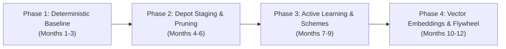

# Edge Data Triage & Golden Data Set (GDS) Architecture
## Remote Autonomous Haulage & Heavy Logistics (500 TB/Day Scaled Fleet)

---

## 1. Executive Summary & Problem Formulation

### 1.1 The Operational Challenge
Autonomous haulage operations in remote mining, quarries, and logistics transfer hubs generate massive quantities of high-fidelity perception data. A modern heavy autonomous truck equipped with multi-modal sensor arrays (high-resolution cameras, solid-state and mechanical LiDARs, 4D imaging radars, and high-frequency IMU/telemetry) generates approximately **3 TB to 5 TB of raw uncompressed data per 24-hour cycle**. 

At an initial scale of 10 trucks, a site produces **30–50 TB/day**. As fleet sizes scale to 50–100 trucks and next-generation sensor suites are introduced, site-level data generation quickly scales to **500 TB per 24 hours**.

```
+-----------------------------------------------------------------------------------+
|                              THE SCALING BOTTLENECK                               |
|                                                                                   |
|  100 Autonomous Trucks x 5 TB/day = 500 TB / day / site                           |
|  Standard Starlink Uplink Capacity = ~10-25 Mbps continuous (~100-250 GB/day)    |
|  Uplink Deficit: ~99.95% of generated raw data cannot leave the site over WAN    |
+-----------------------------------------------------------------------------------+
```

### 1.2 The Core Premise: 95%+ Redundancy
Haul trucks in open-pit mining and closed-circuit logistics operate on **repetitive, closed-loop paths** (e.g., Pit Face $\rightarrow$ Primary Crusher $\rightarrow$ Waste Dump). Driving the exact same 4-kilometer haul road under identical sunny conditions for the 80th time in a week yields zero incremental learning value for machine learning models. 

Streaming or uploading continuous raw sensor feeds produces:
1. **Network exhaustion:** Saturation of critical private 5G/LTE pit networks required for safety heartbeats and fleet dispatch (FMS).
2. **Astronomical storage & cloud egress costs:** Ingesting 15 PB/month into cloud object storage without curation creates unsustainable cloud bills.
3. **Data swamps:** Annotators and ML pipelines drown in identical, low-entropy nominal miles.

### 1.3 Objective
To transition from a **"Collect and Upload"** paradigm to an **"Intelligent Edge Triage"** architecture. By evaluating information density directly on the vehicle's edge compute and at local depot aggregation servers, the fleet identifies, extracts, and transmits only high-entropy, safety-critical, and novel scenarios—the **Golden Data Set (GDS)**—compressing 500 TB/day of raw logs into **<50 GB/day** of high-priority WAN uplink data and targeted on-demand physical offloads.

---

## 2. Defining the Golden Data Set (GDS) for Heavy Industry

In autonomous mining and heavy transport, data qualifies for the Golden Data Set if and only if it fulfills at least one of four core objectives:

```
                                  GOLDEN DATA SET (GDS)
                                            │
        ┌───────────────────┬───────────────┴───────────────┬───────────────────┐
        ▼                   ▼                               ▼                   ▼
 [Model Failure &     [High Entropy &               [Safety Incidents &  [Stratified ODD
    Uncertainty]         Novelty]                      Near-Misses]          Baselines]
  • High epistemic     • Unseen mining equipment     • Remote takeovers   • 0.1% nominal
    variance           • Severe blast dust plumes    • E-Stops & AEB        sampling
  • Detector jitter    • Extreme weather / mud       • Spilled rock berm  • Continuous
  • Sensor cross-      • Low-angle pit wall glare      near-strikes         regression
    disagreement                                                            anchors
```

1. **Failure & Uncertainty Manifestation:** Scenarios where perception classifiers, occupancy grids, or path planners exhibited high ambiguity, low confidence, bounding-box flickering, or ensemble divergence.
2. **High Domain Entropy (Outliers & Novelty):** Visual, geometric, or radar features that diverge significantly from the existing training baseline (e.g., novel contractor vehicles, rare water-truck spray patterns, extreme sun glare off wet quarry rock, deep pit fog).
3. **Safety-Critical & Control Violations:** Hard decelerations, emergency stops (E-Stops), human/remote operator overrides, traction control events, and proximity alerts with light vehicles or personnel.
4. **Stratified Operational Design Domain (ODD) Anchors:** A tiny, scientifically balanced slice of nominal driving across every permutation of operational variables (lighting, precipitation, payload mass, road grade) to prevent catastrophic forgetting and maintain regression testing suites.

---

## 3. Industry Benchmarks & Structural Precedents

Leading autonomous systems across commercial automotive and industrial haulage employ distinct data harvesting methodologies:

| Organization / Platform | Core Mechanism | Relevance to Remote Mining & Logistics |
| :--- | :--- | :--- |
| **Tesla Data Engine** | • **Shadow Mode:** Experimental models run in background; divergence against primary controller triggers capture.<br>• **Micro-Classifiers:** Lightweight neural triggers detect specific anomalies.<br>• **Vector Space Retrieval:** High-dimensional embeddings enable semantic search across fleet data. | **Directly Applicable:** Running shadow models on haul trucks to detect path discrepancies or unclassified obstacles against human or baseline controllers. |
| **AWS IoT FleetWise** | • **Declarative Edge Schemes:** Dynamic filtering rules deployed OTA without firmware rebuilds.<br>• **Condition-Based Logging:** Evaluates CAN signals, geofences, and vision flags at the edge. | **Directly Applicable:** Enables central autonomy teams to push dynamic "harvesting campaigns" to specific trucks or sectors without re-flashing vehicle software. |
| **Applied Intuition** | • **Simulation Coupling:** Real-world edge-case logs are converted directly into parameterized simulation tests.<br>• **Synthetic Augmentation:** Real edge events generate hundreds of synthetic variations. | **Directly Applicable:** Minimizes the need to collect thousands of physical edge cases by parameterizing each captured incident for virtual fleet re-simulation. |
| **Caterpillar MineStar & Komatsu FrontRunner** | • **Strict QoS Prioritization:** Telemetry, collision avoidance, and dispatch have 100% priority on private LTE/5G.<br>• **Depot Offloading:** High-throughput data dumps are strictly confined to maintenance shops and fueling islands. | **Critical Operational Constraint:** Confirms that bulk data transfer must NEVER share wireless bandwidth with real-time haulage safety networks. |

---

## 4. The 5-Layer Edge Data Value Triage Mechanics

To determine value at runtime, the truck’s on-vehicle edge compute continuously runs five complementary triage filters:

```
[Continuous Raw Sensor Streams (LiDAR, Cameras, Radar, IMU, CAN)]
                                │
                                ▼
 ┌─────────────────────────────────────────────────────────────────────────────┐
 │                         ON-VEHICLE EDGE TRIAGE ENGINE                       │
 ├─────────────────────────────────────────────────────────────────────────────┤
 │ [Filter 1] Deterministic Hard Triggers (E-stops, Slip, Sensor Occlusion)    │
 │ [Filter 2] Active Learning & Uncertainty Scoring (Entropy > Threshold)     │
 │ [Filter 3] Feature Vector Embeddings (Novelty & Cosine Distance)            │
 │ [Filter 4] Targeted Harvesting Campaigns (Dynamic OTA Rules)                │
 │ [Filter 5] Stratified ODD Baseline Sampler (0.1% Uniform Slice)             │
 └─────────────────────────────────────────────────────────────────────────────┘
                                │
             Candidate Snippet Flagged? (Yes/No)
                                │
         ┌──────────────────────┴──────────────────────┐
         ▼ NO                                          ▼ YES
   [Discard / Ring Buffer               [Capture Temporal Window:
    Overwritten]                         T-20s to T+10s]
                                                       │
                                        [Apply Frustum & Channel Pruning]
                                                       │
                                        [Store to Onboard U.2 NVMe Staging]
```

### 4.1 Filter 1: Deterministic & Kinematic Triggers
Hard-coded rules operating directly off vehicle kinematics, safety controllers, and hardware diagnostic buses:
* **Human Interventions:** Remote teleoperation takeovers, safety supervisor disengagements, or manual in-cab overrides.
* **Control Boundary Violations:** Autonomous Emergency Braking (AEB) events, lateral accelerations exceeding $0.3g$, uncommanded roll/pitch deviations on compromised haul-road berms, and severe wheel-slip events.
* **Hardware & Perception Faults:** Sensor degradation alerts (camera lens mud splatter, LiDAR reflectivity attenuation from thick dust, radar radome blockage, GNSS RTK lock dropouts).
* **Proximity & Safety Envelope Breaches:** Time-To-Collision (TTC) $< 3.0\text{s}$ relative to auxiliary equipment, light vehicles (pickups), or workers.

### 4.2 Filter 2: Active Learning & Model Uncertainty
Edge perception and prediction models calculate real-time confidence scores and information entropy:
* **Epistemic Uncertainty:** Low confidence scores ($< 0.65$) on detected bounding boxes, or high Shannon entropy in semantic segmentation heads (e.g., distinguishing between a harmless dust cloud and a solid boulder).
* **Sensor & Ensemble Disagreements:** Divergence between parallel heads (e.g., primary LiDAR detector identifies an obstacle at 45m, but the vision foundation model identifies clear road; or tracker bounding-box variance exceeds tolerance over 5 consecutive frames).
* **Planner Trajectory Surprises:** Significant delta between the trajectory the planner intended to execute and sudden emergency avoidance paths.

### 4.3 Filter 3: Latent Space Vector Embeddings & Novelty Detection
Raw point clouds and imagery cannot be compared across the fleet, but lightweight latent vectors can:
* A lightweight vision-backbone encoder (e.g., MobileNetV4 or DINO-based feature extractor running at 1–2 Hz) compresses multi-camera views into a 128-D or 256-D float vector.
* The vector is compared against an onboard **k-NN index of baseline operational scenes**.
* If the cosine distance $d(\mathbf{v}_{\text{scene}}, \mathbf{V}_{\text{baseline}}) > \tau_{\text{novelty}}$, the clip is tagged as an out-of-distribution environmental anomaly (e.g., rare whiteout blizzard, heavy mud rooster-tails, atypical rock wall geological formations).

### 4.4 Filter 4: Targeted Harvesting Campaigns (OTA Dynamic Schemes)
Autonomous engineering teams frequently train models for specific operational issues. Configurable logging schemes are pushed to specific trucks or sectors without software redeployments:
* *Campaign Example:* "Harvest 15 seconds of raw uncompressed LiDAR + forward cameras whenever a truck enters Pit Sector 7 during haul road watering operations."
* *Trigger Configuration:* Geofence polygon + CAN water-truck proximity flag + local wind speed sensor threshold.

### 4.5 Filter 5: Stratified ODD Baseline Sampler
To prevent the GDS from suffering from severe anomaly bias (which creates false positives during retraining), a background sampler collects a uniform, randomized 0.1% to 0.5% slice of nominal driving:
* Binned across: `[Shift: Day/Night] x [Weather: Clear/Rain/Dust] x [Payload: Empty/Loaded] x [Route Segment: Ramp/Dump/Crusher]`.
* Provides continuous anchor data for regression testing and nominal safety verification.

---

## 5. Multi-Tier Transport & Infrastructure Topology

Data offloading follows a strict hierarchy designed around the real physical bandwidth limitations of remote open-pit and industrial sites:

```
+─────────────────────────────────────────────────────────────────────────────────+
|                               DATA FLOW TOPOLOGY                                |
+─────────────────────────────────────────────────────────────────────────────────+

  [ Autonomous Haul Truck ]
     │  (Continuous Ring Buffering: 3 TB/day)
     │
     ├─► [Tier 1: Continuous WAN] ──► Starlink / Private 5G (Low Bandwidth)
     │     Payload: JSON Telemetry Index, Trigger Logs, Downsampled Thumbnails
     │     Bandwidth: ~10-50 kbps/truck  │  Volume: ~100-200 MB/truck/day
     │     Target: Cloud Fleet Management & GDS Metadata Index
     │
     └─► (Enters Maintenance / Fueling Depot Island)
           │
           ├─► [Tier 2: High-Speed Depot Offload] ──► Wi-Fi 6 / 60 GHz mmWave Dock
           │     Payload: Pre/Post Trigger Snippets, Novelty Clips, Campaign Data
           │     Transfer Rate: 1.2 - 2.5 Gbps burst per truck (15-20 min turnaround)
           │     Volume: ~25-50 GB/truck/day  │  Site Aggregate: 2.5 - 5 TB/day
           │     Target: On-Site Edge Server & Staging NAS (250 TB)
           │               │
           │               ├─► [Selective Cloud Uplink] (Overnight WAN)
           │               │     Surgically requested GDS raw blobs (<50 GB/day)
           │               │
           │               └─► [Tier 3: Sneakernet / Physical Transit]
           │                     Payload: Cold rolling raw archives, dense sensor bags
           │                     Hardware: Swappable Rugged NVMe Shuttles (e.g. AWS Snowball)
           │                     Frequency: Bi-weekly / Monthly physical shipment
+─────────────────────────────────────────────────────────────────────────────────+
```

### 5.1 Tier Sizing & Quantitative Reduction Funnel
For a scaled site producing **500 TB/day** across the fleet:

| Tier | Transmission Medium | Daily Data Volume | Latency / Availability | Purpose |
| :--- | :--- | :--- | :--- | :--- |
| **Tier 1: Immediate Telemetry** | Private 5G / Starlink Satellite | **~10–20 GB / day** (fleet total) | Real-time (<500ms) | Fleet safety alerts, disengagement coordinates, and JSON metadata catalog. |
| **Tier 2: Depot Edge Ingestion** | High-speed Wi-Fi 6 / mmWave docking at fuel bays | **~5–10 TB / day** (fleet total) | Hourly / Shift-change | Ingestion of all candidate snippets, campaign bags, and sensor health logs. |
| **Tier 3: Cloud GDS Ingestion** | Cloud-directed pull over night-time WAN / Sat | **~20–50 GB / day** (fleet total) | 12–24 hours | Highest-priority GDS snippets, auto-labeled training cases, edge-case anchors. |
| **Tier 4: Physical Archive (Sneakernet)** | Rugged U.2/U.3 NVMe storage shuttles | **20–50 TB / batch** (on demand) | 7–14 days transit | Forensic incident investigations, baseline sensor re-simulation, regulatory audits. |

---

## 6. Data Representation & Reduction Strategies

Before any triggered event is finalized for storage or transmission, three reduction passes are executed to minimize storage and bandwidth footprints.

### 6.1 Temporal Ring Buffering
Every truck maintains a circular rolling buffer in high-speed RAM and local NVMe storage:
* **Duration:** 45 seconds total ($T - 30\text{s}$ pre-trigger, $T + 15\text{s}$ post-trigger).
* **Rationale:** A disengagement or emergency stop is the *consequence* of an error that manifested 10–20 seconds earlier (e.g., an unmapped rock or misclassified berm). The pre-event buffer captures the root cause; the post-event buffer captures the vehicle's dynamic response.

### 6.2 Spatial Frustum & Channel Pruning
When an anomaly triggers a recording, the system strips irrelevant data streams:

```
[Trigger Fired: Front Obstacle Classification Uncertainty at Azimuth +15°]
                                │
        ┌───────────────────────┴───────────────────────┐
        ▼ KEEP (High Resolution)                        ▼ DROP or HEAVILY COMPRESS
  • Front-Center 8MP Camera (Full Frame)          • Rear Perimeter Cameras (Dropped)
  • Primary Forward 128-Beam LiDAR                • Cabin Driver-Facing Camera (Dropped)
  • Forward 4D Imaging Radar                      • Blind-spot Side Radars (Dropped)
  • High-rate IMU & Steer/Brake CAN               • Surrounding non-relevant channels
```

* **Bandwidth Savings:** Eliminating unnecessary camera and sensor angles reduces individual snippet size by **70% to 85%**.

### 6.3 Decimation & Perceptual Compression
* **Frame Decimation:** For slow-moving haul trucks (typical pit speeds: 15–35 km/h), camera feeds are decimated from 30 FPS down to 10 FPS without loss of spatial training utility for perception models.
* **LiDAR Quantization:** Point clouds outside the operational envelope (e.g., points $>100\text{m}$ or high sky points) are cropped; spatial coordinates are converted from 32-bit floats to 16-bit fixed-point representations.

---

## 7. Metadata Schema Specification (The Searchable Index)

The metadata-first approach relies on a standardized, low-overhead JSON record generated for every candidate snippet. Central cloud systems query these metadata records to select specific raw blobs for WAN upload.

```json
{
  "$schema": "https://specs.autonomy-mining.org/v1/gds-metadata.json",
  "snippet_id": "SNIP-20261002-TRK042-00892",
  "truck_id": "HAUL-TRUCK-042",
  "site_id": "MINE-PILBARA-WEST",
  "timestamp_utc_start": "2026-10-02T07:14:22.104Z",
  "timestamp_utc_trigger": "2026-10-02T07:14:52.104Z",
  "timestamp_utc_end": "2026-10-02T07:15:07.104Z",
  "software": {
    "autonomy_version": "v4.12.2-prod",
    "perception_model_hash": "a8f90c4e12",
    "active_campaign_ids": ["CAMP-DUST-RADAR-09"]
  },
  "operational_context": {
    "pit_sector": "SECTOR-04-BENCH-12",
    "route_id": "PIT-RAMP-NORTH-TO-CRUSHER-01",
    "payload_state": "LOADED_100",
    "payload_metric_tons": 242.5,
    "speed_kmh": 22.4,
    "road_gradient_percent": -7.2,
    "gnss_rtk_status": "FIXED_INTEGER",
    "sun_elevation_deg": 8.4,
    "sun_azimuth_deg": 82.1,
    "dust_density_index": 0.74,
    "precipitation": "NONE"
  },
  "triage_triggers": [
    {
      "category": "ACTIVE_LEARNING_UNCERTAINTY",
      "source_module": "perception.obstacle_detector",
      "metric_name": "entropy_score",
      "threshold": 0.65,
      "measured_value": 0.88,
      "frustum_azimuth_deg": 14.5
    },
    {
      "category": "HARD_KINEMATIC",
      "source_module": "control.chassis",
      "metric_name": "deceleration_ms2",
      "threshold": -2.5,
      "measured_value": -3.8
    }
  ],
  "latent_vector_128d": [
    0.0421, -0.1842, 0.9201, "...", 0.0154
  ],
  "candidate_payload": {
    "total_size_mb": 1420.5,
    "pruned_channels": [
      "cam_front_center_8mp",
      "lidar_forward_main",
      "radar_forward_4d",
      "telemetry_can_imu"
    ],
    "local_depot_uri": "depot://nas01.pilbara/staging/20261002/SNIP-20261002-TRK042-00892.mcap"
  }
}
```

---

## 8. Site Infrastructure & Storage Lifecycle Management

Deploying a 500 TB/day triage pipeline requires balancing edge compute, depot staging buffers, and automated lifecycle eviction.

```
                          DEPOT STAGING SERVER (250 TB NAS)
                     ┌────────────────────────────────────────┐
                     │ Rolling Window: 14-Day Candidate Buffer │
                     └───────────────────┬────────────────────┘
                                         │
             ┌───────────────────────────┴───────────────────────────┐
             ▼ (Requested by Cloud)                                  ▼ (Not Requested)
     [Upload to Cloud GDS]                                  [Evicted after 14 Days]
  (Surgically pulled via WAN)                             (Overwritten by new shifts)
```

### 8.1 On-Truck Hardware Provisioning
* **Storage:** 2x 15.36 TB Enterprise Rugged U.2/U.3 NVMe SSDs in RAID-0/1 configuration. Provides 72 hours of localized candidate buffer.
* **Compute Isolation:** Compute loads for active learning, vector encoding, and ring-buffer compression are pinned to isolated low-priority NPU/GPU execution streams to prevent CPU/GPU contention with real-time planning and safety systems.

### 8.2 Depot Staging Server (On-Site Edge NAS)
* **Capacity:** 250 TB to 500 TB ruggedized All-Flash or Tiered NVMe/SAS NAS located at the mine's main equipment maintenance shop / fueling island.
* **Network Ingestion:** 4x 10GbE / 25GbE fiber uplinks powering rugged industrial outdoor Wi-Fi 6 (802.11ax) access points or mmWave 60 GHz wireless links at the fuel bays.
* **Automated Retention Lifecycle:**
  * **Day 0–3:** Full uncompressed candidate snippets preserved.
  * **Day 4–7:** If not flagged for cloud pull, downsample point clouds and compress imagery by 50%.
  * **Day 14:** Hard eviction of unrequested candidate snippets.

---

## 9. Ground Truth Annotation & Auto-Labeling Strategy

Data added to the Golden Data Set is only useful if it can be labeled accurately. Mining operations feature specialized machinery and terrain not present in standard automotive foundation models.

```
[Curated GDS Candidate Snippet]
               │
               ▼
 ┌────────────────────────────────────────────────────────────────────────┐
 │                   SITE / CLOUD 4D AUTO-LABELING PIPELINE               │
 ├────────────────────────────────────────────────────────────────────────┤
 │ 1. Multi-Pass Offline World Model (Runs heavy non-causal Transformers) │
 │ 2. NeRF / 3D Gaussian Splatting for Static Haul Road Geometry          │
 │ 3. Dynamic Object Bounding (Excavators, Light Vehicles, Drill Rigs)    │
 │ 4. Confidence Evaluation on Generated Labels                           │
 └────────────────────────────────────────────────────────────────────────┘
               │
     Auto-Label Confidence High?
               │
       ┌───────┴───────┐
       ▼ YES           ▼ NO
 [Approved for GDS]   [Human-in-the-Loop Expert Annotation]
```

1. **Heavy Offline 4D Auto-Labeling:** Unlike on-vehicle models which must run under 20ms causal constraints, site and cloud servers run heavy, multi-frame bidirectional (non-causal) foundation models that look forward and backward across the clip to generate 3D bounding boxes and tracklets.
2. **Mining-Specific Semantic Ontology:** The annotation schema explicitly incorporates industrial classes:
   * Heavy haulers, bucket excavators, front-end wheel loaders, water trucks, service pickups.
   * Static infrastructure: Safety berms (with height estimation), high-voltage dragline cables, blast cones, oversize rock obstacles ($>30\text{cm}$).
3. **Targeted Human-in-the-Loop:** Only auto-labeled samples with spatial label ambiguity $< 0.85$ are routed to human annotators, reducing manual labeling costs by up to 90%.

---

## 10. Commercial Product Landscape & Vendor Evaluation

Rather than engineering every tier from scratch, several off-the-shelf and enterprise tools provide production-tested components across the data lifecycle. The commercial market is segmented into four distinct layers:

```
[ In-Vehicle Edge ]         [ Depot Staging & Pruning ]      [ Cloud / Central GDS ]
  Edge Filtering &              Smart Sampling &               Active Learning &
  Ring Buffering                Coreset Selection              Ground-Truth Labeling
        │                               │                                │
 ┌──────────────┐               ┌──────────────┐                 ┌──────────────┐
 │AWS FleetWise │               │  Akridata    │                 │   Kognic     │
 │Sonatus       │ ──(Wi-Fi 6)─► │  Voxel51     │ ──(Sat/Sneak)─► │  Scale AI    │
 │Foxglove MCAP │               │  FiftyOne    │                 │  Applied     │
 └──────────────┘               └──────────────┘                 │  Intuition   │
                                                                 └──────────────┘
```

### 10.1 Evaluation: Kognic (AD/ADAS Annotation & Active Learning)
* **Market Position:** Kognic (formerly Annotell) is an industry-leading platform specifically built for the AD/ADAS and robotics data flywheel, trusted by automotive Tier-1s and OEMs (Continental, Qualcomm, Zenseact/Volvo).
* **Core Capabilities:**
  * **Multi-Sensor 4D Fusion:** Natively aligns 3D LiDAR point clouds, 4D imaging radars, and multi-camera visual feeds in a synchronized spatio-temporal coordinate space.
  * **Active Learning & Curation:** Integrates with perception models to identify high-impact failure modes, detector disagreement, and low-confidence edge cases for human review.
  * **Auto-Labeling Copilot & QA:** Automated validation engines (e.g., verifying physical bounding-box constraints, temporal trajectory consistency, and occlusion sanity checks).
* **Role in This Architecture:** Kognic is the primary candidate for the **Cloud / Central GDS Ground-Truth & Active Learning Engine**. It does not operate onboard the truck at the physical edge, but ingests the curated candidate snippets delivered via depot offload/WAN.

### 10.2 Comprehensive Vendor Matrix Across Pipeline Layers

| Pipeline Layer | Platform / Vendor | Core Strength | Operational Trade-off | Relevance Score |
| :--- | :--- | :--- | :--- | :--- |
| **In-Vehicle Edge Agent** | **AWS IoT FleetWise** | Low-overhead C++ edge agent evaluating declarative rules (CAN signals, geofencing, vision flags). | Tight AWS ecosystem coupling; requires custom bridging for heavy LiDAR dumps. | **High** (For Filters 1 & 4: Kinematic triggers & dynamic OTA campaigns). |
| **In-Vehicle Edge Agent** | **Sonatus Collector** | Software-defined dynamic vehicle data collector; instant policy updates without OTA firmware re-flashing. | Primarily tailored for passenger automotive CAN/Ethernet architectures. | **Medium** (Excellent for deep chassis & CAN diagnostics). |
| **Edge Container / Format**| **Foxglove (MCAP)** | Serialization-agnostic, row-oriented, append-only container format designed for high-throughput robotics logs. | Open standard format; platform visualization layer requires enterprise tier for large teams. | **Critical** (Adopt MCAP as the standardized onboard ring-buffer file format). |
| **Depot Edge Curation** | **Akridata (DataSense)** | Specifically built for the **edge-to-cloud visual data bottleneck**. Uses Coreset Sampling and patch search to eliminate 90%+ of redundant video at the edge. | Proprietary enterprise platform; requires dedicated depot compute integration. | **High** (Solves the physical Depot NAS 500 TB $\rightarrow$ 5 TB pruning problem). |
| **Depot Edge Curation** | **Voxel51 (FiftyOne)** | Open-source + enterprise visual dataset curation. Employs vector embeddings (**FiftyOne Brain**) to compute uniqueness and detect distribution shift. | Requires in-house ML infrastructure to deploy and maintain on local depot hardware. | **High** (Ideal for cross-fleet clustering and novelty scoring at the mine depot). |
| **Cloud GDS & Labeling** | **Kognic** | Specialized for multi-sensor temporal fusion (LiDAR + Camera + Radar), active learning curation, and AD safety validation. | Premium enterprise pricing; requires pre-curated data (cannot ingest raw 500 TB feeds directly). | **High** (Industry gold standard for multi-modal 4D ground-truth generation). |
| **Cloud GDS & Labeling** | **Scale AI (Nucleus)** | Massive auto-labeling infrastructure, semantic dataset search, and human-in-the-loop annotation pools. | Less specialized in European automotive/robotics multi-sensor calibration than Kognic. | **Medium-High** (Strong enterprise data engine alternative). |
| **Simulation & Validation** | **Applied Intuition (Strada)** | Extracts real-world incident logs into synthetic simulation scenarios for regression testing. | High platform complexity and cost; focused on full AV stack validation. | **High** (Converts 1 real mining near-miss into 500 virtual edge-case variants). |

### 10.3 Recommended Commercial Reference Stack
For a remote mining operation looking to balance build vs. buy, the optimal commercial stack combines:
1. **On-Vehicle Edge:** Standardize raw ring buffers on **Foxglove MCAP** format, with trigger rules orchestrated via **AWS IoT FleetWise** edge agent.
2. **Depot Edge Server:** Ingest Wi-Fi 6 offloads into a 250 TB NAS running **Akridata DataSense** or **Voxel51 FiftyOne** to perform fleet-wide deduplication and novelty coreset extraction.
3. **Cloud GDS Platform:** Ingest surgical high-priority snippets into **Kognic** for 4D multi-sensor annotation and model feedback, feeding verified edge cases directly into **Applied Intuition** for synthetic re-simulation.

---

## 11. Phased Implementation Roadmap



### Phase 1: Deterministic Baseline & Ring Buffers (Months 1–3)
* Implement continuous rolling circular buffers (MCAP format in RAM/NVMe) on all active haul trucks.
* Instrument hard triggers: Teleoperation interventions, E-Stops, AEB events, and sensor blind alerts.
* Establish private 5G / Starlink Tier-1 telemetry uplink for JSON event metadata.

### Phase 2: Depot Staging & Channel Pruning (Months 4–6)
* Deploy 250 TB depot staging server at mine fueling/maintenance island with Wi-Fi 6 offload docks.
* Implement spatial frustum and channel-pruning algorithms on the truck to strip irrelevant camera angles before depot offload.
* Establish central cloud-querying pipeline to surgically request raw candidate blobs over WAN.

### Phase 3: Active Learning & Dynamic Campaigns (Months 7–9)
* Integrate epistemic uncertainty and detector entropy scoring into the perception stack.
* Implement dynamic, over-the-air harvesting campaigns (declarative schemes via FleetWise or custom agent) to allow autonomy engineers to target specific environmental conditions (e.g., dust watering, night glares).

### Phase 4: Vector Embeddings & Full Data Flywheel (Months 10–12)
* Deploy lightweight edge encoder backbones for real-time latent embedding generation.
* Implement automated cross-fleet deduplication and k-NN novelty scoring (e.g., via Voxel51 / Akridata) at the depot server.
* Close the loop with Kognic 4D multi-sensor annotation, offline world models, and automated synthetic scenario generation.

