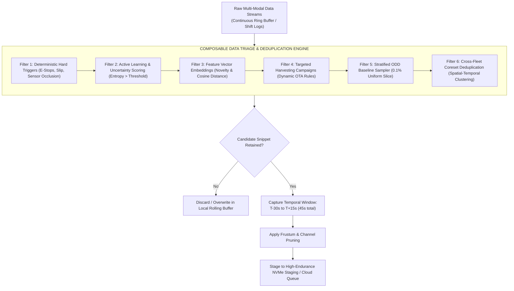
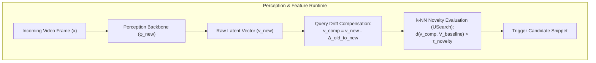
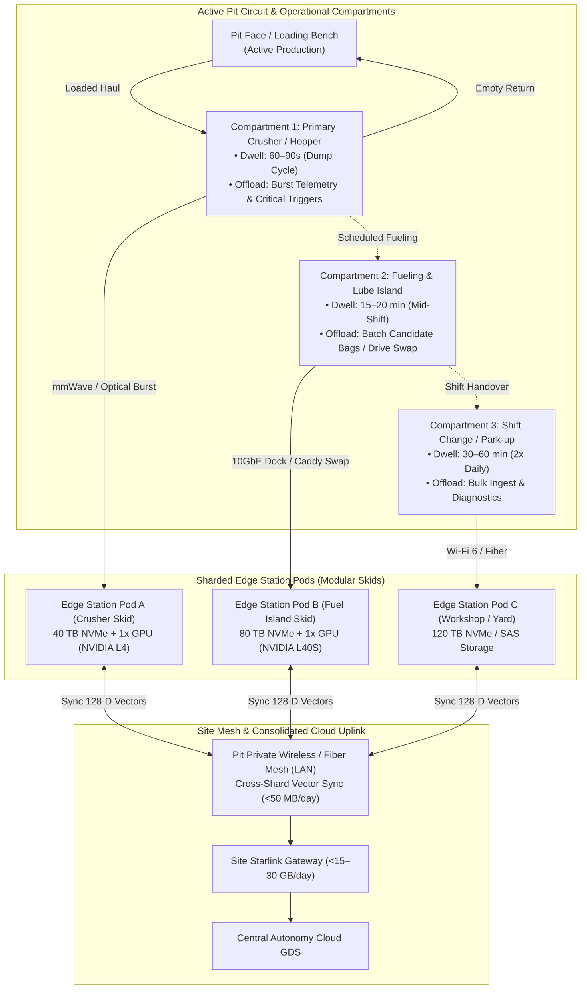
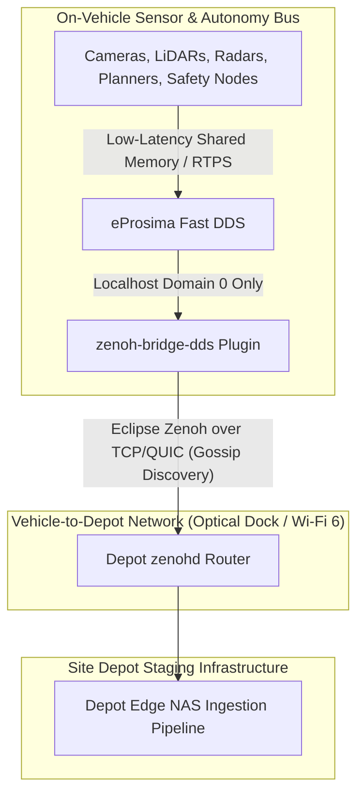
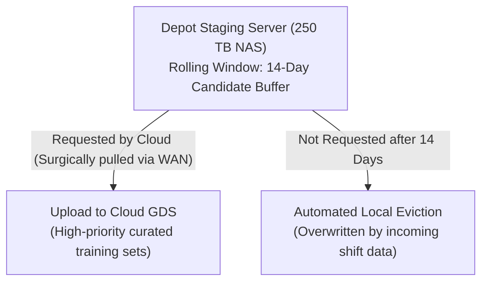
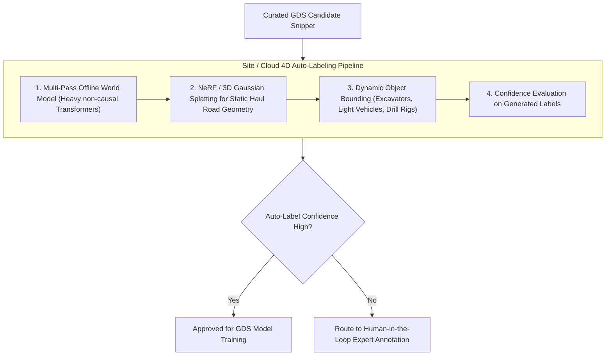
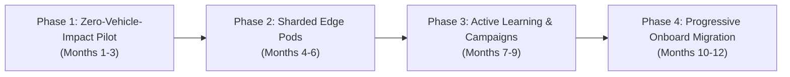

# Edge Data Triage & Golden Data Set (GDS) Architecture
## Remote Autonomous Haulage & Heavy Logistics: Distributed Edge Sharding & Location-Agnostic Triage

---

## 1. Executive Summary & Problem Formulation

### 1.1 The Operational Challenge & Fleet Scaling Reality
Autonomous haulage operations in remote mining, quarries, and logistics transfer hubs generate massive quantities of high-fidelity perception data. A modern heavy autonomous truck equipped with multi-modal sensor arrays (high-resolution cameras, solid-state and mechanical LiDARs, 4D imaging radars, and high-frequency IMU/telemetry) generates approximately **3 TB to 5 TB of raw uncompressed data per 24-hour cycle**. 

In industrial autonomy, operations rarely scale as a monolithic 100-vehicle mega-fleet. Instead, sites operate in **distributed cells and operational compartments (typically 8 to 25 trucks per pit or transfer circuit)**:
* **Initial Deployment / Single Pit Cell (10 trucks):** Generates **30–50 TB/day**.
* **Medium Multi-Bench Complex (25 trucks across 2–3 compartments):** Generates **75–125 TB/day**.
* **Scaled Mega-Site Aggregate (50–100 trucks across multiple pits):** Generates **250–500 TB/day**.

| Operational Dimension | Single Pit Cell (10 Trucks) | Multi-Bench Complex (25 Trucks) | Scaled Mega-Site (100 Trucks) | Architectural Impact |
| :--- | :--- | :--- | :--- | :--- |
| **Fleet Raw Generation** | **30–50 TB / day** | **75–125 TB / day** | **300–500 TB / day** | Massive multi-modal sensor data generated across distributed vehicles. |
| **WAN Uplink Capacity [1]** | ~10–25 Mbps (Starlink) | ~25–50 Mbps (Multi-Dish) | ~50–100 Mbps (Enterprise Sat) | Extreme WAN bandwidth deficit in remote, off-grid extraction environments. |
| **WAN Uplink Deficit** | **>99.9%** cannot leave site | **>99.9%** cannot leave site | **>99.95%** cannot leave site | Mandatory local edge triage, spatial pruning, and cross-vehicle deduplication. |

### 1.2 The Production Vehicle Modification Hurdle
A foundational reality of heavy autonomous haulage is that **modifying software running directly on the truck is exceptionally difficult, slow, and operationally hazardous**:
1. **Functional Safety & Certification (ISO 26262 / ISO 19014):** Modifying binaries on safety-critical automotive compute risks invalidating ASIL ratings, tripping OEM supervisor watchdogs, and requiring months of closed-track regression testing.
2. **OEM Warranty & Black-Box Stacks:** Mining haulage platforms (e.g., Caterpillar MineStar, Komatsu FrontRunner) are closed, proprietary systems. Operators and autonomy teams are rarely permitted to run custom Python/C++ active learning or vector-search daemons on the primary compute.
3. **Mission-Critical Production Risk:** An experimental edge process that leaks memory or contends for PCIe bandwidth with the trajectory planner can emergency-stop a 400-ton hauler, halting pit production at tens of thousands of dollars per hour.

**Architectural Principle: Location-Agnostic Capability**  
To overcome this constraint, this architecture defines **Data Triage and Deduplication as a location-agnostic capability**. The same core intelligence (kinematic triggers, active learning uncertainty, vector embeddings, frustum pruning, and coreset deduplication) can be deployed across three flexible execution topologies:
* **Topology A: Edge-Site Centric (Immediate / Zero-Vehicle-Modification):** The vehicle runs purely passive circular logging (or utilizes physical hot-swap NVMe caddies / 10GbE umbilical dumps). All compute-heavy triage and cross-fleet deduplication execute on ruggedized **Edge Station Pods** distributed across the site.
* **Topology B: Hybrid / Parasitic Tap:** A non-intrusive, read-only hardware tap (GMSL splitters and Ethernet mirror taps) captures perception streams without modifying or interacting with the vehicle's safety bus.
* **Topology C: Distributed Onboard (Matured Integration):** Triage filters run directly inside vehicle compute as OEM stacks open up or achieve certification over time.

### 1.3 The Core Premise: 95%+ Redundancy
Haul trucks in open-pit mining and closed-circuit logistics operate on **repetitive, closed-loop paths** (e.g., Pit Face $\rightarrow$ Primary Crusher $\rightarrow$ Waste Dump). Driving the exact same 4-kilometer haul road under identical sunny conditions for the 80th time in a week yields zero incremental learning value for machine learning models. 

Streaming or uploading continuous raw sensor feeds produces:
1. **Network exhaustion:** Saturation of critical private 5G/LTE pit networks required for safety heartbeats and fleet dispatch (FMS).
2. **Astronomical storage & cloud egress costs:** Ingesting 15 PB/month into cloud object storage without curation creates unsustainable cloud bills.
3. **Data swamps:** Annotators and ML pipelines drown in identical, low-entropy nominal miles.

### 1.4 Objective
To transition from a **"Collect and Upload"** paradigm to an **"Intelligent Edge Triage & Site Sharding"** architecture. By evaluating information density directly at distributed edge compute stations (or on-vehicle where feasible), the fleet identifies, extracts, and transmits only high-entropy, safety-critical, and novel scenarios—the **Golden Data Set (GDS)**—compressing 30–500 TB/day of raw logs into **<15–50 GB/day** of high-priority WAN uplink data.

### 1.5 Financial Feasibility & Cloud Cost Model
Ingesting raw data uncurated into commercial hyperscaler object storage ([AWS S3 [2]](#131-cloud-economics-satellite-networking--haulage-operations), [GCP Cloud Storage [3]](#131-cloud-economics-satellite-networking--haulage-operations)) is economically prohibitive:
* **Raw Storage Overhead:** For a 100-truck aggregate (500 TB/day), baseline storage alone costs **>$345,000 per month** ($0.023/GB/month [[2]](#131-cloud-economics-satellite-networking--haulage-operations)), compounding by >$4.1M annually. Even for a 10-truck site (30–50 TB/day), uncurated cloud ingest costs **>$25,000–$35,000/month** in storage alone.
* **Annotation Bottleneck:** Human labeling of multi-sensor 3D point clouds, 4D radar tracks, and multi-view video streams costs between **$3 and $8 per synchronized frame**. Attempting to annotate even 1% of raw uncurated footage would quickly exhaust annual autonomy R&D budgets.
* **Curated ROI:** By pruning data at the edge to extract **10 GB to 30 GB per day** (for 10 trucks) or **20 GB to 50 GB per day** (for 100 trucks) of high-entropy snippets, recurring cloud object storage collapses to **~$10–$35/month**. Factoring in API request volume, lifecycle transitions, and light cloud compute, the recurring pipeline cost is **~$500–$1,500/month**—a **>99% reduction** [[4]](#131-cloud-economics-satellite-networking--haulage-operations). Capital expenditure is efficiently redirected into modular edge compute pods amortized across multi-year site production.
  > **Sub-Linear Fleet Scaling Note:** The GDS upload volume scales sub-linearly ($O(\log N)$ to $O(\sqrt{N})$) rather than linearly ($10\times$ fleet size increases upload volume by only $\sim 2\times$). Because haul trucks traverse identical pit benches, haul roads, and crushers under identical weather conditions, Filter 6 cross-fleet coreset deduplication (§4.6) eliminates 60%–80% of duplicate observations across trucks, causing site-wide novelty discovery to plateau as fleet density increases.

---

## 2. Defining the Golden Data Set (GDS) for Heavy Industry

In autonomous mining and heavy transport, data qualifies for the Golden Data Set if and only if it fulfills at least one of four core objectives:

| Model Failure & Uncertainty | High Entropy & Novelty | Safety Incidents & Near-Misses | Stratified ODD Baselines |
| :--- | :--- | :--- | :--- |
| • High epistemic variance<br>• Detector bounding-box jitter<br>• Sensor cross-disagreement (LiDAR vs. Vision) | • Unseen mining equipment / contractor vehicles<br>• Severe blast dust plumes<br>• Extreme weather & mud spray<br>• Low-angle pit wall glare | • Remote teleoperation takeovers<br>• Emergency stops (E-Stops) & AEB<br>• Spilled rock berm near-strikes | • 0.1% uniform nominal sampling<br>• Continuous regression anchors across environmental permutations |

1. **Failure & Uncertainty Manifestation:** Scenarios where perception classifiers, occupancy grids, or path planners exhibited high ambiguity, low confidence, bounding-box flickering, or ensemble divergence.
2. **High Domain Entropy (Outliers & Novelty):** Visual, geometric, or radar features that diverge significantly from the existing training baseline (e.g., novel contractor vehicles, rare water-truck spray patterns, extreme sun glare off wet quarry rock, deep pit fog).
3. **Safety-Critical & Control Violations:** Hard decelerations, emergency stops (E-Stops), human/remote operator overrides, traction control events, and proximity alerts with light vehicles or personnel.
4. **Stratified Operational Design Domain (ODD) Anchors:** A tiny, scientifically balanced slice of nominal driving across every permutation of operational variables (lighting, precipitation, payload mass, road grade) to prevent catastrophic forgetting and maintain regression testing suites.

---

## 3. Industry Benchmarks & Structural Precedents

Autonomous vehicle operations across industrial mining, commercial long-haul trucking, passenger transport, and urban robotaxis operate against fundamentally different operational constraints:

| Architectural Dimension | Remote Mining Haulage (This Architecture) | Heavy Mining OEMs ([Caterpillar [5]](#132-autonomous-haulage-systems--industry-benchmarks) / [Komatsu [6]](#132-autonomous-haulage-systems--industry-benchmarks)) | Autonomous Trucking ([Kodiak Robotics [7]](#132-autonomous-haulage-systems--industry-benchmarks)) | Mass Passenger AVs ([Tesla Data Engine [8]](#132-autonomous-haulage-systems--industry-benchmarks)) | Urban Robotaxis ([Waymo Driver [9]](#132-autonomous-haulage-systems--industry-benchmarks)) |
| :--- | :--- | :--- | :--- | :--- | :--- |
| **Operational Design Domain** | Deep open-pit benches, crushers, dumps, private haul roads. | Structured mining benches, waste dumps, crusher ramps. | Long-haul interstate highways and private energy corridors. | Global consumer roadways, mixed urban and highway. | Dense urban cores, complex intersections, arterials. |
| **Cloud Uplink Ingest Ratio** | **<0.01%** uploaded over WAN (<50 GB/day from 500 TB). | **<0.005%** over wireless; strictly critical telemetry and fault codes. | **<0.05%** continuous; critical safety events and target scenarios. | **<0.1%**; micro-classifier triggers and shadow mode clips. | **~0.5%–2.0%**; localized depot fiber offloads with cloud active curation. |
| **Directed Triage Mechanics** | Kinematic bounds, epistemic entropy, vector novelty, dynamic schemes, ODD anchors. | Deterministic fault codes, geofence breaches, payload limits, obstacle stops. | Kinematic exceptions, planner-perceiver deltas, remote ops intervention. | Fleet-wide micro-classifiers, shadow mode path divergence, disengagements. | Causal event logs, planner uncertainty metrics, regression triggers. |
| **Edge Compute Footprint** | Multi-modal perception compute, NPU embedding extractor, U.2/U.3 NVMe SSDs. | Industrial embedded controllers, telemetry gateway, circular crash logger. | Rugged dual-stack commercial vehicle compute, local high-speed NVMe. | In-house dual FSD System-on-Chip (SoC) executing primary and shadow heads. | Automotive-grade custom computing cluster with redundant multi-sensor units. |
| **Depot Edge Responsibilities** | 250 TB NAS, automated optical docking, coreset deduplication, vector re-indexing. | Telemetry offload, scheduled maintenance diagnostics, raw crash archive dumps. | Terminal-based high-speed offload, automated safety inspection diagnostics. | Minimal depot processing; consumer Wi-Fi uploads directly to central clusters. | Extensive depot network infrastructure, complete raw shift ingest, autocalibration. |
| **Simulation Integration** | Closed-loop export to ASAM OpenSCENARIO, synthetic near-miss variations. | Fleet management replays, route optimization, mine digital twins. | Daily simulation operations, virtual incident replay, parameter variations. | Purely data-driven neural network weight retraining, autolabeling loops. | High-fidelity multi-sensor simulation pipelines (e.g., Carcraft, world models). |

### Structural Key Takeaway
* **Industrial Mining OEMs ([Caterpillar MineStar [5]](#132-autonomous-haulage-systems--industry-benchmarks), [Komatsu FrontRunner [6]](#132-autonomous-haulage-systems--industry-benchmarks)):** Enforce absolute QoS prioritization. Safety heartbeats and dispatch commands occupy 100% priority on private LTE/5G; raw perception streaming over WAN is strictly prohibited.
* **Commercial Autonomous Trucking ([Kodiak Robotics [7]](#132-autonomous-haulage-systems--industry-benchmarks)):** Employs selective logging of kinematic and perceptual anomalies to parameterize daily simulation scenarios in ASAM OpenSCENARIO.
* **Urban Robotaxis ([Waymo [9]](#132-autonomous-haulage-systems--industry-benchmarks)):** Can rely on dedicated fiber networks at urban maintenance depots to ingest terabytes per vehicle at each shift return.
* **Remote Heavy Logistics Requirement:** Because remote mine sites lack urban fiber depots and pervasive WAN backhauls, the architecture must synthesize **mining QoS network isolation** with **onboard edge triage** and **automated high-throughput physical depot docking**.

---

## 4. The Composable Data Value Triage & Deduplication Engine

The core value engine of this architecture is designed as a **location-agnostic capability**: the same logical filtering pipeline can execute onboard the vehicle's embedded NPU, inside an isolated "parasitic" flight recorder tap, or across distributed edge compute pods at the mine site. 

Regardless of where it is hosted, the engine evaluates information density across six complementary stages:



### 4.1 Filter 1: Deterministic & Kinematic Triggers
Hard-coded rules operating directly off vehicle kinematics, safety controllers, and hardware diagnostic buses:
* **Human Interventions:** Remote teleoperation takeovers, safety supervisor disengagements, or manual in-cab overrides.
* **Control Boundary Violations:** Autonomous Emergency Braking (AEB) events, lateral accelerations exceeding $0.3g$ (or site-calibrated limit), uncommanded roll/pitch deviations on compromised haul-road berms, and severe wheel-slip events.
* **Hardware & Perception Faults:** Sensor degradation alerts (camera lens mud splatter, LiDAR reflectivity attenuation from thick dust, radar radome blockage, GNSS RTK lock dropouts).
* **Proximity & Safety Envelope Breaches:** Time-To-Collision (TTC) $< 3.0\text{s}$ relative to auxiliary equipment, light vehicles (pickups), or workers.

> **Site Calibration Note for Ultra-Class Haulers:** The $0.3g$ lateral acceleration and $\text{TTC} < 3.0\text{s}$ thresholds are nominal automotive reference figures. For 400-tonne haul trucks operating at 15–35 km/h on steep unpaved grades (-8% to -10%), stopping distances scale heavily with payload (160t tare vs. 400t loaded gross mass) and dust-attenuated perception ranges. Therefore, Filter 1 parameters must be dynamically modulated at runtime based on truck payload state and road grade: loaded downhill operations require extending the TTC trigger to $<4.5\text{--}5.0\text{s}$ and tightening lateral acceleration bounds to $>0.18\text{--}0.22g$ to capture incipient loss of traction and berm scrapes before emergency intervention.

### 4.2 Filter 2: Active Learning & Model Uncertainty
Edge perception and prediction models calculate real-time confidence scores and information entropy:
* **Epistemic Uncertainty:** Low confidence scores ($< 0.65$) on detected bounding boxes, or high Shannon entropy in semantic segmentation heads (e.g., distinguishing between a harmless dust cloud and a solid boulder).
* **Sensor & Ensemble Disagreements:** Divergence between parallel heads (e.g., primary LiDAR detector identifies an obstacle at 45m, but the vision foundation model identifies clear road; or tracker bounding-box variance exceeds tolerance over 5 consecutive frames).
* **Planner Trajectory Surprises:** Significant delta between the trajectory the planner intended to execute and sudden emergency avoidance paths.

### 4.3 Filter 3: Latent Space Vector Embeddings & Novelty Detection
Raw point clouds and imagery cannot be compared across the fleet, but lightweight latent vectors can:
* A lightweight vision-backbone encoder (e.g., MobileNetV4 or DINO-based feature extractor running at 1–2 Hz) compresses multi-camera views into a 128-D or 256-D metric vector.
* The vector is compared against an indexed **k-NN baseline of operational scenes** powered by **USearch (Unum) [[14]](#133-metric-learning-backward-compatibility--embedded-vector-search)**, an embedded, header-only C++11 HNSW vector engine optimized for SIMD and ARM NEON hardware acceleration.
* If the cosine distance $d(\mathbf{v}_{\text{scene}}, \mathbf{V}_{\text{baseline}}) > \tau_{\text{novelty}}$, the clip is tagged as an out-of-distribution environmental anomaly (e.g., rare whiteout blizzard, heavy mud rooster-tails, atypical rock wall geological formations).

#### Vector Space Drift Mitigation under Over-the-Air (OTA) Model Updates
When autonomy engineering deploys an upgraded vision backbone model via an OTA push (e.g., from model hash `a8f90c4e12` to `b9e01d5f34`), the latent manifold shifts from $\mathcal{M}_{\text{old}}$ to $\mathcal{M}_{\text{new}}$. Evaluating query vectors generated by the new backbone against an older onboard k-NN baseline causes representation collapse, triggering either persistent false-positive collection avalanches or dangerous blind spots. 

The architecture enforces a three-stage mathematical mitigation protocol:



1. **Backward-Compatible Training (BCT) [[11], [12], [13]](#133-metric-learning-backward-compatibility--embedded-vector-search):** When training an upgraded vision encoder $\phi_{\text{new}}$, the cloud training loss function couples task objectives with an orthogonal backward-compatibility constraint. As a proposed architectural synthesis combining Shen et al.'s representation regression loss [[11]] with orthogonal projection constraints [[13]]:
   $$\mathcal{L}_{\text{BCT}} = \mathcal{L}_{\text{task}} + \lambda \left\| R \phi_{\text{new}}(x) - \phi_{\text{old}}(x) \right\|_2^2 \quad \text{subject to } R^T R = I$$
   Applying an orthogonal transformation matrix $R$ preserves the global metric geometry of the legacy baseline manifold while allowing the upgraded model to learn novel task features without severe distortion.
2. **Zero-Shot Query Drift Compensation (QDC) [[10]](#133-metric-learning-backward-compatibility--embedded-vector-search):** Prior to fleet-wide OTA rollout, a calibration dataset of $N$ operational mining scenes is passed through both legacy and upgraded encoders to compute a first-order linear bias correction offset:
   $$\Delta_{\text{old}\to\text{new}} = \frac{1}{N} \sum_{i=1}^N \left( \phi_{\text{new}}(x_i) - \phi_{\text{old}}(x_i) \right)$$
   This offset is bundled directly in the OTA deployment payload. Incoming query vectors are compensated at runtime: $\mathbf{v}_{\text{comp}} = \mathbf{v}_{\text{new}} - \Delta_{\text{old}\to\text{new}}$, suppressing artificial novelty spikes caused by coordinate translation.
   > **Non-Linear Manifold Shift & Avalanche Rollback:** Mean-translation $\Delta_{\text{old}\to\text{new}}$ is strictly a first-order linear approximation; it cannot fully compensate for complex non-linear manifold warping across deep layers. Consequently, QDC requires per-site calibration and real-time trigger rate monitoring. If the candidate novelty trigger rate exceeds **$>3\times$ the historical baseline** in the 4-hour window following an OTA rollout, the edge agent initiates an **automated rollback**: reverting to the legacy feature extractor or temporarily elevating $\tau_{\text{novelty}}$ to prevent storage exhaustion until full Edge Forward-Compatible Transformation (FCT) re-indexing completes.
3. **Edge Forward-Compatible Transformation (FCT) & Batch Re-Indexing:** The Edge Station Pod NAS maintains the historical baseline gallery. When an OTA update is deployed, an asynchronous background job re-embeds the local baseline dataset using a trained transformation module, compiling an updated native $\mathcal{M}_{\text{new}}$ k-NN index.

### 4.4 Filter 4: Targeted Harvesting Campaigns (OTA Dynamic Schemes)
Autonomous engineering teams frequently train models for specific operational issues. Configurable logging schemes are pushed to specific trucks or sectors without software redeployments:
* *Campaign Example:* "Harvest 15 seconds of raw uncompressed LiDAR + forward cameras whenever a truck enters Pit Sector 7 during haul road watering operations."
* *Trigger Configuration:* Geofence polygon + CAN water-truck proximity flag + local wind speed sensor threshold.

### 4.5 Filter 5: Stratified ODD Baseline Sampler
To prevent the GDS from suffering from severe anomaly bias (which creates false positives during retraining), a background sampler collects a uniform, randomized 0.1% to 0.5% slice of nominal driving:
* Binned across: `[Shift: Day/Night] x [Weather: Clear/Rain/Dust] x [Payload: Empty/Loaded] x [Route Segment: Ramp/Dump/Crusher]`.
* Provides continuous anchor data for regression testing and nominal safety verification.

### 4.6 Filter 6: Cross-Fleet Coreset Deduplication
While Filters 1–5 evaluate individual clips, Filter 6 eliminates **cross-vehicle duplication across the fleet**. On repetitive closed haul circuits, multiple trucks encounter the exact same static obstacle (e.g., an unusual rock formation, a temporary maintenance berm, or a newly graded haul ramp) within minutes of each other.
* **Mechanism:** Evaluates spatial geohash, temporal proximity windows, and latent embedding cosine distance across all candidate snippets.
* **Execution:** If Truck 02 and Truck 07 both flag an anomaly at coordinate $(X, Y)$ within a 2-hour window and their vector distance $d(\mathbf{v}_2, \mathbf{v}_7) < 0.10$, the engine retains only the highest-entropy instance (e.g., the one with higher sensor confidence or sharper exposure), suppressing the duplicate.
* **Bandwidth Reduction:** Strips an additional **60%–80% of candidate snippets** that survive initial triage.

### 4.7 Deployment Topologies: Where the Capability Runs
Because the triage and deduplication engine is modular, autonomy architects can deploy it across three primary physical configurations based on organizational constraints and vehicle access:

| Architecture Topology | Execution Location | Vehicle Software Impact | Pros | Cons & Constraints |
| :--- | :--- | :--- | :--- | :--- |
| **Topology A: Edge-Site Centric** *(Recommended for Fast Production)* | **Edge Station Pods** (Crusher / Fuel Bay) | **Zero modification.** Vehicle runs dumb rolling MCAP log; dumps raw via physical caddy swap or 10GbE umbilical. | Bypasses ISO 26262 / ASIL re-certification; zero OEM warranty risk; uses full server-grade GPUs (NVIDIA L40S); enables native cross-fleet deduplication. | Requires 10GbE optical docks or physical NVMe drive swaps at fueling stops (1.5–2.5 TB offload per shift). |
| **Topology B: Hybrid / Parasitic Tap** | **Isolated In-Cab Flight Recorder** | **Zero software modification.** Passive GMSL camera splitters and optical Ethernet mirror taps feed an auxiliary logging PC. | Completely isolated from safety bus; can run Filter 1–3 pre-filtering without ASIL risk; reduces physical offload volume. | Additional hardware per vehicle (cables, secondary industrial PC, power tap). |
| **Topology C: Fully Onboard Edge** *(Long-Term Maturity)* | **Primary Vehicle Autonomy Compute** | **Direct software integration.** Custom C++/Rust daemons run on vehicle NPUs. | Maximum bandwidth reduction before data ever leaves vehicle flash (<50 GB offloaded). | High barrier to entry: requires ASIL certification, OEM stack access, thermal/PCIe budget sharing with vehicle planner. |

### 4.8 Triage Recall Risk & Short-Horizon Forensic Retention
Every filter in §4.1–4.6 is a *recall* mechanism: data not flagged by any filter is discarded or overwritten in the circular ring buffer. This is an intentional trade-off for the 95%+ redundant nominal driving the architecture is built to discard, but it introduces an operational risk: **a miscalibrated or drifted uncertainty/novelty model could fail to flag a genuine safety-relevant precursor**.

* **Independent Trigger Floor:** Filter 1's deterministic kinematic/hardware triggers are intentionally independent of the learned models in Filters 2–3, ensuring degraded perception models do not blind the hard-trigger safety net.
* **Continuous Low-Rate Forensic Shadow Log:** In addition to high-fidelity triggered snippets, each truck retains an overwritten, heavily decimated rolling buffer (1 FPS H.265 forward camera @ ~200 KB/s, 1 Hz spatially cropped LiDAR @ ~250 KB/s, and full 100 Hz CAN kinematics @ ~50 KB/s $\approx 0.5\text{ MB/s}$ aggregate) covering the **prior 24–48 hours** on secondary storage for insurance and regulatory investigations:
  * **Storage Sizing:** Sized at **$\sim 43.2\text{ GB/day/truck}$** (~86.4 GB for 48 hours of total retention).
  * **Endurance Impact:** Across a 15.36 TB drive tier (or even lower-cost QLC secondary media rated for 0.5–1.0 DWPD), 43.2 GB/day imposes an endurance burden of only **$\sim 0.0028\text{ DWPD}$** (<0.3% of drive daily endurance limit), incurring negligible wear while guaranteeing an unassailable forensic replay trail.
* **Post-Hoc Recall Auditing:** Edge Station Pods periodically re-score random samples of the forensic shadow log against current novelty thresholds to detect threshold drift before real incidents occur.
* **Tamper-Evidence:** Thresholds controlling Filter 1 are cryptographically signed and checksummed against known manifests to ensure compliance.

---

## 5. Multi-Tier Transport & Sharded Site Topology

Rather than routing all fleet data into a single monolithic server, the architecture partitions the remote site into **modular operational compartments** serviced by distributed **Edge Station Pods**. This aligns data collection with the natural duty cycle and dwell times of autonomous haulage:



### 5.1 Operational Compartments & Natural Duty-Cycle Dwell Times
Commercial haul trucks follow predictable daily cycles. By placing modular edge pods at natural choke points, offloading is amortized throughout the day rather than creating end-of-shift network jams:

| Site Compartment | Typical Truck Dwell | Offload Channel & Medium | Data Offloaded & Station Role |
| :--- | :--- | :--- | :--- |
| **Primary Crusher / Hopper** | **60–90 seconds** (tipping run) | mmWave (60 GHz) or Line-of-Sight VFO [[22]](#135-physical-depot-docking-mechanical-mating--free-space-optics) | **High-Frequency Burst Station:** Pulls Filter 1 safety triggers, fault codes, and CAN telemetry indexes from the preceding haul cycle. |
| **Fueling & Lube Skid** | **15–20 minutes** (1–2x daily) | Automated 10GbE optical coupling [[19]](#135-physical-depot-docking-mechanical-mating--free-space-optics) or manual NVMe caddy swap | **Batch Triage Station:** Ingests candidate GDS snippets (50–150 GB) or complete shift dumps (1.5–2.5 TB) for local GPU deduplication. |
| **Shift Change / Park-up Yard** | **30–60 minutes** (2x daily) | Industrial Wi-Fi 6 / mmWave mesh | **Bulk Ingest & Sync Station:** Clears queue backlogs, uploads maintenance health bags, and pushes updated vector galleries to vehicles. |
| **Workshop / Maintenance Bay** | **Hours to Days** (scheduled PM) | 10GbE / 25GbE fiber umbilical | **Forensic & Full Archive Station:** Offloads dense raw sensor logs, recalibration bags, and historical forensic shadow disks. |

### 5.2 Cross-Shard Vector Federation & Global Deduplication
When data is offloaded across multiple edge stations, the critical technical challenge is avoiding **cross-shard duplication**: *What if Truck 02 at the Crusher Pod and Truck 07 at the Fuel Bay Pod both logged the exact same road berm obstacle or dust plume?*

Rather than transferring terabytes of uncurated sensor bags between pods over pit Wi-Fi, the stations federate via a lightweight **two-tier vector and geohash exchange**:
1. **Local Station Triage:** Each pod independently runs Filter 1–5 triage on incoming logs, generating 128-D latent embeddings and spatio-temporal keys for candidate snippets.
2. **Inter-Pod Vector Sync:** Pods broadcast lightweight metadata packets over the local pit LAN (combining 128-D embeddings, GPS geohash tiles, and timestamp bounds; **<50 MB total per day** across the site).
3. **Global Coreset Resolution:** Using a distributed **LanceDB [[29]](#137-open-source-middleware-serialization--dataset-infrastructure)** or **USearch [[14]](#133-metric-learning-backward-compatibility--embedded-vector-search)** index, each pod cross-checks its candidate snippets against the global site registry. If Pod B finds that Pod A already staged a near-identical event ($d(\mathbf{v}_A, \mathbf{v}_B) < 0.10$ within the same lighting/weather window), Pod B suppresses its local snippet from WAN upload.
4. **Consolidated Uplink:** Only the globally deduplicated Golden Data Set (**<15–30 GB/day** for a 10-truck site) is transmitted over Starlink to the central cloud.

### 5.3 Dual-Mode Depot Offload Interface & Throughput Sizing
In active mining environments, RF wireless offloads suffer from dust attenuation, multipath reflection off massive haulers, and concurrent channel contention, dropping real-world Wi-Fi 6 throughput to **150–300 Mbps**. At 200 Mbps, offloading 50 GB exceeds 33 minutes, overflowing vehicle storage. 

To eliminate this bottleneck, the offload topology uses a **hybrid dual-interface**:
1. **Primary Physical Dock (5–10 Gbps Nominal):** Automated robotic coupling interface integrated into stationary fueling and maintenance islands. 
   * **Mechanical Standard & Form-Factor Reuse:** Adapts the mechanical pin-and-socket envelope of **SAE J3105/3 [[21]](#135-physical-depot-docking-mechanical-mating--free-space-optics)** (originally for EV conductive charging) to house ruggedized expanded-beam multi-mode optical ferrules alongside auxiliary power contacts. Representative industrial implementations include **Stäubli QCC-5000 series [[19]](#135-physical-depot-docking-mechanical-mating--free-space-optics)** and **Cavotec automated systems [[20]](#135-physical-depot-docking-mechanical-mating--free-space-optics)**.
   * **Second-Source Architecture:** To avoid single-vendor lock-in, the dock receiver bay can interchangeably mount modular industrial connectors (e.g., Harting Han-Modular with expanded-beam fiber inserts or Amphenol industrial optical assemblies) or automated push-pull pneumatic carriages.
   * **Dust Mitigation:** The mating arm incorporates an automated **high-pressure compressed air purge nozzle** that blasts the vehicle's protective optical shutter clean immediately before physical mating.
   * **Throughput:** An integrated 10GBASE-SR / 25GBASE-SR optical line transfers a standard 50 GB candidate payload in **45–80 seconds** under nominal conditions.
2. **Line-of-Sight Optical Wireless (Virtual Fiber Optics / VFO):** Where mechanical docking arms are unfeasible, directed Free-Space Optical transceivers (e.g., In A Blink VFO [[22]](#135-physical-depot-docking-mechanical-mating--free-space-optics)) provide 2.5 to 10 Gbps line-of-sight wireless optical transfer over 10 to 50 meters, immune to RF spectrum saturation and metal multipath interference. As a secondary wireless backup, 60 GHz V-band mmWave bridges (e.g., Peraso / Siklu) provide gigabit-rate wireless handoffs.
3. **Empirical Pilot Validation Requirement:** Nominal vendor specifications (5–10 Gbps transfer, 45–80s duration, VFO beam maintenance) are theoretical maximums. Heavy dust deposition, thermal shimmering in open pits, and haul truck engine vibration during idle require rigorous pilot verification before finalizing dock provisioning (see §13 source class disclaimer).
4. **Wireless Fallback (Industrial Wi-Fi 6 / mmWave):** Engaged at auxiliary parking bays or mobile service trucks.
5. **Dynamic Offload Prioritization Engine:** When operating over constrained wireless links ($<300\text{ Mbps}$), the vehicle's edge agent automatically sheds lower-priority queues:
   * **Priority 1 (Mandatory):** Filter 1 (Deterministic/E-Stops/Interventions) and Filter 2 (High Uncertainty).
   * **Priority 2 (Deferred):** Filter 4 (Targeted Campaigns).
   * **Priority 3 (Suppressed):** Filter 5 (Nominal Stratified Baselines) are dropped from queues to preserve buffer headroom.

### 5.3.1 Dock Capacity Planning Under Fleet-Scale Contention ($M/M/c$ Queuing Model)
A per-truck transfer time of 45–80 seconds represents raw optical pipe time. Real-world berth occupancy includes vehicle maneuvering, robotic alignment, compressed air purging, and mating disengagement:
* **Effective Berth Service Time ($T_s$):** $\sim 240\text{s}$ ($4.0\text{ minutes}$) per truck ($60\text{s}$ positioning + $30\text{s}$ air purge/latch + $60\text{s}$ data transfer + $30\text{s}$ verify/unmate + $60\text{s}$ clearance). This yields an individual dock service rate $\mu = 15\text{ trucks/hour/berth}$.
* **Shift-Change Arrival Burst ($\lambda$):** During a 90-minute shift change in a 25-truck compartment, peak arrival rates reach $\lambda = 15\text{ to } 20\text{ trucks/hour}$.
* **$M/M/c$ Queuing Analysis:**
  * **Single Bay ($c=1$):** Offered load $\rho = \frac{\lambda}{\mu} = \frac{18}{15} = 1.20$. System is unstable ($\rho > 1.0$), generating severe truck queues that stall mine production.
  * **Dual Bay ($c=2$):** System capacity $\mu_{\text{total}} = 30\text{ trucks/hour}$; utilization $\rho = \frac{18}{30} = 0.60$. Average wait time in queue $W_q \approx 2.5\text{--}3.8\text{ minutes}$.
  * **Triple Bay ($c=3$):** System capacity $\mu_{\text{total}} = 45\text{ trucks/hour}$; utilization $\rho = \frac{18}{45} = 0.40$. Average wait time $W_q < 0.5\text{ minutes}$, absorbing unexpected re-mate retries without queue buildup.
* **Sizing Rule:** Sites provision a minimum of **$c=2$ parallel docking berths** per 10–20 truck operational cell, and **$c=3\text{ to }4$ berths** for complexes exceeding 25 trucks, supplemented by crusher burst offloads.
  > **Analytical Approximation & Pilot Validation Note:** The $M/M/c$ formulation provides an analytical baseline and sizing bound, but real-world mining shift-change arrivals are batched and dispatch-coordinated rather than memoryless Poisson processes. Furthermore, 60-second spotting and alignment for a 400-tonne hauler in night-time mud or dust conditions is an aggressive estimate that may vary with driver skill or robotic positioning precision. Exact berth occupancy ($T_s$) and empirical arrival distributions must be measured and validated during Phase 1/2 pilot trials to tune bay sizing.

### 5.4 Quantitative Reduction Funnel across Scale Tiers

| Tier | Transmission Medium | Volume (10-Truck Cell) | Volume (100-Truck Site) | Latency / Frequency | Architectural Purpose |
| :--- | :--- | :--- | :--- | :--- | :--- |
| **Tier 1: Immediate Telemetry** | Private 5G / Starlink Satellite [[1]](#131-cloud-economics-satellite-networking--haulage-operations) | **~1–2 GB / day** | **~10–20 GB / day** | Real-time (<500ms) | Fleet safety alerts, disengagement coordinates, and JSON metadata catalog. |
| **Tier 2: Sharded Edge Ingestion** | 10 Gbps Optical Dock + mmWave / Wi-Fi 6 | **~30–50 TB / day** (raw) or **~0.5–1.0 TB** (pruned) | **~300–500 TB / day** (raw) or **~5–10 TB** (pruned) | Hourly / Shift-change | Ingestion of raw shift logs or candidate snippets into local Edge Pods. |
| **Tier 3: Cloud GDS Ingestion** | Cloud-directed pull over night-time WAN / Sat | **~10–20 GB / day** | **~20–50 GB / day** | 12–24 hours | Highest-priority deduplicated GDS snippets and auto-labeled training cases. |
| **Tier 4: Physical Archive (Sneakernet)** | Rugged U.2/U.3 NVMe storage shuttles | **5–10 TB / month** (on demand) | **20–50 TB / batch** (bi-weekly) | 7–14 days transit | Regulatory compliance, catastrophic incident replays, and long-term cold archives. |

### 5.5 Hybrid Transport Middleware Architecture: Resolving the DDS Wireless Dilemma
A major operational failure mode in distributed vehicle-to-depot robotics is relying on standard Data Distribution Service (DDS) protocols across wireless boundaries:
* **The Problem:** eProsima Fast DDS [[27]](#137-open-source-middleware-serialization--dataset-infrastructure) and CycloneDDS provide nanosecond-level shared-memory IPC on-vehicle, but rely on continuous multicast Simple Participant Discovery Protocol (SPDP) broadcasts. When haul trucks enter intermittent wireless zones around depot bays, DDS discovery initiates packet storms, saturating wireless bandwidth, exhausting CPU cycles, and dropping telemetry.
* **The Architecture:** The system decouples internal vehicle IPC from external fleet transport:



* **Eclipse Zenoh [[28]](#137-open-source-middleware-serialization--dataset-infrastructure)** bridges the vehicle to the depot server. By replacing multicast discovery with set-theoretic resource keys and gossip-based scouting, Zenoh maintains deterministic, low-overhead data transport over lossy or intermittent wireless channels without network flooding.

---

## 6. Data Representation & Reduction Strategies

Before any triggered event is finalized for storage or transmission, three reduction passes are executed to minimize storage and bandwidth footprints.

### 6.1 Temporal Ring Buffering
Every truck maintains a circular rolling buffer in high-speed RAM and local NVMe storage:
* **Duration:** 45 seconds total ($T - 30\text{s}$ pre-trigger, $T + 15\text{s}$ post-trigger).
* **Rationale:** A disengagement or emergency stop is the *consequence* of an error that manifested 10–20 seconds earlier (e.g., an unmapped rock or misclassified berm). The pre-event buffer captures the root cause; the post-event buffer captures the vehicle's dynamic response.

### 6.2 Spatial Frustum & Channel Pruning
When an anomaly triggers a recording, the system strips irrelevant data streams:

| Channel / Sensor Stream | Retention Decision | Resolution & Processing Handling |
| :--- | :--- | :--- |
| **Front-Center 8MP Camera** | **KEEP** (High Resolution) | Full frame retained for forward visual obstacle verification. |
| **Primary Forward 128-Beam LiDAR** | **KEEP** (High Resolution) | Full-density point cloud retained across forward azimuth. |
| **Forward 4D Imaging Radar** | **KEEP** (High Resolution) | Full Doppler elevation and velocity tracks preserved. |
| **High-Rate IMU & Steer/Brake CAN** | **KEEP** (High Resolution) | Dynamic telemetry bus recorded at native 100 Hz frequency. |
| **Rear Perimeter Cameras** | **DROP** *(Forward)* / **KEEP** *(Reversing)* | Pruned during nominal forward haul; dynamically retained at high resolution if in reverse gear or tipping at crusher/dump. |
| **Cabin Driver-Facing Camera** | **DROP** | Completely excluded from perception training sets. |
| **Blind-Spot Side Radars** | **DROP** | Lateral radar clusters dropped to conserve storage during forward haul. |
| **Surrounding Auxiliary Channels** | **DROP / HEAVILY COMPRESS** | Stripped before staging to onboard NVMe (saves 70%–85% overall). |

* **Bandwidth Savings:** Eliminating unnecessary camera and sensor angles reduces individual snippet size by **70% to 85%**.

> **Reversing & Hopper Maneuvering Frustum Exception:** Unconditionally dropping rear and side views creates unacceptable blindness during high-risk maneuvers. Haul truck reverse maneuvers at the crusher hopper or dump edge account for significant collision hazards. If a trigger occurs while the CAN powertrain indicates reverse gear or geofencing locates the truck within a dump/crusher zone, the pruning mask dynamically flips: rear-facing vision, perimeter LiDAR beams, and rear radars are promoted to **KEEP** at native resolution, while forward channels are decimated.

### 6.3 Decimation & Perceptual Compression
* **Frame Decimation:** For slow-moving haul trucks (typical pit speeds: 15–35 km/h), camera feeds are decimated from 30 FPS down to 10 FPS without loss of spatial training utility for perception models.
* **LiDAR Quantization:** Point clouds outside the operational envelope (e.g., points $>100\text{m}$ or high sky points) are cropped; spatial coordinates are converted from 32-bit floats to 16-bit fixed-point representations.

### 6.4 Daily Snippet Budget & Per-Filter Quota Allocation Policy
A 45-second raw rolling buffer recorded at 35–60 MB/s produces **1.6 to 2.7 GB of uncompressed data per event**. After applying spatial frustum pruning (70%–85% reduction) and temporal decimation (§6.2–6.3), an individual pruned snippet occupies **250 to 500 MB** (average $\sim 350\text{ MB}$).

Given a strict **10 to 20 GB/day WAN uplink ceiling** for a 10-truck pit cell, the site infrastructure operates under a hard budget of **30 to 60 high-fidelity snippets per day** across the entire fleet. To prevent a single noisy sensor from exhausting the daily satellite allotment, Edge Station Pods enforce an **adaptive quota allocation policy**:

| Triage Filter | Guaranteed Daily Quota | Threshold Adaptivity Mechanism | Overflow Handling |
| :--- | :--- | :--- | :--- |
| **Filter 1: Kinematic / Safety (E-Stops, AEB)** | **100% Guaranteed** (No hard cap; typically 2–5/day) | Deterministic; thresholds are non-negotiable safety floors. | Highest QoS tier. Preempts and evicts all lower-priority staged clips. |
| **Filter 2: Active Learning / Model Uncertainty** | **Max 15 snippets / day / site** | **PID Threshold Adaptation:** If candidate rate exceeds budget, epistemic confidence trigger $\tau_{\text{entropy}}$ automatically tightens. | Deferred to local Pod NVMe tier; dropped from WAN queue if unrequested. |
| **Filter 3: Latent k-NN Novelty Discovery** | **Max 15 snippets / day / site** | **Dynamic Cosine Margin:** Cosine distance threshold $\tau_{\text{novelty}}$ dynamically floats upward during high-entropy conditions. | Lowest novelty scores discarded first. Automated rollback if trigger rate $>3\times$ baseline. |
| **Filter 4: Targeted Dynamic Campaigns** | **Max 10 snippets / day / site** | Quota pre-allocated and distributed per active engineering campaign ID. | Rate-limited per geofence sector once daily campaign ceiling is met. |
| **Filter 5: Stratified ODD Nominal Baselines** | **Fixed 5 snippets / day / site** | Deterministic uniform sampling (1 clip per operational quadrant). | First to be shed if WAN link degrades or buffer exceeds 80% capacity. |
| **Filter 6: Fleet Coreset Resolution** | **Site Deduplication Layer** | Suppresses 60%–80% of cross-truck redundant triggers before WAN staging. | Guarantees final consolidated uplink stays strictly within the 10–20 GB/day envelope. |

> **Safety-Critical Burst & Filter 1 Preemption / Sneakernet Overflow:** Filter 1 triggers (safety interventions, AEB, E-stops) have zero quota caps because safety data cannot be discarded. However, during an operational anomaly day (e.g., 20 E-stops generating ~7 GB of Filter 1 data alone), this could squeeze learned quotas to zero or breach the daily WAN ceiling. To handle this, the edge pod enforces an explicit **cascading preemption and overflow protocol**:
> 1. **Cascading WAN Preemption:** As Filter 1 volume expands, the scheduler preemptively sheds lower-priority WAN upload queues in strict reverse order: Filter 5 (nominal baselines) is dropped first, followed by Filter 4 (campaigns), and finally Filters 2 and 3 (uncertainty and novelty).
> 2. **Local Retention Guarantee:** Dropped clips are never deleted from local storage; they remain fully indexed on the Edge Pod NVMe tier for the standard 7-day retention window.
> 3. **Sneakernet WAN-Cap Overflow:** If Filter 1 volume itself exceeds 12 GB/day (threatening to saturate real-time satellite telemetry), only the metadata JSON catalog and the first 10 highest-severity Filter 1 snippets are uploaded over WAN. All remaining Filter 1 high-resolution MCAP blobs are automatically diverted and staged to **Tier 4 Physical Storage Shuttles (Sneakernet, §5.4)** for uncompressed courier transport. This prevents satellite link exhaustion while guaranteeing that 100% of safety-relevant events are preserved for engineering investigation.

---

## 7. Metadata Schema Specification (gds_metadata_v2.json)

The metadata-first approach relies on a standardized, low-overhead JSON record generated for every candidate snippet. Central cloud systems query these metadata records to select specific raw blobs for WAN upload without moving heavy sensor bags.

```json
{
  "$schema": "https://specs.autonomy-mining.org/v2/gds-metadata.json",
  "snippet_id": "SNIP-20261002-TRK042-00941",
  "truck_id": "HAUL-TRUCK-042",
  "site_id": "MINE-PILBARA-WEST",
  "timestamp_utc_start": "2026-10-02T08:12:10.000000Z",
  "timestamp_utc_trigger": "2026-10-02T08:12:40.000000Z",
  "timestamp_utc_end": "2026-10-02T08:12:55.000000Z",
  "software_manifest": {
    "autonomy_stack_version": "v4.14.0-prod",
    "active_perception_hash": "b9e01d5f348a",
    "previous_perception_hash": "a8f90c4e127f",
    "vector_space_version": "v3.2",
    "active_harvesting_campaigns": ["CAMP-2026-BERM-DETECTION"]
  },
  "clock_synchronization_telemetry": {
    "ptp_profile": "IEEE_1588_PTPV2_BOUNDARY",
    "master_oscillator_type": "MICROCHIP_SA45S_CSAC",
    "gnss_rtk_lock_state": "DENIED",
    "gnss_outage_duration_seconds": 14280.5,
    "integrated_phase_drift_microseconds": 0.412,
    "holdover_status": "WITHIN_SUB_MICROSECOND_SPEC",
    "spatial_registration_uncertainty_mm": 0.041
  },
  "operational_context": {
    "bench_level_elevation_m": -184.2,
    "pit_sector_geofence": "SECTOR-09-DEEP-SLOPE",
    "payload_metric_tons": 248.6,
    "speed_kmh": 26.8,
    "road_grade_percent": -8.4,
    "dust_density_attenuation_db": 4.2
  },
  "triage_triggers": [
    {
      "trigger_tier": "FILTER_1_DETERMINISTIC",
      "source_subsystem": "chassis.traction_controller",
      "metric_name": "wheel_slip_ratio",
      "threshold": 0.15,
      "measured_value": 0.28,
      "action_taken": "TORQUE_DERATE"
    },
    {
      "trigger_tier": "FILTER_3_VECTOR_NOVELTY",
      "source_subsystem": "perception.vision_encoder",
      "metric_name": "cosine_distance_compensated",
      "threshold": 0.72,
      "measured_value": 0.89,
      "drift_compensation_applied": true
    }
  ],
  "embedding_payload": {
    "dimensions": 128,
    "model_backbone_hash": "b9e01d5f348a",
    "drift_compensation_vector_norm": 0.0241,
    "vector_data": [0.0381, -0.1422, 0.8912, 0.0054, -0.0612]
  },
  "offload_lifecycle": {
    "offload_interface_used": "PHYSICAL_OPTICAL_DOCK_10G",
    "raw_optical_transfer_duration_seconds": 38.4,
    "total_berth_occupancy_seconds": 224.6,
    "berth_breakdown_seconds": {
      "spotting_and_robotic_alignment": 58.2,
      "pneumatic_purge_and_latch": 31.0,
      "raw_optical_data_payload_transfer": 38.4,
      "manifest_verify_and_unlatch": 37.0,
      "bay_departure_and_clearance": 60.0
    },
    "channel_pruning_mask": [
      "cam_front_center_8mp",
      "lidar_128_beam_main",
      "radar_4d_imaging_front",
      "vehicle_telemetry_bus"
    ],
    "storage_capacity_at_offload_percent": 68.2,
    "depot_storage_uri": "mcap://nas01.depot/staging/20261002/SNIP-20261002-TRK042-00941.mcap"
  }
}
```

---

## 8. Site Infrastructure, Hardware Hardening & Storage Lifecycle

Deploying a 500 TB/day triage pipeline requires balancing edge compute endurance, clock holdover during GNSS denial, depot staging buffers, and automated lifecycle eviction.



### 8.1 On-Truck Storage Endurance, Hardware PLP & Thermal Contention
Continuous circular ring buffering at 3–5 TB/day per vehicle imposes a sustained write throughput of **35–60 MB/s** (24/7/365), with transient write bursts reaching **450 MB/s** when flushing high-priority multi-camera buffers to disk. In unconditioned in-cab electronics bays where ambient temperatures reach **45°C–50°C**, high sustained IOPS combined with GPU/NPU active learning execution risks severe thermal throttling.

* **Drive Endurance Specification:** Mandate enterprise-grade U.2/U.3 NVMe SSDs rated for **$\ge 3$ Drive Writes Per Day (DWPD)** over a 5-year operating warranty (e.g., **Micron 7450 MAX [[23]](#136-rugged-storage-hardware-nvme-endurance--power-loss-protection) or Solidigm D7-P5810 [[24]](#136-rugged-storage-hardware-nvme-endurance--power-loss-protection)**). A 15.36 TB drive at 3 DWPD provides **>84 Petabytes Written (PBW)** of endurance. Standard consumer or datacenter SSDs (<1 DWPD) will exhaust their Program/Erase (P/E) cycles within 12–18 months.
* **Level-4 Hardware Power-Loss Protection (PLP):** Heavy industrial trucks experience harsh electrical environments, emergency master-switch trips, and battery voltage transients. On-vehicle SSDs must incorporate discrete onboard **tantalum capacitor arrays** to provide sufficient hold-up power during abrupt power cuts, ensuring in-flight DRAM write caches and Flash Translation Layer (FTL) mapping tables are safely flushed to non-volatile NAND [[25]](#136-rugged-storage-hardware-nvme-endurance--power-loss-protection).
* **Thermal & Bus Isolation:** 
  * Storage drives and compute accelerators are mounted in conduction-cooled, sealed IP67 enclosures thermally coupled to the vehicle's structural chassis, maintaining controller junction temperatures below 65°C.
  * Direct Memory Access (DMA) and storage write queues are isolated on dedicated PCIe Gen4 x4 lanes separate from the safety-critical autonomy and path-planning buses.

### 8.2 Hardware-Backed PTP Holdover Circuitry (GNSS Outage Protection)
Deep open-pit benches frequently experience complete GNSS RTK dropouts, carrier-phase cycle slips, and satellite constellation shadowing from highwalls. If the vehicle relies solely on GNSS-derived 1PPS clock signals, loss of lock causes rapid phase drift across the sensor suite. At 36 km/h (10.0 m/s), a timing desynchronization of just **10 milliseconds** between an 8MP camera exposure and a 10 Hz LiDAR sweep produces a **10-centimeter spatial registration error**, causing bounding-box jitter, distorting 3D occupancy grids, and corrupting 4D auto-labeling reconstructions.

To maintain sub-millimeter multi-modal sensor alignment, timing drift must remain strictly below **$1.0\,\mu\text{s}$ over a continuous 24-hour GNSS denial window** (IEEE 1588 PTPv2 [[17]](#134-precision-timing-ptp-holdover--gnss-denied-navigation)):

| Timing Reference Technology | Frequency Stability ($\sigma_y$ at $\tau=1000\text{s}$) | Typical Daily Frequency Drift | Maximum Time Error after 24h Outage | Sub-Microsecond Holdover Duration | Operational Viability in Deep Pits |
| :--- | :--- | :--- | :--- | :--- | :--- |
| **Standard Quartz TCXO** | $\sim 1 \times 10^{-8}$ | $\sim 1 \times 10^{-7}$ / day | $\sim 5.0\text{ ms}$ | < 30 seconds | **Unacceptable:** Causes severe spatial registration errors within minutes [[18]](#134-precision-timing-ptp-holdover--gnss-denied-navigation). |
| **Stratum 3E Quartz OCXO** | $\sim 1 \times 10^{-10}$ | $\sim 1 \times 10^{-9}$ / day | $\sim 10\text{ to } 50\,\mu\text{s}$ | ~ 2 to 4 hours | **Marginal:** Requires recurring surface fixes between pit haulage cycles [[18]](#134-precision-timing-ptp-holdover--gnss-denied-navigation). |
| **Ruggedized MEMS Super-TCXO (SiTime SiT7111)** | $\sim 5 \times 10^{-11}$ | $\sim 5 \times 10^{-10}$ / day | $\sim 40\text{ to } 50\,\mu\text{s}$ | ~ 4 to 8 hours | **Marginal-to-High:** Superior resistance to heavy vehicle shock, vibration, and thermal transients, but linear drift extrapolation still exceeds sub-µs budget well before 24h; viable only with mid-shift PTP re-lock opportunities [[16]](#134-precision-timing-ptp-holdover--gnss-denied-navigation). |
| **Chip-Scale Atomic Clock (Microchip SA.45s / SA.65)** | **$< 1.5 \times 10^{-11}$** | **$< 3 \times 10^{-10}$ / month** | **$< 0.8\,\mu\text{s}$ over 24h** | **> 24 to 48 hours** | **Mission-Critical:** Guarantees sub-microsecond IEEE 1588 PTP alignment throughout continuous deep-bench operations [[15]](#134-precision-timing-ptp-holdover--gnss-denied-navigation). |

* **Hardware Implementation:** The primary on-vehicle network switch incorporates an integrated **Microchip SA.45s Chip-Scale Atomic Clock (CSAC)** [[15]](#134-precision-timing-ptp-holdover--gnss-denied-navigation). Consuming under 120 mW and occupying less than 17 cm³, the CSAC's coherent population trapping (CPT) rubidium physics package maintains clock drift $<0.8\,\mu\text{s}$ over 24 hours of total GNSS denial, constraining spatial registration error below 0.01 mm at haul speeds.
  > **Empirical Holdover Pilot Validation Note:** While the SA.45s datasheet rates holdover at $<0.8\,\mu\text{s}/24\text{h}$ under controlled bench conditions, severe continuous harmonic vibration from 4,000 HP diesel-electric drivetrains and extreme diurnal temperature swings (-20°C to +55°C) can induce accelerated crystal stress and phase jitter. True field holdover performance must be empirically benchmarked during initial site pilot testing per the §13 source class disclaimer.

### 8.3 Graceful Storage Degradation Policy (Queue-Overflow Management)
If a haul truck is delayed in returning to the fueling depot or experiences temporary docking offload failures, onboard NVMe storage will reach capacity. To prevent buffer overflows or uncommanded dropped frames, the vehicle edge agent enforces a strict **Priority-Based Dynamic Pruning Sequence**:

| Degradation Tier | NVMe Capacity | Triggered Action | Operational Rationale |
| :--- | :--- | :--- | :--- |
| **Threshold 1** | **>80%** | **Purge Nominal Stratified Baseline Samples (Filter 5)** | Discard redundant nominal anchors; non-critical. |
| **Threshold 2** | **>85%** | **Quantize LiDAR Point Clouds on Candidate Snippets** | Crop points $>50\text{m}$, quantize 32-bit floats to 16-bit fixed-point. |
| **Threshold 3** | **>90%** | **Drop Secondary / Perimeter Camera Views** | Prune frustums to forward-facing 8MP camera only; saves 75% frame volume. |
| **Threshold 4** | **>95%** | **Lock Safety-Critical & E-Stop Snippets (Filter 1 - Immutable)** | Drop un-indexed Filter 2 uncertainty clips to guarantee storage for mandatory E-Stop logs. |

#### Storage Eviction Configuration (`storage_eviction_policy.yaml`)
```yaml
storage_eviction_manager:
  monitored_mount: "/mnt/nvme_staging"
  polling_interval_seconds: 5
  hysteresis_percent: 3.0       # Requires capacity to fall 3% below trigger before de-escalating
  dwell_time_seconds: 30        # Capacity must remain above threshold for 30s before triggering
  dry_run: false                # When true, logs eviction actions without modifying files
  thresholds:
    nominal_baseline_drop:
      trigger_capacity_percent: 80.0
      action: "PURGE_FILTER_5_ODD_SAMPLES"
      log_level: "INFO"
    pointcloud_quantization:
      trigger_capacity_percent: 85.0
      action: "QUANTIZE_LIDAR_16BIT_CROP_50M"
      log_level: "WARNING"
    frustum_pruning:
      trigger_capacity_percent: 90.0
      action: "DROP_SECONDARY_CAMERA_CHANNELS"
      retained_channels: ["cam_front_center_8mp", "lidar_main", "can_raw"]
      log_level: "WARNING"
    emergency_lockout:
      trigger_capacity_percent: 95.0
      action: "PRESERVE_FILTER_1_ONLY_DROP_UNINDEXED"
      log_level: "CRITICAL"
```

> **Anti-Flapping Hysteresis & Dwell:** To prevent rapid oscillation between degradation tiers when storage hovers around trigger boundaries (e.g. fluctuating at 79.9%–80.2%), the manager enforces a 30-second dwell window before escalation and a 3.0% hysteresis margin before relaxing an active pruning policy. The `dry_run` mode enables harmless verification during initial commissioning.

### 8.4 Modular Skid-Mounted Edge Compute Pods & Ingestion Architecture
To accommodate dynamic open-pit topography and eliminate the single-depot bottleneck, site edge compute is packaged into **standardized, modular Edge Station Pods** sized for 5 to 10 vehicles:
* **Physical Form Factor:** 4U shock-mounted chassis housed inside an outdoor NEMA 4X / IP66 weather-sealed enclosure with closed-loop HVAC (-20°C to +55°C). The entire unit is integrated onto a ruggedized steel skid with fork pockets and lifting eyes, allowing it to be winched onto a flatbed and relocated as mining benches advance.
* **Compute & Acceleration Footprint:** Single-socket AMD EPYC / Intel Xeon (16–32 cores) paired with **1x enterprise GPU (NVIDIA L4 for crusher pods; NVIDIA L40S for fuel-bay triage pods)** with 24–48 GB VRAM to execute Filter 2–3 active learning and Filter 6 coreset deduplication.
* **Storage Sizing:** 40 TB to 80 TB Enterprise U.3 NVMe flash storage per pod, providing 5–7 days of local candidate staging buffer.
* **Truck-to-Station Ingestion Interfaces:** Supports three handoff options matching site operational constraints:
  1. **Hot-Swappable NVMe Sleds (Option A - Zero Vehicle Software Impact):** Operators swap the vehicle's ruggedized U.2/U.3 caddy into the pod's front-loading high-speed ingest bay during scheduled fueling stops (30-second swap; bus-speed transfer).
  2. **Parasitic Flight-Recorder Offload (Option B):** Vehicles equipped with isolated secondary logging PCs offload over directed mmWave or optical links without touching primary autonomy compute.
  3. **Automated Optical Docking (Option C):** Stationary fuel islands utilize Stäubli QCC / Cavotec robotic arms with 10G/25G optical transceivers and air-purge dust nozzles.
* **Automated Retention Lifecycle:**
  * **Day 0–3:** Full uncompressed candidate snippets preserved in high-speed NVMe flash tier.
  * **Day 4–7:** If not requested for cloud pull, downsample point clouds and compress imagery by 50% into secondary tier.
  * **Day 14:** Hard eviction of unrequested candidate snippets.
* **Edge Vector Re-Indexing Daemon:** Runs background batch embedding jobs across local baseline datasets whenever an OTA update introduces a new vision backbone model hash.

### 8.5 Data Security, Chain of Custody & Access Control
Every tier in this architecture — on-vehicle staging, physical docking, depot NAS, and sneakernet shuttles — moves or holds safety-relevant and potentially commercially sensitive operational data (haul routes, payload volumes, production cadence, incident footage). This requires explicit security controls that are easy to omit when the focus is on throughput and triage logic:

* **Encryption in Transit:** All vehicle-to-depot links (optical dock, VFO, Wi-Fi 6 fallback) and depot-to-cloud WAN uplinks must use authenticated, encrypted transport (TLS 1.3 or equivalent over the Zenoh TCP/QUIC transport, §5.3) rather than relying on physical/RF link obscurity as a security boundary — dust and multipath are availability concerns, not confidentiality controls.
* **Encryption at Rest, SED Key Management & Rotation:** On-vehicle NVMe staging and the depot NAS utilize Self-Encrypting Drives (SEDs) with hardware AES-256-XTS. Key Encryption Keys (KEKs) are managed via on-site Hardware Security Modules (HSMs) or enterprise HashiCorp Vault instances running on Edge Pods, enforcing automated quarterly key rotation and instant cryptographic erasure ("crypto-shredding") for decommissioned or compromised drives.
* **Docking Authentication & PKI:** The physical optical dock (§5.3) and VFO links enforce hardware-rooted mutual TLS (mTLS) authentication. Both the vehicle gateway and the depot docking berth present X.509 certificates anchored in on-chip TPM 2.0 security modules prior to opening Zenoh data channels, preventing rogue endpoints from exfiltrating data or injecting forged vector baselines.
* **Chain of Custody for Sneakernet Shuttles (Tier 4, §5.4):** Physical NVMe shuttles carrying 20–50 TB of raw archive data for forensic investigations or regulatory audits require strict evidentiary custody: tamper-evident enclosures with serialized seals, accompanied by an Ed25519-signed manifest (containing SHA-256 digests of every MCAP block) generated at the depot pod before dispatch. Upon delivery at the central cloud ingestion facility, automated checksum verification validates file integrity against the signed manifest before ingest admission, closing the custody gap.
* **Config/Firmware Integrity:** This reinforces the Filter 1 tamper-evidence requirement in §4.8 — OTA-delivered triage thresholds, harvesting campaign definitions (§4.4), and the drift-compensation vectors (§4.3) are safety- and evidence-relevant configurations and must be cryptographically signed by autonomy engineering and verified against local hardware TPMs upon receipt.

### 8.6 Vehicle-to-Depot Middleware Configuration (`zenoh_bridge_config.json5`)
```json5
{
  plugins: {
    dds: {
      domain: 0,
      localhost_only: true,
      allow: {
        publishers: [
          "/triage/candidate_metadata",
          "/chassis/critical_kinematics",
          "/sensors/diagnostics"
        ],
        subscribers: [
          "/fleetwise/dynamic_schemes",
          "/depot/vector_gallery_update"
        ]
      }
    }
  },
  transport: {
    unicast: {
      endpoints: ["tcp/10.240.12.1:7447"],
      multicast_scouting: false
    },
    link_loss_action: "BUFFER_IN_LOCAL_RING",
    buffer_management: {
      max_buffer_size_mb: 2048,
      overflow_action: "DROP_LOWEST_PRIORITY_TIER_5", // Aligned directly with §8.3 degradation tiers
      priority_shedding_order: [
        "DROP_FILTER_5_ODD_SAMPLES",
        "DROP_FILTER_4_CAMPAIGNS",
        "DROP_FILTER_2_UNCERTAINTY",
        "PRESERVE_FILTER_1_IMMUTABLE"
      ]
    }
  }
}
```

---

## 9. Ground Truth Annotation & Auto-Labeling Strategy

Data added to the Golden Data Set is only useful if it can be labeled accurately. Mining operations feature specialized machinery and terrain not present in standard automotive foundation models.



1. **Heavy Offline 4D Auto-Labeling:** Unlike on-vehicle models which must run under 20ms causal constraints, site and cloud servers run heavy, multi-frame bidirectional (non-causal) foundation models and neural radiance/splatting pipelines (such as EmerNeRF [[34]](#138-4d-perception-ground-truth-annotation--simulation-standards) and Street Gaussians [[35]](#138-4d-perception-ground-truth-annotation--simulation-standards)) that look forward and backward across the clip to generate 3D bounding boxes and tracklets.
2. **Mining-Specific Semantic Ontology:** The annotation schema explicitly incorporates industrial classes:
   * Heavy haulers, bucket excavators, front-end wheel loaders, water trucks, service pickups.
   * Static infrastructure: Safety berms (with height estimation), high-voltage dragline cables, blast cones, oversize rock obstacles ($>30\text{cm}$).
3. **Targeted Human-in-the-Loop:** Only auto-labeled samples with spatial label ambiguity $< 0.85$ are routed to human annotators via platforms like Kognic [[31]](#138-4d-perception-ground-truth-annotation--simulation-standards), reducing manual labeling costs by up to 90%.

---

## 10. Commercial Product Landscape & Vendor Evaluation

Rather than engineering every tier from scratch, several off-the-shelf and enterprise tools provide production-tested components across the data lifecycle. The commercial market is segmented into four distinct layers:

| Pipeline Tier | Architectural Role | Core Functional Responsibilities | Representative Technologies & Platforms | Interconnect & Offload Link |
| :--- | :--- | :--- | :--- | :--- |
| **In-Vehicle Edge** | Edge Filtering & Ring Buffering | Pre-trigger circular buffering, deterministic triggers, uncertainty scoring, frustum pruning. | **AWS IoT FleetWise**, Sonatus, **Foxglove MCAP**, USearch | Vehicle PCIe / Localhost Fast DDS |
| **Depot Staging & Pruning** | Smart Sampling & Coreset Selection | Automated optical offload ingest, visual coreset sampling, cross-fleet deduplication, vector re-indexing. | **Akridata DataSense**, **Voxel51 FiftyOne**, LanceDB | 10 Gbps Optical Dock / Wi-Fi 6 (`zenoh-bridge-dds`) |
| **Cloud / Central GDS** | Active Learning & Ground-Truth Labeling | Multi-sensor 4D auto-labeling, expert human annotation, ASAM OpenSCENARIO simulation loop. | **Kognic**, Scale AI (Nucleus), **Applied Intuition (Strada)** | LEO Satellite WAN (<50 GB/day) / NVMe Sneakernet |

### 10.1 Evaluation: Kognic (AD/ADAS Annotation & Active Learning)
* **Market Position:** Kognic (formerly Annotell) is an industry-leading platform specifically built for the AD/ADAS and robotics data flywheel [[31]](#138-4d-perception-ground-truth-annotation--simulation-standards), trusted by automotive Tier-1s and OEMs (Continental, Qualcomm, Zenseact/Volvo).
* **Core Capabilities:**
  * **Multi-Sensor 4D Fusion:** Natively aligns 3D LiDAR point clouds, 4D imaging radars, and multi-camera visual feeds in a synchronized spatio-temporal coordinate space.
  * **Active Learning & Curation:** Integrates with perception models to identify high-impact failure modes, detector disagreement, and low-confidence edge cases for human review.
  * **Auto-Labeling Copilot & QA:** Automated validation engines (e.g., verifying physical bounding-box constraints, temporal trajectory consistency, and occlusion sanity checks).
* **Role in This Architecture:** Kognic is the primary candidate for the **Cloud / Central GDS Ground-Truth & Active Learning Engine**. It does not operate onboard the truck at the physical edge, but ingests the curated candidate snippets delivered via depot offload/WAN.

### 10.2 Open Standards and Open-Source Technology Matrix

To prevent vendor lock-in and minimize proprietary dependencies, the architecture leverages mature open standards and open-source infrastructure:

| Architecture Layer | Open Standard / Tool | Licensing | Edge / Embedded Suitability | Primary Operational Role | Trade-offs & Engineering Considerations |
| :--- | :--- | :--- | :--- | :--- | :--- |
| **Serialization Container** | **Foxglove MCAP [[26]](#137-open-source-middleware-serialization--dataset-infrastructure)** | Apache 2.0 | **Native Embedded** (C++, Rust, Python, Go) | Row-oriented, append-only container format for multi-modal robotics logs. | Built-in indexing adds minor file size overhead; requires custom schema decoders for proprietary sensors. |
| **Intra-Vehicle IPC** | **eProsima Fast DDS [[27]](#137-open-source-middleware-serialization--dataset-infrastructure)** | Apache 2.0 | **Native Embedded** (C++, RTPS compliant) | Ultra-low latency, deterministic inter-process communication on-vehicle. | Multicast discovery floods lossy/wireless links; strictly confined to localhost loopback. |
| **Edge-to-Depot Transport**| **Eclipse Zenoh [[28]](#137-open-source-middleware-serialization--dataset-infrastructure)** | EPL 2.0 / Apache 2.0 | **Native Embedded** (Rust, C, Python; low memory footprint) | Unified data plane bridging vehicle networks to depot servers over wireless without multicast storms. | Requires running a lightweight routing daemon (`zenohd`); emerging standard in ROS 2 / Autoware. |
| **On-Vehicle Vector Search** | **USearch (Unum) [[14]](#133-metric-learning-backward-compatibility--embedded-vector-search)** | Apache 2.0 | **Native Embedded** (Header-only C++11, SIMD/NEON optimized) | Lightweight HNSW vector engine running real-time novelty checks ($d(\mathbf{v}, \mathbf{V}) > \tau$) on NPUs. | In-memory index architecture requires explicit disk serialization across reboots. |
| **Depot Vector Database** | **LanceDB [[29]](#137-open-source-middleware-serialization--dataset-infrastructure)** | Apache 2.0 | **High Embedded** (Rust, Python) | Serverless, disk-backed multimodal vector database built on Lance columnar format for depot NAS search. | Optimized for local NVMe access; distributed multi-server scaling requires custom coordination logic. |
| **Outlier & Noise Detection**| **Cleanlab [[30]](#137-open-source-middleware-serialization--dataset-infrastructure)** | AGPLv3 | **Medium** (Python) | Confident learning algorithms to detect label noise, estimate out-of-distribution density, and prune data. | Tailored for classification/tabular data; requires pre-extracted feature vectors for point clouds. **Licensing Caveat:** AGPLv3 copyleft triggers over network service boundaries; if modified and hosted as a networked edge pod microservice, source disclosure may be mandated. Production deployments must acquire a commercial license, isolate as an unmodified CLI batch process, or substitute with Apache-2.0 / BSD alternatives (e.g., PyOD / scikit-learn). |
| **4D Auto-Labeling Pipeline**| **EmerNeRF [[34]](#138-4d-perception-ground-truth-annotation--simulation-standards) / Street Gaussians [[35]](#138-4d-perception-ground-truth-annotation--simulation-standards)** | Open Research / Apache 2.0 | **Cloud / Depot GPU Cluster** | Self-supervised 4D neural radiance fields / Gaussian Splatting decomposing dynamic scenes. | Computationally intensive (30 to 120 minutes of GPU training per sequence). |
| **Cross-Tier Simulation** | **ASAM OpenSCENARIO [[36]](#138-4d-perception-ground-truth-annotation--simulation-standards) & OpenDRIVE [[37]](#138-4d-perception-ground-truth-annotation--simulation-standards)** | ASAM Open Standard | **Cross-Platform Standard** | Standardized formats for dynamic scenario behavior and static haul road surface geometry. | Complex XML schema specifications; requires specialized conversion tools for raw telemetry logs. |

### 10.3 Comprehensive Commercial Vendor Matrix

| Pipeline Layer | Platform / Vendor | Core Strength | Operational Trade-off | Strategic Recommendation |
| :--- | :--- | :--- | :--- | :--- |
| **In-Vehicle Edge Agent** | **AWS IoT FleetWise [[38]](#138-4d-perception-ground-truth-annotation--simulation-standards)** | Dynamic declarative scheme deployment, CAN signal parsing, condition-based edge filtering without firmware re-flashing. | Tied to AWS cloud ecosystem; lacks native parsing support for high-throughput uncompressed LiDAR point clouds. | **Hybrid Integration:** Deploy FleetWise for vehicle kinematics, CAN telemetry, and Filter 1/4 rules; wrap it with custom edge agents for raw MCAP sensor buffers. |
| **In-Vehicle Edge Agent** | **Sonatus Collector** | Software-defined dynamic vehicle data collector; instant policy updates without OTA firmware re-flashing. | Primarily tailored for passenger automotive CAN/Ethernet architectures. | **Selective Use:** Excellent for deep chassis CAN and powertrain diagnostics. |
| **In-Vehicle Diagnostics** | **Vector Informatik (CANape / VP75x1)** | Industry standard for multi-gigabit sensor data capture, microsecond hardware time-stamping, and ASAM compliance. | High enterprise licensing costs; proprietary hardware dependency; lacks cloud-native active learning curation. | **Selective Buy:** Deploy on specialized engineering prototype trucks; implement lightweight C++/Rust logging agents on production haulers. |
| **Machine Observability** | **Sift [[32]](#138-4d-perception-ground-truth-annotation--simulation-standards)** | High-frequency physical machine observability, sub-second telemetry anomaly triage, Apache Arrow/Parquet data stack. | Focused on time-series telemetry and system health rather than 3D LiDAR/video point cloud computer vision. | **Commercial Buy:** Deploy to unify chassis CAN, PTP timing health, and hardware telemetry triage across the fleet. |
| **Depot Edge Curation** | **Akridata (DataSense) [[40]](#138-4d-perception-ground-truth-annotation--simulation-standards)** | Visual Coreset sampling algorithms, edge deduplication, eliminating 90%+ of redundant video frames before cloud upload. | Closed-source proprietary software; requires dedicated edge compute nodes at depot NAS installations. | **Commercial Buy:** Deploy at depot fueling bays to automate visual candidate deduplication prior to WAN transmission. |
| **Depot Edge Curation** | **Voxel51 (FiftyOne Enterprise) [[39]](#138-4d-perception-ground-truth-annotation--simulation-standards)** | Centralized visual dataset exploration, FiftyOne Brain similarity indexing, distribution shift detection. | Geared primarily toward server/cloud curation; requires custom orchestration to automate headless depot pruning. | **Buy / Integrate:** Adopt as the unified catalog platform for the Depot NAS and Cloud GDS tiers. |
| **Cloud GDS & Labeling** | **Kognic [[31]](#138-4d-perception-ground-truth-annotation--simulation-standards)** | Specialized for multi-sensor temporal fusion (LiDAR, Camera, Radar), active learning copilot, and dataset quality assurance. | Enterprise pricing structure; requires pre-curated candidate data (cannot ingest raw 500 TB/day site feeds directly). | **Commercial Buy:** Integrate as the primary platform for generating verified 4D ground-truth labels from curated GDS snippets. |
| **Cloud GDS & Labeling** | **Scale AI (Nucleus)** | Massive auto-labeling infrastructure, semantic dataset search, and human-in-the-loop annotation pools. | Less specialized in European automotive/robotics multi-sensor calibration than Kognic. | **Enterprise Alternative:** Strong general-purpose data engine for large-scale computer vision models. |
| **Simulation & Validation** | **Applied Intuition (Strada / Simian) [[33]](#138-4d-perception-ground-truth-annotation--simulation-standards)** | Automated scenario extraction from real drive logs, conversion to ASAM OpenSCENARIO, synthetic edge-case permutation. | Complex enterprise stack with high licensing tiers; requires well-structured input data. | **Commercial Buy:** The premier solution for closing the active learning loop from real-world edge cases to synthetic simulation. |

### 10.4 Recommended Commercial Reference Stack
For a remote mining operation looking to balance build vs. buy, the optimal commercial stack combines:

> **Lock-In Trade-off Note:** §10.2 prioritizes open standards specifically to avoid proprietary dependencies at the layers where lock-in is most costly to reverse later (serialization format, intra-vehicle IPC, vehicle-to-depot transport, vector search). The recommendation below deliberately reintroduces one proprietary dependency — AWS IoT FleetWise for declarative trigger/campaign orchestration (Filters 1 and 4) — because its hot-reloadable rule deployment without firmware re-flashing has no mature open-source equivalent at the time of writing. This is a conscious buy decision, not an oversight: it is isolated to the *trigger configuration* layer, which speaks to the rest of the stack only through the open MCAP/Zenoh/USearch data path, so FleetWise could be replaced by a custom rule engine later without touching serialization, transport, or vector search. Teams with lower AWS-ecosystem tolerance should treat the "custom edge agent" fallback mentioned in §10.3's FleetWise row as the default, not the exception.

1. **Vehicle & Ingest Layer:** Standardize raw ring buffers on **Foxglove MCAP [[26]](#137-open-source-middleware-serialization--dataset-infrastructure)** format with passive caddy swaps or 10GbE umbilical links, using **USearch [[14]](#133-metric-learning-backward-compatibility--embedded-vector-search)** for local metric vector indexing and **Sift [[32]](#138-4d-perception-ground-truth-annotation--simulation-standards)** for chassis telemetry health. Confine **eProsima Fast DDS [[27]](#137-open-source-middleware-serialization--dataset-infrastructure)** to vehicle-internal loopback.
2. **Sharded Edge Station Pods:** Ingest automated optical offloads and caddy drops via **Eclipse Zenoh [[28]](#137-open-source-middleware-serialization--dataset-infrastructure)** into 40–80 TB Edge Station Pods running **Akridata DataSense [[40]](#138-4d-perception-ground-truth-annotation--simulation-standards)** and **Voxel51 FiftyOne Enterprise [[39]](#138-4d-perception-ground-truth-annotation--simulation-standards)** (backed by **LanceDB [[29]](#137-open-source-middleware-serialization--dataset-infrastructure)**) to perform cross-fleet deduplication, vector synchronization, and coreset extraction.
3. **Cloud GDS Platform:** Ingest surgical high-priority snippets into **Kognic [[31]](#138-4d-perception-ground-truth-annotation--simulation-standards)** for 4D multi-sensor annotation and model feedback, feeding verified edge cases directly into **Applied Intuition Strada [[33]](#138-4d-perception-ground-truth-annotation--simulation-standards)** for synthetic re-simulation and regression testing.

---

## 11. Phased Implementation Roadmap



### Phase 1: Zero-Vehicle-Modification Pilot (Months 1–3)
* **Fleet Scope:** 5–10 trucks operating in a single pit cell (30–50 TB/day raw generation).
* **Infrastructure:** Deploy 1x modular Edge Station Pod (80 TB NVMe, 1x NVIDIA L40S GPU) at the primary fueling island.
* **Vehicle Integration:** Zero onboard code modifications. Configure passive circular logging to high-endurance NVMe caddies. Implement manual caddy swaps or manual 10GbE umbilical offloads during scheduled 15-minute fueling dwells.
* **Triage Execution:** Edge Station Pod runs Filter 1 CAN error parsing, Filter 2–3 uncertainty and novelty scoring, and Filter 6 coreset deduplication directly on server GPUs.
* **Uplink:** Establish private 5G / Starlink Tier-1 telemetry and Tier-3 curated GDS upload (<15 GB/day).

### Phase 2: Sharded Edge Stations & Cross-Shard Federation (Months 4–6)
* **Fleet Scope:** 10–25 trucks across multiple site compartments (75–125 TB/day raw generation).
* **Infrastructure:** Deploy a 2nd modular Edge Station Pod at the Primary Crusher (40 TB NVMe, 1x NVIDIA L4 GPU) for high-frequency burst offloading during 60–90 second dump cycles.
* **Transport Middleware:** Deploy Eclipse Zenoh (`zenoh-bridge-dds`) on 60 GHz mmWave / optical interfaces for deterministic offloading without wireless DDS discovery storms.
* **Cross-Shard Federation:** Connect Crusher and Fuel Bay pods via the local pit wireless/fiber mesh to synchronize 128-D vector embeddings (<50 MB/day), eliminating duplicate edge-case uploads across pods.

### Phase 3: Active Learning & Dynamic Campaigns on Edge Pods (Months 7–9)
* **Heavy Edge Intelligence:** Execute EmerNeRF / 3D Gaussian Splatting static background reconstruction and Cleanlab confident learning algorithms on Edge Pod GPUs.
* **Dynamic Harvesting Campaigns:** Deploy dynamic over-the-air schemes (declarative rules targeting haul road watering operations, dust plumes, and low-angle sun glare) managed centrally across the Edge Station Pods.
* **Cloud Feedback Loop:** Integrate surgical GDS blobs into Kognic for 4D multi-sensor ground truth annotation and Applied Intuition Strada for ASAM OpenSCENARIO synthetic permutations.

### Phase 4: Progressive Onboard Migration & Full Data Flywheel (Months 10–12+)
* **Selective In-Vehicle Migration:** As OEM integration paths open up or ASIL safety certification pathways mature, selectively migrate lightweight filters (Filter 1 deterministic thresholds and USearch HNSW vector novelty) directly into vehicle compute to reduce physical offload sizes to <50 GB.
* **Backward-Compatible Vector Updates:** Enforce Backward-Compatible Training (BCT) and Zero-Shot Query Drift Compensation (QDC) for seamless OTA model upgrades without invalidating historical vector galleries.
* **Automated Flywheel:** Full closed-loop pipeline from site edge triage to cloud auto-labeling, simulation parameterization, and OTA model redeployment.

### 11.1 Pilot Engineering Punch-List & Commissioning Verification
During Phase 1 and Phase 2 pilot deployments, site commissioning engineers must benchmark and tune three non-blocking edge behaviors before scaling to full fleet production:
1. **Inter-Pod Time Synchronization for Coreset Deduplication:** The 2-hour spatial deduplication window in Filter 6 (§4.6) assumes consistent timestamps across distributed Edge Station Pods. Crusher, fuel island, and maintenance pods must synchronize system clocks via IEEE 1588 PTP over site backhaul fiber or dedicated multi-GNSS disciplined oscillators to constrain inter-pod time skew $<10\text{ ms}$, ensuring cross-pod vector comparisons remain time-coherent.
2. **Secondary Storage Power-Loss Protection (PLP) Architecture:** While primary 3 DWPD enterprise SSDs feature Level-4 hardware PLP (tantalum capacitors), secondary QLC drives selected for the 24–48h forensic shadow log (§4.8) must be audited. If commercial QLC lack discrete PLP capacitors, the storage daemon must stage all shadow chunks through the primary PLP-backed NVMe write cache before asynchronous flushing, preventing Flash Translation Layer (FTL) corruption during ungraceful master battery disconnects.
3. **PID Controller Tuning & Anti-Windup for Adaptive Thresholds ($\tau$):** The adaptive quota feedback loops in Filter 2 ($\tau_{\text{entropy}}$) and Filter 3 ($\tau_{\text{novelty}}$) require calibrated proportional, integral, and derivative coefficients ($K_p, K_i, K_d$). Crucially, the integral term must enforce strict **anti-windup clamping** ($I_{\text{min}}, I_{\text{max}}$) to prevent threshold runaway and sluggish recovery during abrupt environmental step-changes (e.g., immediate onset of highwall blast dust or torrential rain).

---

## 12. Architectural Hardening & Operational Review Alignment

Following independent architectural peer review, the following critical edge vulnerabilities were systematically analyzed and resolved with concrete hardware and protocol specifications:

| Dual-Mode Docking | PTP CSAC Clock Holdover | Vector Space Versioning | Sharded Site Federation |
| :--- | :--- | :--- | :--- |
| • **10 Gbps Optical Mating (Nominal):** Targets clearing 50 GB payload in $<45\text{--}80$ seconds (raw optical pipe; pilot to validate end-to-end berth time).<br>• **Air Purge Nozzle:** Blasts optical shutter clean.<br>• **Fallback:** Tier 2B Wi-Fi 6 with priority shedding. | • **Microchip SA.45s CSAC (Nominal):** Datasheet $<0.8\,\mu\text{s}$ drift over 24h GNSS denial (pilot to validate under heavy pit vibration and thermals).<br>• **Sub-Millimeter Alignment:** Prevents camera/LiDAR spatial registration errors at haul speeds. | • **Backward-Compatible Training (BCT):** Constrains manifold geometry.<br>• **Query Drift Compensation (QDC):** Zero-shot offset suppression.<br>• **Depot Re-indexing:** Asynchronous baseline updates. | • **Modular Edge Pods:** 4U skids deployed at Crusher (burst) and Fuel (batch).<br>• **Cross-Shard Sync:** Exchanging 128-D vectors (<50 MB/day) eliminates duplicate uploads.<br>• **Location-Agnostic Engine:** Zero-vehicle-modification deployment. |

| Technical Pillar | Baseline Assumption | Operational Vulnerability | Hardened Architecture Specification | Section Reference |
| :--- | :--- | :--- | :--- | :--- |
| **Site Scaling & Vehicle Integration** | Monolithic central depot requiring complex active learning software modifications directly on vehicle compute. | Modifying onboard software voids OEM warranties, breaks ASIL safety certifications, and causes dispatch bottlenecks at single depot. | **Location-Agnostic Triage & Sharded Pods:** Modular 4U skid-mounted Edge Station Pods at natural choke points (Crusher, Fuel Bay) + Cross-Shard Vector Federation (<50 MB/day) + Zero-Vehicle-Modification caddy/umbilical ingest (Topology A/B). | [Section 1.2](#12-the-production-vehicle-modification-hurdle), [Section 4.7](#47-deployment-topologies-where-the-capability-runs) & [Section 5.1–5.2](#51-operational-compartments--natural-duty-cycle-dwell-times) |
| **Depot Offload Throughput** | Continuous 1.2–2.5 Gbps Wi-Fi 6 offload during 15-min fueling stop. | Dust attenuation, metal multipath, and multi-truck RF contention drop speeds to **150–300 Mbps**, taking >33 min to offload 50 GB and overflowing storage. | **Dual-Mode Hybrid Interface:** Automated robotic optical dock (**Stäubli QCC / Cavotec**, adapting SAE J3105/3 pin-and-socket mechanical envelope) with compressed air dust purge delivering nominal **5–10 Gbps** (<45–80s transfer) + Virtual Fiber Optics (VFO) second-sourced with 60 GHz mmWave + Dynamic Priority Offload Engine that sheds Filter 5 baseline clips if wireless bandwidth drops <300 Mbps. | [Section 5.3](#53-dual-mode-depot-offload-interface--throughput-sizing) |
| **Transport Protocol Stability** | Standard DDS participant discovery across vehicle-to-depot wireless. | Intermittent wireless triggers DDS SPDP multicast discovery storms, packet flooding, CPU exhaustion, and dropped telemetry. | **Hybrid IPC & Transport Architecture:** **eProsima Fast DDS** restricted to vehicle-internal loopback + **Eclipse Zenoh** (`zenoh-bridge-dds`) for wireless transport via TCP/QUIC unicast with gossip-based discovery. | [Section 5.5](#55-hybrid-transport-middleware-architecture-resolving-the-dds-wireless-dilemma) & [Section 8.6](#86-vehicle-to-depot-middleware-configuration-zenoh_bridge_configjson5) |
| **Sensor Time Synchronization** | Standard GNSS RTK 1PPS + IEEE 1588 PTP. | Deep pit benches experience prolonged GNSS denial; microsecond-level clock drift causes **spatial registration errors** (>10 cm) between cameras and LiDAR, corrupting 4D auto-labeling. | **Hardware-Backed CSAC Holdover:** Primary switch incorporates a **Microchip SA.45s Chip-Scale Atomic Clock**, targeting nominal **$<0.8\,\mu\text{s}$ drift over 24h** of complete GNSS denial (<120 mW power; subject to field pilot validation). | [Section 8.2](#82-hardware-backed-ptp-holdover-circuitry-gnss-outage-protection) |
| **Novelty Vector Embeddings** | Static 128-D vector cosine distance against onboard k-NN baseline. | OTA updates to vision backbone model shift latent vector space, invalidating onboard indices and causing false-positive novelty avalanches. | **BCT, QDC & Versioned Embeddings:** Cloud trains with **Backward-Compatible Training (BCT)**, runtime applies **Zero-Shot Query Drift Compensation (QDC)** with **USearch**, and edge NAS executes automated batch re-indexing. | [Section 4.3](#43-filter-3-latent-space-vector-embeddings--novelty-detection) & [Section 7](#7-metadata-schema-specification-gds_metadata_v2json) |
| **Storage Endurance & Thermals** | 2x 15.36 TB U.2 NVMe SSDs in RAID-0/1. | Continuous 35–60 MB/s writes in **>45°C** in-cab bays wear out flash in <18 months and trigger thermal throttling, risking dropped frames in the autonomy thread. | **3 DWPD Enterprise NVMe with PLP:** Micron 7450 MAX / Solidigm D7-P5810 (>84 PBW endurance), Level-4 Hardware PLP (tantalum capacitors), conduction chassis cooling, and **Graceful Storage Degradation Policy** (`storage_eviction_policy.yaml`). | [Section 8.1](#81-on-truck-storage-endurance-hardware-plp--thermal-contention) & [Section 8.3](#83-graceful-storage-degradation-policy-queue-overflow-management) |

---

## 13. References & Source Material

**A note on source classes:** these references are a mix of three distinct categories with different evidentiary weight, and they should not be read as uniformly "authoritative." (1) **Standards and peer-reviewed literature** (IEEE 1588, ASAM OpenSCENARIO/OpenDRIVE, SAE J3105/3, arXiv/conference papers [10]–[13], [34]–[35]) are independently vetted and can be cited as ground truth. (2) **Vendor technical/spec-sheet pages** (Micron, Solidigm, Microchip, SiTime, Stäubli, Cavotec, USearch/LanceDB/Zenoh/MCAP docs) are primary sources for *what a product claims to do*, generally reliable for datasheet specs (endurance, power draw, nominal throughput) but not independently validated for performance *in this operating environment* (dust, EMI, thermal extremes) — the dock throughput, VFO range, and Starlink uplink figures used throughout this document are vendor-stated nominal figures, not measured pilot data, and should be re-validated against an actual site deployment before being treated as design-closing numbers. (3) **Marketing/commercial pages and media** (AWS/GCP pricing pages, Starlink's business page, the Tesla AI Day video, individual vendor homepages in §10) are useful for positioning and rough cost baselines but carry the least evidentiary weight and should not be cited as if they were benchmarked, audited figures.

### 13.1 Cloud Economics, Satellite Networking & Haulage Operations
1. **Starlink Enterprise & Maritime:** [Starlink High-Performance Satellite Terminals & Uplink Specifications](https://www.starlink.com/business) – *Documents LEO satellite sustained uplink capacity (10–25 Mbps) in remote field extraction environments.*
2. **Amazon Web Services:** [AWS Simple Storage Service (S3) Pricing & TCO Model](https://aws.amazon.com/s3/pricing/) – *Standard S3 object storage baseline pricing ($0.023/GB/month) used to calculate 15 PB/month uncurated storage overhead ($345,000/mo).*
3. **Google Cloud Platform:** [Google Cloud Storage Class Pricing](https://cloud.google.com/storage/pricing) – *Enterprise multi-region and nearline cold storage cost comparators.*
4. **Heavy Duty Journal:** [Autonomous Truck Costs and Self-Driving Truck ROI Explained](https://heavydutyjournal.com/autonomous-truck-costs-and-self-driving-truck-roi/) – *Economic models for class-8 heavy vehicle autonomy and operational design domain maintenance.*

### 13.2 Autonomous Haulage Systems & Industry Benchmarks
5. **Caterpillar Inc.:** [Cat MineStar Command for Hauling](https://www.caterpillar.com/en/brands/cat-minestar/command.html) – *Autonomous haulage system operational protocols and strict private LTE/5G network QoS prioritization.*
6. **Komatsu Ltd.:** [Komatsu FrontRunner Autonomous Haulage System (AHS)](https://www.komatsu.com/en/products/technology/autonomous-haulage-system/) – *Deep-pit vehicle dispatch, fleet management communication, and localized diagnostic data recording.*
7. **Kodiak Robotics:** [Kodiak Autonomous Trucking Technology & Simulation Architecture](https://kodiak.ai/) – *Selective edge logging, safety-critical kinematic exceptions, and parameterized simulation testing.*
8. **Tesla, Inc.:** [Tesla AI Day: The Data Engine, Shadow Mode, and Vector Space Autolabeling](https://www.youtube.com/watch?v=j0z4FweCy4M) – *Micro-classifier triggers, fleet-wide shadow mode divergence, and 3D vector space retrieval.*
9. **Waymo LLC:** [Waymo Safety Impact: Empirical Validation of the Waymo Driver](https://waymo.com/safety/) – *Depot-level multi-sensor data offload architectures and simulation-driven scenario verification.*

### 13.3 Metric Learning, Backward Compatibility & Embedded Vector Search
10. **Goswami et al. (Research Preprint):** [Enabling Compatibility in Continual Learning of Retrieval Embeddings](https://raw.githubusercontent.com/mlresearch/v330/main/assets/goswami26a/goswami26a.pdf) – *Research preprint (PMLR submission) formalizing first-order zero-shot query drift compensation (QDC) and embedding transformation during model updates.*
11. **Shen et al. (CVPR):** [Towards Backward-Compatible Representation Learning](https://arxiv.org/abs/2003.11942) – *Mathematical formulation of BCT regularizers preserving metric space geometry across model revisions.*
12. **Ramanujan et al.:** [Metric Compatible Training for Online Backfilling in Large-Scale Vector Search](https://arxiv.org/html/2301.03767v2) – *Techniques for avoiding catastrophic false-positive avalanches during latent manifold shifts.*
13. **OpenReview:** [Orthogonality Regularization for Compatible Representation Learning](https://openreview.net/forum?id=Due3iZPa6u) – *Orthogonal projection constraints ($R^T R = I$) for cross-model feature vector compatibility.*
14. **Unum Cloud:** [USearch: Compact & Fast Vector Search Engine](https://github.com/unum-cloud/usearch) – *Header-only C++11 HNSW vector engine optimized for SIMD (AVX-512, ARM NEON) execution on edge NPUs.*

### 13.4 Precision Timing, PTP Holdover & GNSS-Denied Navigation
15. **Microchip Technology:** [SA.45s Chip-Scale Atomic Clock (CSAC) Technical Specification](https://www.microchip.com/en-us/product/sa45s) – *Physics package consuming <120 mW with <0.8 µs holdover time drift over 24-hour GNSS denial.*
16. **SiTime Corporation:** [Precision Timing in Defense and Autonomous Open Systems Architecture](https://www.sitime.com/company/newsroom/blog/precision-timing-heart-defense-open-architecture-systems) – *Ruggedized MEMS oscillators (SiT7111) resistant to mechanical shock and heavy vehicle vibration.*
17. **IEEE Standards Association:** [IEEE 1588-2019: Standard for a Precision Clock Synchronization Protocol for Networked Measurement and Control Systems (PTPv2)](https://standards.ieee.org/ieee/1588/6825/) – *Sub-microsecond hardware timestamping across automotive Ethernet and GMSL2 sensor gateways.*
18. **Bregni et al. (arXiv):** [A Review of Contemporary Atomic Frequency Standards and Clock Holdover in GNSS-Denied Environments](https://arxiv.org/pdf/2004.09987) – *Quantitative analysis of phase drift and frequency stability across quartz, rubidium, and MEMS standards.*

### 13.5 Physical Depot Docking, Mechanical Mating & Free-Space Optics
19. **Stäubli International AG:** [QCC Automatic Quick Charging and Multi-Pole Connectors for Industrial Vehicles](https://www.staubli.com/en/electrical-connectors/products/multi-pole-connectors/qcc.html) – *Automated industrial coupling interface with high-pressure air purge for heavy dust environments.*
20. **Cavotec SA:** [Automated Connection Systems for Mining & Heavy Industry](https://www.cavotec.com/industry/mining-tunnelling) – *Robotic mating systems engineered for open-pit and underground mobile equipment.*
21. **SAE International:** [SAE J3105/3: Recommended Practice for Electric Vehicle Automated Conductive Connection (Enclosed Pin and Socket)](https://www.sae.org/standards/content/j3105/3_202001/) – *Industrial automated connection practice; referenced for mechanical form-factor and pin-and-socket envelope reuse to house expanded-beam optical contacts alongside DC power.*
22. **In A Blink:** [Virtual Fiber Optics (VFO) Free-Space Optical Wireless Data Transfer](https://inablink.zone/) – *Line-of-sight optical wireless communications (2.5–10 Gbps) immune to RF multipath interference.*

### 13.6 Rugged Storage Hardware, NVMe Endurance & Power-Loss Protection
23. **Micron Technology:** [Micron 7450 MAX Enterprise NVMe SSD with 3 DWPD Endurance](https://www.micron.com/products/ssd/product-lines/7450) – *High-endurance enterprise storage specification (>84 PBW for 15.36 TB) engineered for 24/7 continuous writes.*
24. **Solidigm:** [Solidigm D7-P5810 High-Endurance PCIe 4.0 Storage](https://www.solidigm.com/products/data-center/d7.html) – *Extreme endurance NVMe drives built for sustained write-heavy edge buffer applications.*
25. **ATP Electronics:** [Hardware Power-Loss Protection (PLP) and Level-4 Industrial SSD Reliability](https://www.atpinc.com/about/news/highest-endurance-industrial-ssd) – *Onboard tantalum capacitor hold-up circuitry ensuring DRAM and FTL cache safety during sudden power cuts.*

### 13.7 Open-Source Middleware, Serialization & Dataset Infrastructure
26. **Foxglove Technologies:** [MCAP: High-Performance Open Container Format for Robotics](https://mcap.dev/) – *Append-only, serialization-agnostic log container optimized for high-frequency sensor streaming.*
27. **eProsima:** [Fast DDS (Fast RTPS): High-Performance OMG DDS Implementation](https://www.eprosima.com/index.php/products-all/eprosima-fast-dds) – *Real-time publish-subscribe middleware for deterministic in-vehicle intra-node IPC.*
28. **Eclipse Foundation:** [Eclipse Zenoh: Zero Overhead Pub/Sub, Store, and Query Protocol](https://zenoh.io/) – *Gossip-scouting and unicast transport resolving DDS discovery storms across lossy wireless links.*
29. **LanceDB Inc.:** [LanceDB: Developer-Friendly Serverless Vector Database for Multimodal Data](https://lancedb.com/) – *Disk-backed columnar vector database engineered for NVMe storage performance on edge servers.*
30. **Cleanlab:** [Confident Learning: Estimating Uncertainty and Label Errors in Machine Learning Datasets](https://cleanlab.ai/) – *Open-source algorithms for detecting out-of-distribution density, label errors, and dataset noise.*

### 13.8 4D Perception, Ground Truth Annotation & Simulation Standards
31. **Kognic AB:** [Kognic: The Dataset Platform for Autonomous Driving and Robotics](https://www.kognic.com/) – *Multi-sensor 4D temporal calibration, point-cloud bounding, active learning curation, and quality copilot.*
32. **Sift Stack:** [Sift: Unified Observability for Critical Physical Systems](https://www.siftstack.com/) – *High-frequency machine telemetry, Apache Arrow/Parquet data streaming, and hardware time-series triage.*
33. **Applied Intuition:** [Applied Intuition: Simulation & Software Development Platform for Autonomy](https://www.appliedintuition.com/) – *Automated incident scenario extraction (Strada) and synthetic regression testing (Basis/Simian).*
34. **Yang et al. (ICLR 2024):** [EmerNeRF: Emergent Spatial-Temporal Scene Decomposition](https://proceedings.iclr.cc/paper_files/paper/2024/file/47fc64d05a394955b1ae2487bfef1ab0-Paper-Conference.pdf) – *Self-supervised 4D neural radiance field reconstructing dynamic objects and static geometry.*
35. **Yan et al. (2024):** [Street Gaussians for Modeling Dynamic Urban and Driving Scenes](https://openreview.net/forum?id=0PcJAHbSmc) – *4D Gaussian Splatting for photorealistic driving scene simulation and ground-truth modeling.*
36. **ASAM e.V.:** [ASAM OpenSCENARIO Standard for Dynamic Driving Behavior](https://www.asam.net/standards/detail/openscenario/) – *Industry standard for parameterizing real-world vehicle maneuvers into virtual simulation test suites.*
37. **ASAM e.V.:** [ASAM OpenDRIVE Standard for Static Road Network Description](https://www.asam.net/standards/detail/opendrive/) – *Standard format for describing haul road topologies, bench geometries, and surface boundaries.*
38. **Amazon Web Services:** [AWS IoT FleetWise: Collect and Transfer Vehicle Data to the Cloud](https://aws.amazon.com/iot-fleetwise/) – *Edge agent and campaign manager evaluating declarative collection schemes at vehicle run-time.*
39. **Voxel51 Inc.:** [FiftyOne: Open Source Dataset Curation and Model Analysis for Computer Vision](https://voxel51.com/) – *FiftyOne Brain embedding analysis, duplicate detection, and visual dataset exploration.*
40. **Akridata Inc.:** [Akridata DataSense: Visual Data Curation from Edge to Cloud](https://akridata.ai/) – *Coreset sampling algorithms and patch-based search for visual edge data reduction.*


