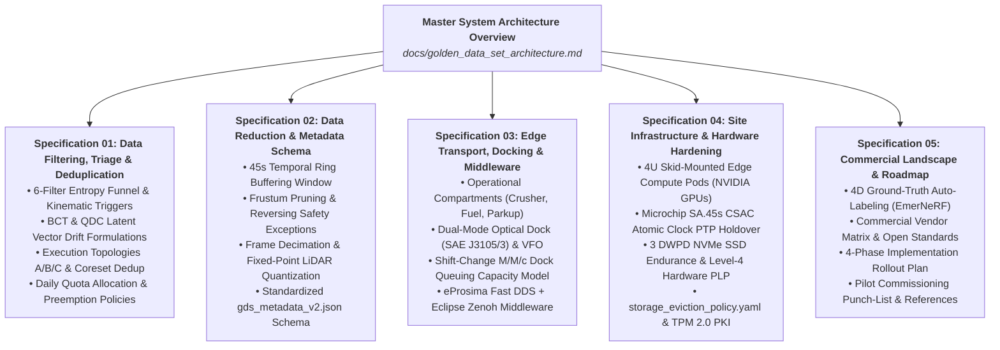
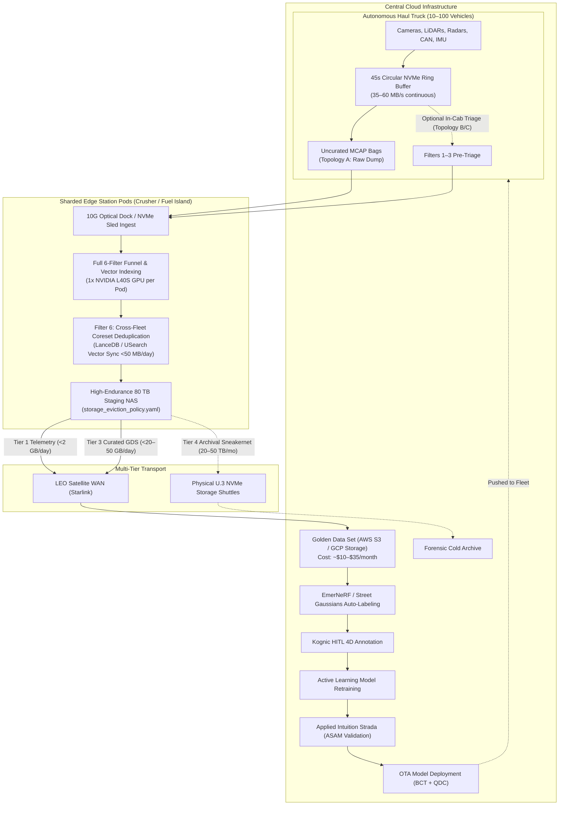

# Master Architecture: Remote Autonomous Fleet Data Triage & Golden Data Set (GDS) Pipeline

**Document Status:** Approved Master Architecture  
**Revision:** 2.1  
**Target Operational Environment:** Deep Open-Pit Mining & Remote Heavy Haulage Circuits

---

## 1. Executive Summary & Problem Formulation

### 1.1 The Edge Data Avalanche
Autonomous haul trucks in industrial mining operate under conditions fundamentally different from consumer passenger AVs or long-haul highway trucks. A single Class-8 equivalent ultra-class autonomous haul truck (e.g., Cat 797F, Komatsu 930E) generates between **1.5 TB and 2.5 TB of multi-modal telemetry per 12-hour shift** (3.0 to 5.0 TB/day/truck):
* **High-Rate Vision:** 4 to 8 high-resolution cameras (8MP @ 10–30 FPS, raw or lightly compressed Bayer feeds) $\approx$ 15–25 MB/s.
* **Dense 3D Spatial Geometry:** 2 to 4 solid-state and mechanical LiDARs (128-beam, 10–20 Hz) $\approx$ 15–25 MB/s.
* **All-Weather 4D Radar:** 2 to 4 imaging radars (Doppler, range, azimuth, elevation) $\approx$ 2–5 MB/s.
* **Sub-Millisecond Dynamic Bus:** IMUs, GNSS RTK, steering angles, braking pressure, engine torque, and hydraulic CAN/Ethernet buses $\approx$ 1–2 MB/s.

Across an industrial fleet of **10 to 100 autonomous haulers**, daily data generation scales from **30 TB to over 500 TB per day**. Remote operations (e.g., Western Australia's Pilbara, Chile's Atacama Desert, northern Canada) lack fiber backhaul, relying on commercial Low-Earth Orbit (LEO) satellite uplinks (Starlink Business / OneWeb) constrained to **10–25 Mbps sustained uplink** per terminal.

### 1.2 The Production Vehicle Modification Hurdle
In production mining, modifying onboard software running on active haul trucks is exceptionally difficult and undesirable:
* **OEM Warranty & Support:** Modifying the primary compute stack on commercial haulers risks voiding multi-million-dollar OEM warranties and service-level agreements.
* **Functional Safety (ISO 26262 / ASIL):** Deploying experimental active learning or novelty triage code directly to vehicle safety compute triggers costly safety re-certification and poses operational risk to active pit production.
* **Thermal & Compute Constraints:** In-cab vehicle compute is thermally constrained under ambient pit conditions (>45°C) and already heavily loaded with primary path planning and real-time obstacle avoidance threads.

**Architectural Principle:** The data triage and deduplication capability must be **location-agnostic**. While the long-term roadmap enables deployment directly on vehicle compute (Topology C), production rollouts prioritize running triage at **modular edge compute stations on-site** (Topology A) or on isolated secondary flight recorders (Topology B) with zero modifications to the vehicle's primary safety software.

### 1.3 The Three Core Operational Failure Modes
1. **Network starvation:** Attempting to offload raw sensor feeds over wireless saturates site networks and drops critical fleet telemetry.
2. **Economic insolvency:** Cloud storage and egress costs scale linearly with fleet size while information entropy drops logarithmically.
3. **Data swamps:** Annotators and ML pipelines drown in identical, low-entropy nominal miles.

### 1.4 Architectural Objective
To transition from a **"Collect and Upload"** paradigm to an **"Intelligent Edge Triage & Site Sharding"** architecture. By evaluating information density directly at distributed edge compute stations (or on-vehicle where feasible), the fleet identifies, extracts, and transmits only high-entropy, safety-critical, and novel scenarios—the **Golden Data Set (GDS)**—compressing 30–500 TB/day of raw logs into **<15–50 GB/day** of high-priority WAN uplink data.

### 1.5 Financial Feasibility & Cloud Cost Model
Ingesting raw data uncurated into commercial hyperscaler object storage (AWS S3, GCP Cloud Storage) is economically prohibitive:
* **Raw Storage Overhead:** For a 100-truck aggregate (500 TB/day), baseline storage alone costs **>$345,000 per month** ($0.023/GB/month), compounding by >$4.1M annually. Even for a 10-truck site (30–50 TB/day), uncurated cloud ingest costs **>$25,000–$35,000/month** in storage alone.
* **Annotation Bottleneck:** Human labeling of multi-sensor 3D point clouds, 4D radar tracks, and multi-view video streams costs between **$3 and $8 per synchronized frame**. Attempting to annotate even 1% of raw uncurated footage would quickly exhaust annual autonomy R&D budgets.
* **Curated ROI:** By pruning data at the edge to extract **10 GB to 30 GB per day** (for 10 trucks) or **20 GB to 50 GB per day** (for 100 trucks) of high-entropy snippets, recurring cloud object storage collapses to **~$10–$35/month**. Factoring in API request volume, lifecycle transitions, and light cloud compute, the recurring pipeline cost is **~$500–$1,500/month**—a **>99% reduction**. Capital expenditure is efficiently redirected into modular edge compute pods amortized across multi-year site production.
  > **Sub-Linear Fleet Scaling Note:** The GDS upload volume scales sub-linearly (O(log N) to O(√N)) rather than linearly (10× fleet size increases upload volume by only ~2×). Because haul trucks traverse identical pit benches, haul roads, and crushers under identical weather conditions, cross-fleet coreset deduplication eliminates 60%–80% of duplicate observations across trucks, causing site-wide novelty discovery to plateau as fleet density increases.

---

## 2. Industry Benchmarks & Structural Precedents

Autonomous vehicle operations across industrial mining, commercial long-haul trucking, passenger transport, and urban robotaxis operate against fundamentally different operational constraints:

| Architectural Dimension | Remote Mining Haulage (This Architecture) | Heavy Mining OEMs (Caterpillar / Komatsu) | Autonomous Trucking (Kodiak Robotics) | Mass Passenger AVs (Tesla Data Engine) | Urban Robotaxis (Waymo Driver) |
| :--- | :--- | :--- | :--- | :--- | :--- |
| **Operational Design Domain** | Deep open-pit benches, crushers, dumps, private haul roads. | Structured mining benches, waste dumps, crusher ramps. | Long-haul interstate highways and private energy corridors. | Global consumer roadways, mixed urban and highway. | Dense urban cores, complex intersections, arterials. |
| **Cloud Uplink Ingest Ratio** | **<0.01%** uploaded over WAN (<50 GB/day from 500 TB). | **<0.005%** over wireless; strictly critical telemetry and fault codes. | **<0.05%** continuous; critical safety events and target scenarios. | **<0.1%**; micro-classifier triggers and shadow mode clips. | **~0.5%–2.0%**; localized depot fiber offloads with cloud active curation. |
| **Primary Triage Locus** | **Modular Edge Station Pods** (Crusher/Fuel) or onboard. | Monolithic central depot maintenance facility. | Terminal depot servers; cellular event snapshots. | In-vehicle FSD computer (shadow mode triggers). | Depot high-speed physical ingest racks + cloud curation. |
| **Network Constraints** | Remote satellite WAN (10–25 Mbps) + localized optical docks. | Private LTE/5G wireless mesh strictly reserved for dispatch. | Commercial 4G/5G cellular along freight corridors. | Fleet-wide consumer LTE/Wi-Fi offload. | High-capacity depot fiber links (>40 Gbps per bay). |

---

## 3. Architecture Specification Suite Map

To provide modular, in-depth technical specifications tailored for different engineering teams, the architecture is partitioned into five dedicated standalone specifications:

### Direct Specification Index
1. [**Specification 01: Data Filtering, Triage & Deduplication**](./01_data_filtering_and_triage.md)
2. [**Specification 02: Data Reduction & Metadata Schema**](./02_data_reduction_and_metadata_schema.md)
3. [**Specification 03: Edge Transport, Docking & Middleware**](./03_transport_docking_and_middleware.md)
4. [**Specification 04: Site Infrastructure, Hardware Hardening & Storage Lifecycle**](./04_site_infrastructure_and_hardware.md)
5. [**Specification 05: Commercial Landscape, Tooling Evaluation & Implementation Roadmap**](./05_commercial_landscape_and_roadmap.md)

*Historical Reference:* [Initial Monolithic Working Draft (Archived)](./Remote%20Fleet%20Data%20Triage%20Architecture.md)

---

## 4. End-to-End System Architecture

---

## 5. Architectural Subsystem Summaries

### 5.1 Data Triage & The 6-Filter Funnel
* **Full Specification:** [01_data_filtering_and_triage.md](./01_data_filtering_and_triage.md)
* **Summary:** The triage engine evaluates candidate snippets through a two-stage triage funnel:
  1. *Filter 1 (Kinematic/Safety):* AEB, E-stops, lateral acceleration >0.3g, TTC < 3.0s, dynamically calibrated for 400t trucks on steep downhill grades.
  2. *Filter 2 (Active Learning):* Epistemic uncertainty (<0.65 confidence) and sensor cross-disagreement.
  3. *Filter 3 (Vector Novelty):* 128-D embedding cosine search against k-NN baselines via USearch, protected against OTA model drift via Backward-Compatible Training (BCT) and Query Drift Compensation (QDC) with automated rollback (3× baseline rate).
  4. *Filter 4 (Targeted Campaigns):* Dynamic OTA logging schemes targeting specific geofences and environmental conditions.
  5. *Filter 5 (Stratified ODD):* Uniform 0.1% randomized nominal anchors.
  6. *Filter 6 (Coreset Deduplication):* Cross-truck spatial and vector clustering eliminating 60%–80% of duplicate scenes across the fleet.
* **Daily Quota Policy:** Hard budget of 28–57 snippets/day/cell (<10–20 GB/day WAN ceiling) with cascading burst preemption and Tier 4 sneakernet overflow.

### 5.2 Representation, Frustum Pruning & Metadata Schema
* **Full Specification:** [02_data_reduction_and_metadata_schema.md](./02_data_reduction_and_metadata_schema.md)
* **Summary:** Every snippet captures a 45-second window (T - 30s pre-event root cause to T + 15s post-event stabilization). Frustum pruning strips non-informative camera angles and auxiliary sensors, saving 70%–85% of snippet volume. A critical safety exception dynamically elevates rear cameras, perimeter LiDAR, rear radar, and blind-spot side radars to full resolution whenever the truck is reversing or maneuvering within crusher hoppers or dump pockets. Every snippet produces a standardized `gds_metadata_v2.json` record with distinct raw optical wire transfer (`raw_optical_data_payload_transfer: 38.4s`) and berth occupancy (`total_berth_occupancy_seconds: 224.6s`) telemetry.

### 5.3 Sharded Site Topology, Optical Docking & Transport Funnel
* **Full Specification:** [03_transport_docking_and_middleware.md](./03_transport_docking_and_middleware.md)
* **Summary:** Mining circuits are partitioned into Crusher (burst offload, 60–90s dwell), Fuel Island (batch offload, 15–20 min dwell), and Parkup compartments. High-speed automated docking adapts the rugged pin-and-socket mechanical envelope of **SAE J3105/3** to house expanded-beam optical ferrules delivering nominal 5–10 Gbps with high-pressure air-purge nozzles, second-sourced with Free-Space Optics (VFO) and mmWave bridges. Shift-change contention is sized via an $M/M/c$ queuing model ($T_s \approx 240\text{s}$, $\lambda = 15\text{--}20\text{ trucks/hr}$), establishing that dual berths ($c=2$) clear shift bursts with $W_q \approx 2.25\text{--}3.20\text{ min}$. DDS wireless discovery storms are resolved by restricting Fast DDS to localhost loopback and bridging external links via Eclipse Zenoh (`zenoh_bridge_config.json5`).

### 5.4 Edge Compute Pods, CSAC Atomic Clock & Storage Hardening
* **Full Specification:** [04_site_infrastructure_and_hardware.md](./04_site_infrastructure_and_hardware.md)
* **Summary:** On-vehicle storage mandates enterprise U.2/U.3 NVMe SSDs rated for $\ge 3$ DWPD (~70 PBW endurance for 12.8 TB; e.g., Micron 7450 MAX / Solidigm D7-P5620) with discrete tantalum Level-4 hardware PLP. To prevent sub-millimeter multi-sensor misalignment during 24-hour deep-pit GNSS outages, primary switches incorporate a **Microchip SA.45s Chip-Scale Atomic Clock (CSAC)** maintaining time drift <0.8 µs over 24 hours (<120 mW; subject to pilot validation). Modular 4U skid-mounted Edge Station Pods (IP66, closed-loop HVAC, NVIDIA GPUs) execute on-site triage and enforce a 4-tier graceful storage degradation sequence (`storage_eviction_policy.yaml`) with anti-flapping hysteresis and dwell windows. Security is hardened via AES-256 SED key unseal via HashiCorp Vault, TPM 2.0 mTLS dock authentication, and signed Ed25519 sneakernet manifests.

### 5.5 Vendor Reference Stack, 4D Auto-Labeling & Phased Roadmap
* **Full Specification:** [05_commercial_landscape_and_roadmap.md](./05_commercial_landscape_and_roadmap.md)
* **Summary:** The reference commercial architecture combines Foxglove MCAP serialization, USearch vector search, Sift machine observability, Eclipse Zenoh middleware, Akridata/FiftyOne depot curation, Kognic 4D multi-sensor annotation, and Applied Intuition Strada simulation. Rollout is executed across four phases: Phase 1 (Zero-vehicle-modification pilot), Phase 2 (Sharded edge pods & federation), Phase 3 (Active learning & dynamic schemes on pods), and Phase 4 (Progressive onboard migration). Phase 1/2 commissioning benchmarks three non-blocking pilot punch-list items: inter-pod PTP time synchronization (<10 ms), secondary QLC PLP architecture, and calibrated PID anti-windup clamping for adaptive triage thresholds.

---

## 6. Architectural Hardening & Review Alignment

| Technical Pillar | Baseline Assumption | Operational Vulnerability | Hardened Architecture Specification | Detailed Reference |
| :--- | :--- | :--- | :--- | :--- |
| **Site Scaling & Vehicle Integration** | Monolithic central depot requiring active learning code on vehicle compute. | Modifying onboard software voids OEM warranties, breaks ASIL safety certifications, and causes dispatch bottlenecks at single depot. | **Location-Agnostic Triage & Sharded Pods:** Modular 4U skid-mounted Edge Station Pods at natural choke points (Crusher, Fuel Bay) + Cross-Shard Vector Federation (<50 MB/day) + Zero-Vehicle-Modification caddy/umbilical ingest (Topology A/B). | [Spec 01 (§3)](./01_data_filtering_and_triage.md) & [Spec 03 (§1)](./03_transport_docking_and_middleware.md) |
| **Depot Offload Throughput** | Continuous 1.2–2.5 Gbps Wi-Fi 6 offload during 15-min fueling stop. | Dust attenuation, metal multipath, and multi-truck RF contention drop speeds to **150–300 Mbps**, taking >33 min to offload 50 GB and overflowing storage. | **Dual-Mode Hybrid Interface:** Automated robotic optical dock (**Stäubli QCC / Cavotec**, adapting SAE J3105/3 mechanical envelope) with compressed air dust purge delivering nominal **5–10 Gbps** (<45–80s transfer) + Virtual Fiber Optics (VFO) second-sourced with 60 GHz mmWave + Dynamic Priority Offload Engine that sheds Filter 5 baseline clips if wireless bandwidth drops <300 Mbps (nominal ratings subject to pilot verification). | [Spec 03 (§2–3)](./03_transport_docking_and_middleware.md) |
| **Transport Protocol Stability** | Standard DDS participant discovery across vehicle-to-depot wireless. | Intermittent wireless triggers DDS SPDP multicast discovery storms, packet flooding, CPU exhaustion, and dropped telemetry. | **Hybrid IPC & Transport Architecture:** **eProsima Fast DDS** restricted to vehicle-internal loopback + **Eclipse Zenoh** (`zenoh-bridge-dds`) for wireless transport via TCP/QUIC unicast with gossip-based discovery. | [Spec 03 (§5)](./03_transport_docking_and_middleware.md) |
| **Sensor Time Synchronization** | Standard GNSS RTK 1PPS + IEEE 1588 PTP. | Deep pit benches experience prolonged GNSS denial; microsecond-level clock drift causes **spatial registration errors** (>10 cm) between cameras and LiDAR, corrupting 4D auto-labeling. | **Hardware-Backed CSAC Holdover:** Primary switch incorporates a **Microchip SA.45s Chip-Scale Atomic Clock**, targeting nominal **<0.8 µs drift over 24h** of complete GNSS denial (<120 mW power; subject to field pilot validation). | [Spec 04 (§2)](./04_site_infrastructure_and_hardware.md) |
| **Novelty Vector Embeddings** | Static 128-D vector cosine distance against onboard k-NN baseline. | OTA updates to vision backbone model shift latent vector space, invalidating onboard indices and causing false-positive novelty avalanches. | **BCT, QDC & Versioned Embeddings:** Cloud trains with **Backward-Compatible Training (BCT)**, runtime applies **Zero-Shot Query Drift Compensation (QDC)** with **USearch**, and edge NAS executes automated batch re-indexing. | [Spec 01 (§2.3)](./01_data_filtering_and_triage.md) |
| **Storage Endurance & Thermals** | 2x 15.36 TB U.2 NVMe SSDs in RAID-0/1. | Continuous 35–60 MB/s writes in **>45°C** in-cab bays wear out flash in <18 months and trigger thermal throttling, risking dropped frames in the autonomy thread. | **3 DWPD Enterprise NVMe with PLP:** Micron 7450 MAX (12.8 TB) / Solidigm D7-P5620 (~70 PBW endurance) + optional D7-P5810 SLC write cache, Level-4 Hardware PLP (tantalum capacitors), conduction chassis cooling, and **Graceful Storage Degradation Policy** (`storage_eviction_policy.yaml`). | [Spec 04 (§1 & §3)](./04_site_infrastructure_and_hardware.md) |
